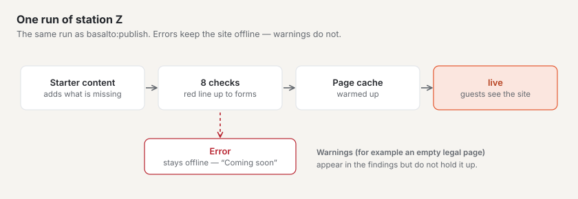
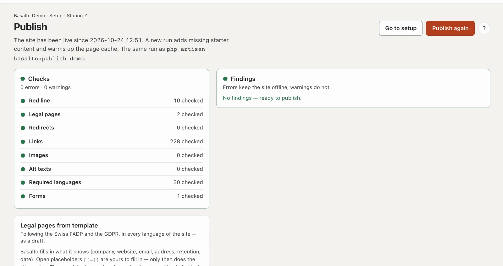

# Going live

The last station, **“Ready to go live?”** (station Z), checks the whole site and opens it to guests. Until then visitors see a page “Coming soon”; you yourself see the site as long as you are signed in to the backend.

## Where

“Setup” mode › “Ready to go live?” › **“Publish”** — or **“Publish (Z)”** on the start page of setup. In the console it is the same run as `php artisan basalto:publish <site>`.

At the top is the state: “The site is not live yet — guests see “Coming soon”” or “The site has been live since …”.

1. **“Go live”** or, if the site is already live, **“Publish again”** — starts the run. If there are errors, the button is locked: “Fix the errors first — the list shows where”. “To setup” returns to the check report.
2. **Checks** — eight checks, each with a mark and “… checked”.
3. **Findings** — every message with “Open →” to the place where it can be fixed. **Errors keep the site offline, warnings do not.** Without findings: “No findings — ready to publish”.
4. **Legal pages from a template** — see below.

## What a run does

1. **Add starter content** — pages and content the theme brings (in Starter for example start page, About us, Blog, Contact and the footer). Basalto only adds what is missing; changed content stays as it is.
2. **Check** — the eight checks below.
3. **Warm up the page cache** — the pages are ready afterwards, the first guests don’t wait.
4. **Go live** — if no errors remain.

Afterwards the top says for example “Gone live — 8 starter items added, 23 pages warmed up”.

### Starter content

The station “What does it start with?” has no page of its own: this run adds the starter content. To see it, the route leads to “View pages”. Starter content you have changed or deleted stays that way: a new run overwrites nothing and brings nothing back from the trash.

## The eight checks

| Check | What is checked | Typical finding |
| --- | --- | --- |
| **Red line** | the theme’s ten checks A to Z | an error in the theme |
| **Legal pages** | imprint and privacy policy exist and are published in every language, without open placeholders | “Imprint “…” is missing” · “has an open placeholder” (error) · “is empty” (warning) |
| **Redirects** | every redirect leads to a published page and not in a circle | “Redirect /old runs in a circle” |
| **Links** | links in content and menu entries lead to a page | “Link to /prices leads nowhere” |
| **Images** | embedded images exist and are not in the trash | “Image #12 is missing or in the trash” |
| **Alt texts** | embedded images have an alt text in every language — if the site has “Alt text required” switched on or the theme requires the check (the Starter theme does) | “Image … without alt text in EN” |
| **Required languages** | every published item is published in all required languages | “… is not published in the required language EN” |
| **Forms** | every form has an action (email, store or webhook) and valid recipients | “Form … has no action” · warning if the mailer sends no emails |

## Legal pages from a template

Without imprint and privacy policy the site does not go live. The card **“Legal pages from a template”** creates both according to Swiss DSG and European GDPR — in every language of the site, as a **draft**:

1. **“Insert imprint”** or **“Insert privacy policy”**. Basalto asks first; an existing draft is replaced, the published version stays.
2. Basalto fills in what is known: company, website, email, address, retention periods, date.
3. Fill in open **placeholders** `[[…]]` in the editor — as long as one is open, the check reports an error.
4. Publish the pages like any content (see [Approval](../redaktion/freigabe.md)).

The template does not replace a legal review of the individual case.

## Frequently asked questions

**The “Go live” button is locked.**
There is at least one error. The findings name it; “Open →” leads there.

**Do I have to “Publish again” after every change?**
No. Content goes live through approval, the theme through its approval. A new run is worthwhile when the theme brings new starter content or you want to check the whole site.

## Next

- [Hosting](../betrieb/hosting.md)
- [Sites](../verwaltung/sites.md)
- [Setup: designing and building the site](README.md)
