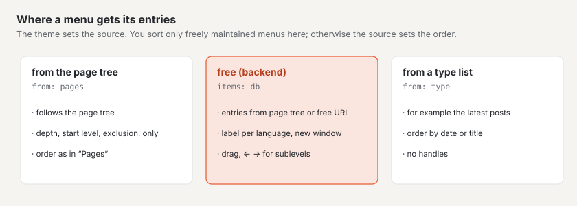
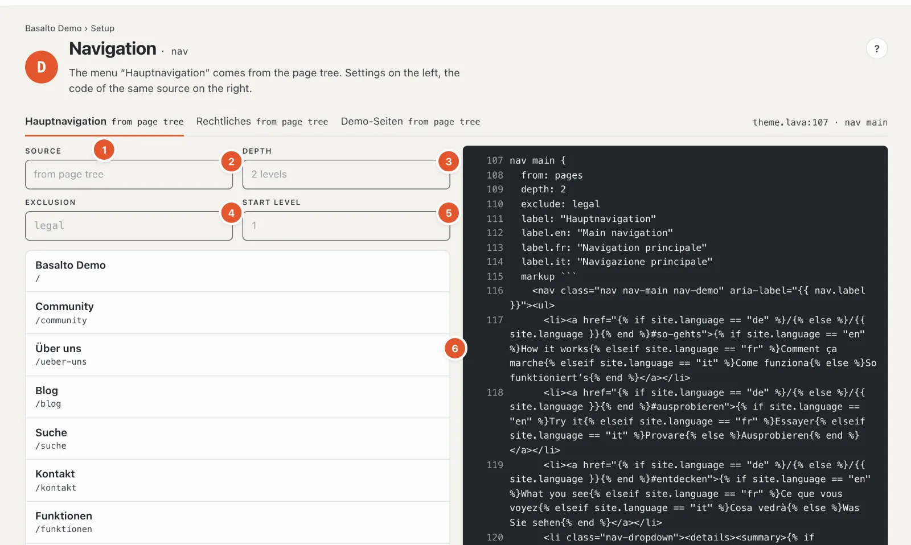
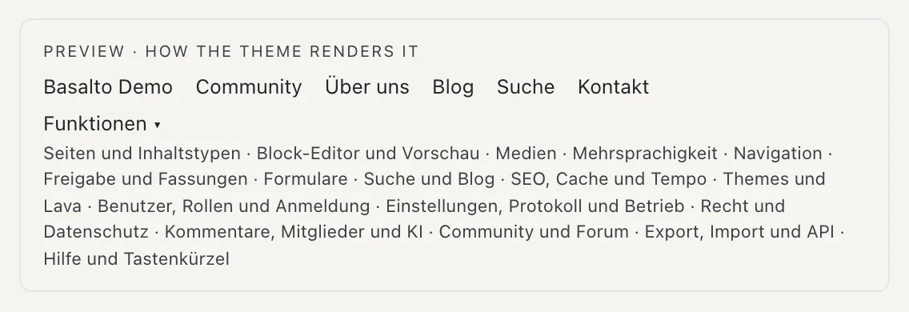

# Menus

The station **“How do people find their way?”** shows the site’s menus: main menu, footer, legal and others. Which menus exist and where they appear on the page is set by the theme; here you see their entries, adjust them and — for freely maintained menus — order them.

## Where

“Setup” mode › “How do people find their way?” › **“Edit menus”**. At the top there is a tab per menu with its source, for example “Main navigation from page tree”, on the right the place in the theme (“theme.lava:107 · nav main”).

## Where a menu gets its entries

- **From the page tree** — the menu follows the [page tree](../redaktion/seiten.md). A new page appears by itself; the order is changed in “Pages” (the link “Change order in “Pages”” leads there). That is why there are “no handles” here.
- **Freely maintained** — the entries are created here in the backend: pages from the tree or free addresses, in any order and depth.
- **From a type list** — for example the newest posts; the order follows the list (date or title).
- **From the theme** — fixed entries written in the theme; they can only be changed there.

## A menu from the page tree

1. **Choose the menu** — one tab per menu.
2. **Source** — where the entries come from.
3. **Depth** — how many levels of the tree the menu shows, for example “2 levels” (main pages and their subpages).
4. **Exclusion** — pages the menu leaves out, for example the legal pages.
5. **Start level** — the level at which the menu begins; 1 is the top. With **Only** a menu shows only certain pages (in Starter the “Legal” menu).
6. **The entries** as they appear in the menu, indented by level, with their address.

These settings are in the theme and are visible here for checking. Only published, visible pages appear in the menu — pages with “Hide in the menu (remains reachable)” (page settings, tab “Expert”) and protected pages for guests are missing. If the list is empty, it says “Empty — the menu only shows published, visible pages”.

## A freely maintained menu

If the theme knows a freely maintained menu, the field **“Add entry”** is below the list:

- **Search a page** — type part of the title (“ab”), and matching pages appear with their address; a click or Enter
  inserts the page. Its **label** follows the page title until you overwrite it.
- **Enter an address** — “/blog”, “https://…”, “www.…” (becomes “https://www.…”), “mailto:” or “tel:”. If the address
  is a page of the site, Basalto inserts the page (it then follows renamings); otherwise a free entry with this address
  opens — other websites straight away “In a new window”.
- **“Still missing:”** — published pages that are not yet in the menu, top level first; one click inserts them.

Per entry you set:

- **Label** — for a page, leave it empty and the entry is named like the page. Labels in other languages are behind
  “Label in other languages”; if one is missing in a language, the entry takes the default language’s label
  (“— takes over …”).
- **Target** — for a free entry the address. If it is the path of a page of the site, Basalto offers **“Link as
  page”**.
- **Visible** — a hidden entry stays in the list (“hidden”) but does not appear in the menu.
- **In a new window** — the link opens a new tab (“↗ new window”); usual for other websites.

“Edit” opens an entry, “Delete” removes it after the question “Really delete?”. Changes save themselves; “✓ saved” confirms it.

### Ordering

- **Drag** to sort the entries. If you drop an entry **further to the right**, it becomes a child of the entry above.
- With the keyboard: **↑ ↓** moves, **→** makes a child entry (deeper), **←** brings it back one level (higher).
- The new order saves at once; if something fails, the reason appears at the bottom right.

An entry for a page that is not published carries “not published” and only appears once the page is live.

## The preview

Below the code is **“Preview · how the theme renders it”**: the menu as visitors see it, with submenus. With several languages you choose the **language of the labels**.

Next to it is the menu’s code in the theme — the same source as the settings on the left. It is changed in the theme editor (station D).

## Frequently asked questions

**A new page is missing from the menu.**
Is it published? Is it in the page tree below a page the menu shows, and not deeper than the set depth? Is “Hide in the menu (remains reachable)” unticked?

**I can’t change the order.**
The menu comes from the page tree, from a type list or from the theme — the order belongs to the source. If it says “You may not change this menu”, your role only allows viewing the area “Navigation”.

## Next

- [Content types](inhaltstypen.md)
- [Pages and page tree](../redaktion/seiten.md)
