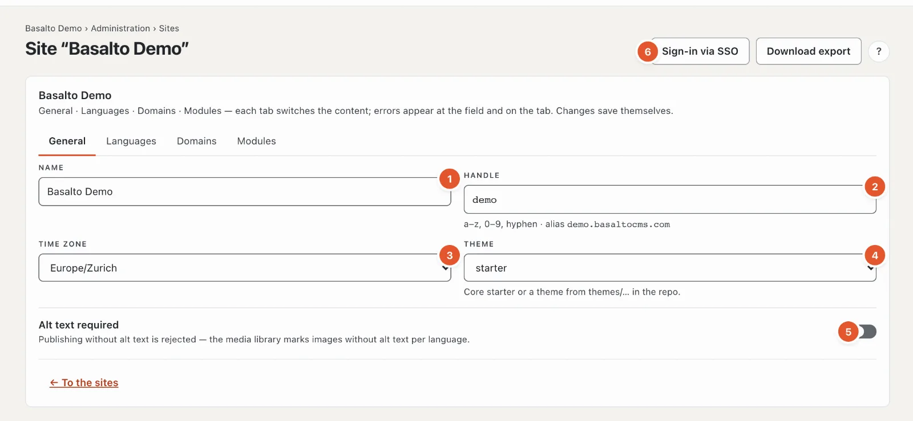
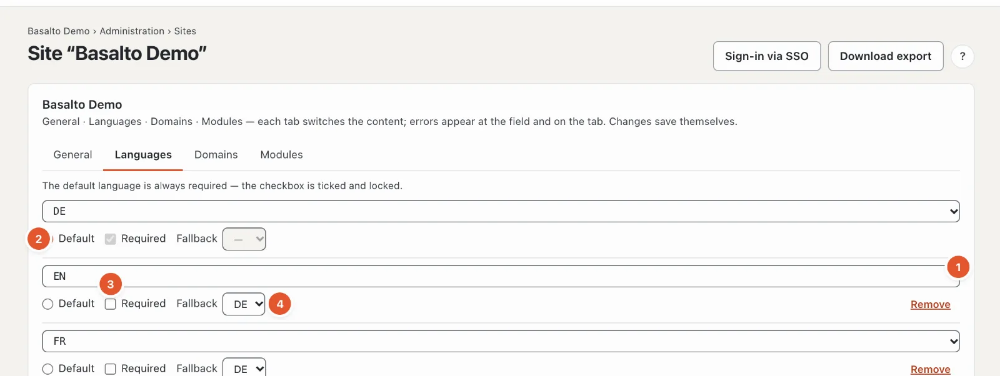
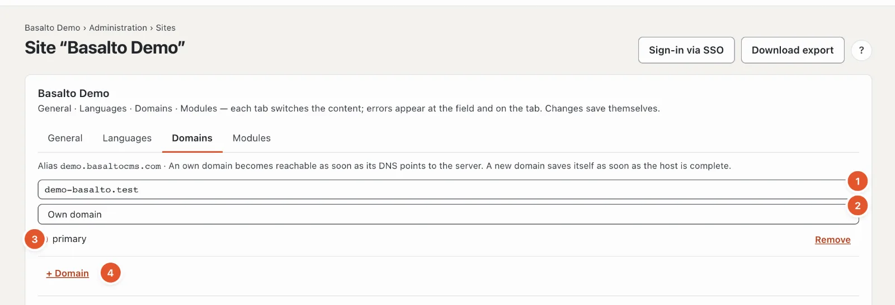
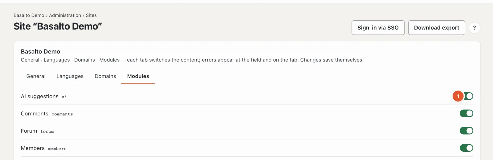

# The site

The first station of the route, **“What is the site?”**, lays the foundation for everything else: name, languages, domains, time zone, theme and modules. It lives in “Administration” mode under **Sites** — the route leads straight to the site you are working in.

## Where

“Administration” mode › **Sites** › open the site, or in the route “What is the site?” › “Edit site”. The “Sites” list shows all sites of the installation with languages, domains and state; **“New site”** creates another one (name, handle, default language, theme — “Save and close”).

The page has four tabs. Changes save themselves; “saved” at the field confirms it. If an entry is invalid, the error appears at the field and as a number on the tab.

## “General” tab

1. **Name** — what the site is called in the backend, in emails and in the website title.
2. **Handle** — the technical short name: lowercase letters, digits and hyphen. It is part of the **alias**, the address under which the site can be reached without a domain of its own (for example “demo.basaltocms.com”), and of commands such as `basalto:publish demo`. Only change it while nobody knows the old address yet.
3. **Time zone** — for the site’s date and time, for example for scheduled publications.
4. **Theme** — which bundled theme the site uses. It is more convenient to switch it under [Themes](aussehen.md#themes): there you see beforehand what changes.
5. **Alt text required** — if on, every publication containing an image without alt text in a language is rejected; the media library marks such images. Off by default — but some themes require alt texts on their own (the Starter theme does).
6. At the top right: **“Sign-in via SSO”** sets up sign-in through a company login (see [SSO](../betrieb/sso.md)); **“Customer account sign-in”** the buttons “Sign in with Google” and so on on the frontend (see [Customer account sign-in](../verwaltung/kundenanmeldung.md)); **“Download export”** downloads the whole site as a ZIP — content as JSON and all media, in the same format as the import, without form submissions and members. Both are only visible to the owner and the account administration.

## “Languages” tab

One row per language:

1. **Language** — choose it from the list.
2. **Default** — the site’s main language. All translations are made from it. There is exactly one.
3. **Required** — without this language, content is not approved. The default language is always required; its box is ticked and locked.
4. **Fallback** — if the published version is missing in this language, guests see the version in the fallback language (and so on up to the default language).
5. **“+ Language”** adds a row, **“Remove”** takes a language away. The content in that language stays in the database but no longer appears.

How translating, required languages and fallback work in daily use is described under [Translating](../redaktion/uebersetzen.md).

## “Domains” tab

At the top is the site’s **alias**. Below, one row per domain:

1. **Host** — the address without “https://”, for example “www.your-company.com”. A new domain saves itself as soon as the host is complete.
2. **Kind**:
   - **Own domain** — the address under which the site should appear,
   - **Alias** — another address of the same site,
   - **Redirect** — an old address that redirects to the main address.
3. **primary** — the main address; it appears in the sitemap, in links and in emails.
4. **“+ Domain”** and **“Remove”**.

For a domain to work, its DNS must point to the server. In the subscription (SaaS) the account manages alias and own domains: the tab then refers to **Account › Domains** (see [Domains](../redaktion/domains.md)).

## “Modules” tab

Each installed module has a switch: **on** means the site uses it — the module’s menu items, blocks and buttons appear. **“always on”** marks modules that cannot be switched off. Which modules are installed is managed under “Administration › Modules”; without modules it says “No modules installed”.

| Module | What it brings |
| --- | --- |
| AI suggestions | improve text, translation, SEO and alt text suggestions — see [AI suggestions](../redaktion/ki.md) |
| Comments | comments below posts and pages — see [Comments](../redaktion/kommentare.md) |
| Members | pages only for signed-in members — see [Members](../redaktion/mitglieder.md) |

## Frequently asked questions

**I don’t see “Sign-in via SSO”, “Customer account sign-in” and “Download export”.**
Both are reserved for the owner and the account administration.

**I removed a language — are the translations gone?**
No. They stay stored and reappear as soon as you add the language again.

## Next

- [Appearance: themes, design and image variants](aussehen.md)
- [Sites](../verwaltung/sites.md)
