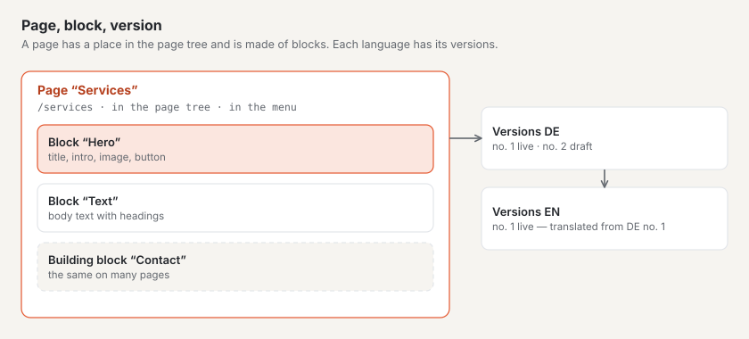

# Key terms

Basalto uses only a few terms, but always in the same way. This page explains each in one sentence and shows how they
fit together. The backend uses the same words.

## Installation and site

| Term | Meaning |
| --- | --- |
| **Installation** | Basalto on a server, with a database. Users, roles, licence and updates apply to the whole installation. |
| **Site** | A website in the installation, with a name, an address (domain), languages and a theme. One installation can have several sites. |
| **Domain** | The address at which a site can be reached, for example `praxis-muster.ch`. |
| **Default language** | The main language of the site. All translations are made from it. |

## Content

| Term | Meaning |
| --- | --- |
| **Page** | An entry in the page tree with its own address, for example “Services” at `/services`. |
| **Page tree** | The order of all pages: main pages and their subpages below them. Menus, addresses and breadcrumbs come from it. |
| **Entry** | Content without a fixed place in the page tree, for example a blog post or a person. |
| **Content type** | The kind of entry and its fields, for example “Post” with title, date and text. |
| **Block** | One part of a page: hero, text, image, cards, questions and answers, form … |
| **Building block** | A group of blocks that appears the same on several pages and is changed in one place. |
| **Media** | The site's images and files in the media library. Every image gets an alt text for people who cannot see it. |

## Versions and approval

| Term | Meaning |
| --- | --- |
| **Version** | A state of an entry in one language. Every change starts as a new version; older ones are kept. |
| **Draft** | A version that is still being written. Basalto saves it automatically. |
| **Submit for approval** | Hand the version in for review. |
| **Approve** | Release the reviewed version for publication. |
| **Publish** | Put the approved version live — straight away or at a scheduled time. |
| **Live** | The version visitors see on the website. |

## Design and extension

| Term | Meaning |
| --- | --- |
| **Theme** | The look and blueprint of a site: colours, fonts, layouts, menus, blocks, content types and starter content. |
| **Lava** | The language themes are written in. Invisible to editors. |
| **Layout** | The frame of a page with its regions, for example header, content and footer. |
| **Module** | An extension such as forms, comments, members or forum, switched on and off per site. |
| **Plugin** | A module from the marketplace or a third party. |

## People

| Term | Meaning |
| --- | --- |
| **User** | A person with access to the backend. |
| **Role** | What a user may do in a site: Editor, Approver, Translator, Administrator or Owner. |
| **Member** | A visitor with an account on the website, for example for protected pages or the forum — no access to the backend. |
| **Passkey** | Signing in with a fingerprint, face or device lock instead of a code by e-mail. |

## Next

- [Installing Basalto](installieren.md)
- [A tour of the backend](rundgang.md)
