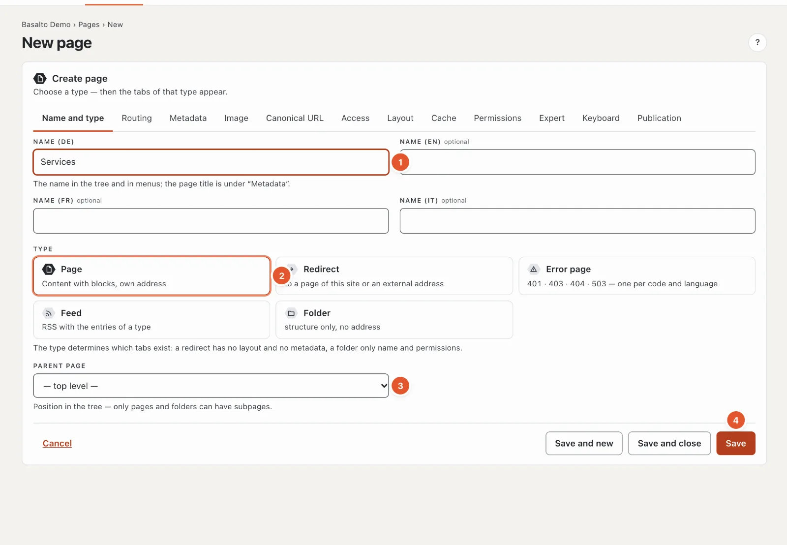
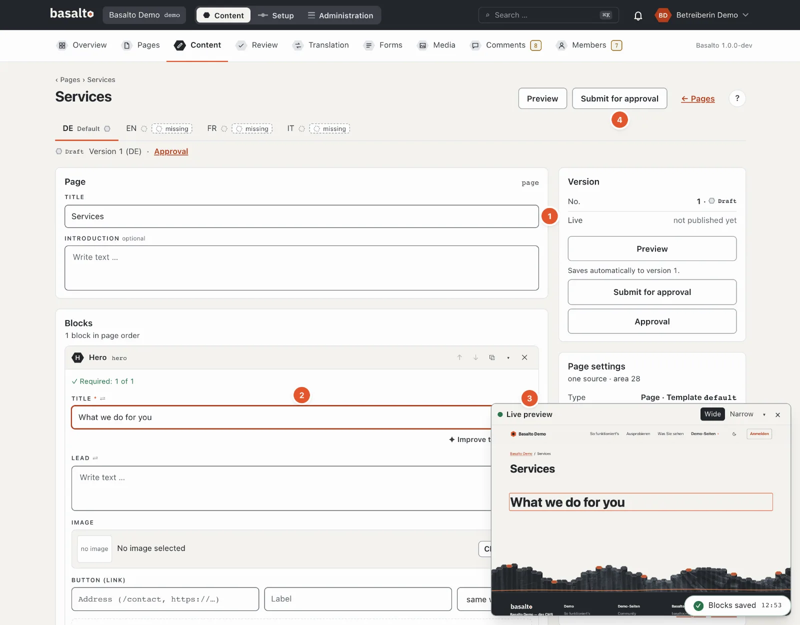
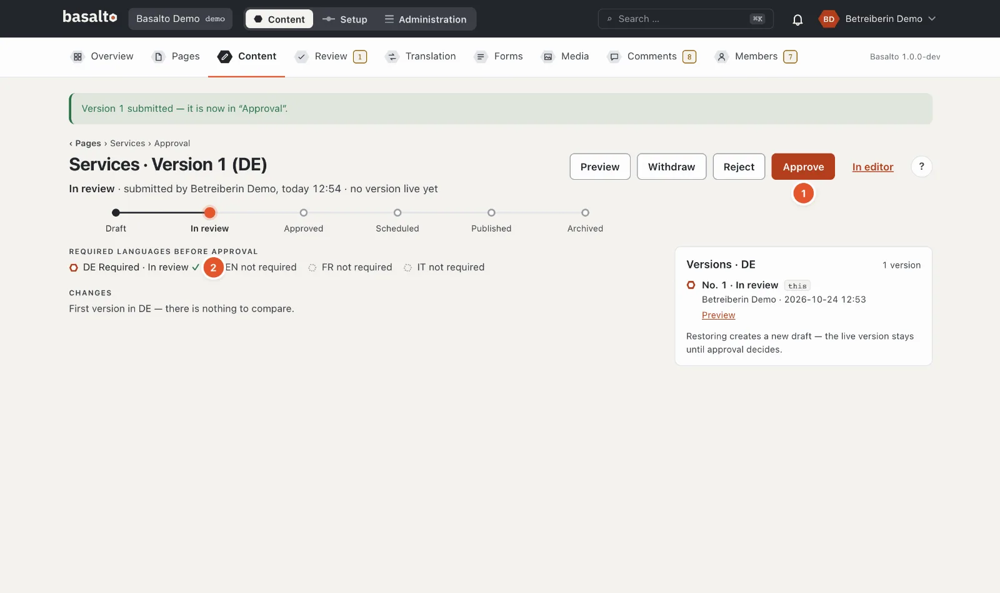
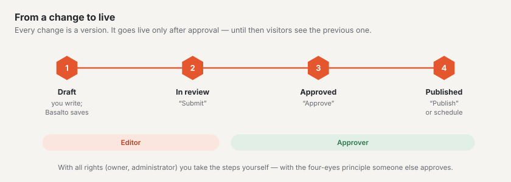
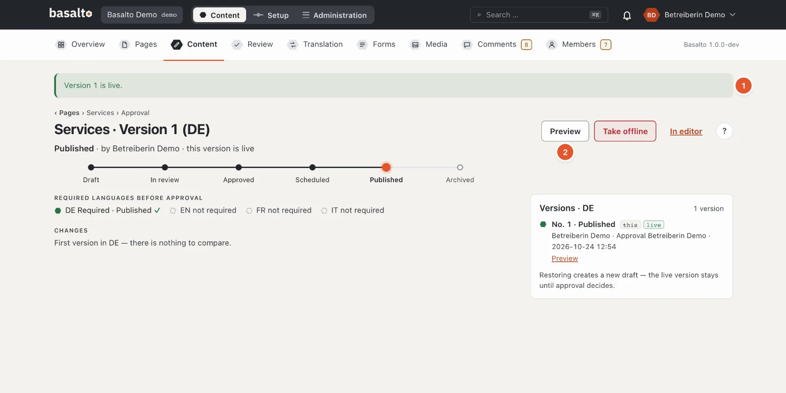

# Your first page

You create a new page “Services”, fill it with blocks, add an image and publish it. The page then appears on the
website and in the menu. The example takes about a quarter of an hour.

## 1. Create the page

1. “Content” mode › **Pages** › **“New”**.
2. In the “Name and type” tab (numbers as in the picture above):
   1. **Name** — “Services”. The name appears in the page tree and in the menu; the address `/services` is made
      from it.
   2. **Type** — “Page” is preselected: content with blocks and its own address.
   3. **Parent page** — “top level” for a main page. If you choose another page, “Services” becomes its subpage,
      such as `/about-us/services`.
   4. **“Save”**.
3. Basalto opens the settings of the new page. At the top right, **“Edit content”** takes you to the editor.

You do not need the other tabs — metadata, image, access, layout and more — for now. Their defaults suit an ordinary
page.

## 2. Add blocks and write

1. **Title** — already filled in: “Services”. Below it you can write an introduction.
2. Under **“Blocks”**, choose a block in “Add block”, here **“Hero”** — a large title with an introduction, image
   and button. In the block's **“Title”** field write: “What we do for you”.
3. The **live preview** shows the page as visitors will see it and follows every keystroke. “Wide” and “Narrow”
   switch between screen and phone.
4. **“+ Insert block”** adds more blocks, for example “Text” for body text or “Cards” for several services side by
   side. The arrows on a block move it, ✕ removes it.

You do not have to save: Basalto saves a second or so after each change and says so at the bottom right, for example
“Blocks saved”. What you write stays a **draft** — nothing changes on the website yet.

## 3. Add an image

1. In the “Hero” block under **“Image”**, click **“Choose …”**. The media library opens in a window.
2. Choose an image — or add a new one with **“Upload”**.
3. Check the **alt text**. Basalto fills it in from the file name; better is a sentence saying what the image shows —
   for people who cannot see it. You change it in **Media**, in the image's details. The Starter theme does not
   publish a page with an image that has no alt text.

Basalto makes the right sizes for screen and phone from every image by itself. More in [Media](../redaktion/medien.md).

## 4. Review and publish

A version goes live in three steps:

1. **“Submit for approval”** — at the top right of the editor. The version is now “In review” and appears under
   “Review”.
2. **“Approve”** — on the approval page (the “Approval” link below the title). Below it you see whether all
   **required languages** are ready; without them Basalto does not approve.
3. **“Publish”** — the version goes live straight away. With **“Schedule publication”** you choose a date and time
   instead.

If you have all rights (Owner or Administrator), you take the three steps yourself. Otherwise a person with the
Approver role approves your version; the bell tells them that something is waiting.

1. **“Version 1 is live.”** — the page is on the website.
2. **“Preview”** shows it; on the website you reach it at `/services`.

If you change the page later, **version 2** is created as a draft. Visitors keep seeing version 1 until you publish
version 2.

## If something goes wrong

| You see | Cause | Solution |
| --- | --- | --- |
| On saving, an error with a number on the “Routing” tab | The address is already taken. | Choose another slug in the “Routing” tab, such as `services-2025`. |
| “Approve” is locked: “Approval only with all required languages” | A required language has no version yet. | Translate the page (see [Menu and languages](menue-und-sprachen.md)) or stop making the language required. |
| “Publish” is locked because of an image | An image has no alt text. | Add the alt text in the media library. |
| “Submit for approval” is missing, only “Preview” | Your role may not edit this page. | Ask the person who looks after your site. |

## Next

- [Menu and languages](menue-und-sprachen.md)
- [Editing content with blocks](../redaktion/bloecke.md)
- [Approval and publication](../redaktion/freigabe.md)
