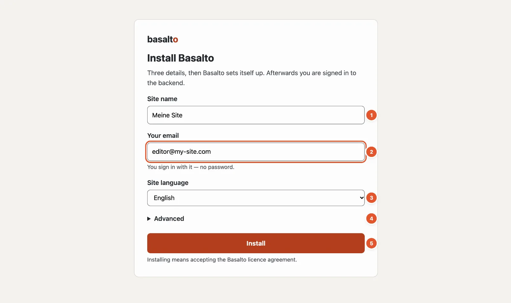
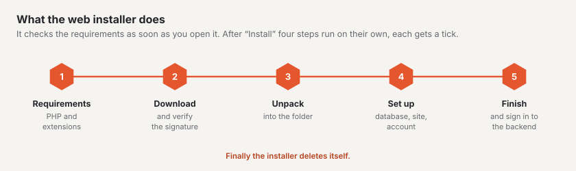

# Installing Basalto

The easiest way to install Basalto is the **web installer**: a single file you put into an empty folder and open in
the browser. Three details are enough, and then you are signed in to the backend — no terminal, no password and no
mail server.

## What you need

| What | Value |
| --- | --- |
| Web space or a local web server | with PHP 8.4 or later and HTTPS |
| PHP extensions | `mbstring`, `intl`, `gd`, `zip`, `sodium` and `pdo_sqlite` (or `pdo_mysql` or `pdo_pgsql`) |
| An empty folder | your domain's folder at the hosting provider, locally a folder your web server serves |
| An e-mail address | for your first account |

You do not have to create a database: by default Basalto uses SQLite, a file in the installation folder. For large
sites choose MariaDB, MySQL or PostgreSQL under “Advanced”.

If a requirement is missing, the installer lists it under “Requirements missing” before it does anything.

## Step by step

1. Download the installer from basaltocms.com under **Download** — a single file `index.php`.
2. Put it into the **empty** folder: by FTP into your domain's folder at the hosting provider, locally for example
   into `~/Sites/my-site`.
3. Open the address in the browser, such as `https://my-site.com` or `http://my-site.test`.
4. Fill in the form (numbers as in the picture above):
   1. **Site name** — suggested from the folder name; you can change it later.
   2. **Your email** — you sign in with it from now on, with a code by e-mail or a passkey. You type or paste the
      code into six boxes; once all digits are in, it continues by itself.
   3. **Site language** — the default language. You add more languages afterwards.
   4. **Advanced** — only if you want another database or want to enter a licence key straight away.
   5. **“Install”**.
5. Wait until the four steps — download and verify the signature, unpack, set up, finish — have a tick. The
   installer then takes you to the backend.

The installer verifies the signature of the downloaded package before unpacking it: a tampered package is rejected.
It then sets up the database, creates your site with the Starter theme and a few starter pages and signs you in.
Finally it deletes itself.

## After the installation

- **Set up a passkey.** The overview in the backend suggests it. With a passkey you sign in with a fingerprint, face
  or device lock — even if an e-mail does not arrive.
- **Look at the starter pages.** Your site already has a home page, “About us”, “Contact”, “Search”, a blog, “Legal
  notice” and “Privacy”. Replace their texts with your own.
- **Enter a licence** as soon as the site works for a company or an association — see [Licence](../verwaltung/lizenz.md).
  Without a key Basalto runs in the free tier.

## If something goes wrong

| You see | Cause | Solution |
| --- | --- | --- |
| “The folder is not empty” with a list of files | There are already files in the folder. | Remove the files listed or use a new folder. Files that hosting providers create themselves (`.htaccess`, `.user.ini`, `.well-known`, `cgi-bin`, `error_log`) may stay. |
| “The installation is already running in another browser” | Another browser has started the installation. | Carry on there — or delete the file `.basalto-install.json` in the folder and start again. |
| “Requirements missing” with a list | PHP is too old or an extension is missing. | Raise the PHP version or switch the extension on in your hosting provider's control panel. |
| After the installation the browser shows a list of files or “Forbidden” | The web server starts in the main folder instead of `public/`. | On Apache the installer creates an `.htaccess` that handles this; on nginx set the domain's root to `public/`. |

## Other ways

If you work on your own server with a console, install Basalto with Composer and the command
`php artisan basalto:install`. The [installation in the operations manual](../betrieb/installation.md) describes
this, together with hosting, backups and updates.

## Next

- [A tour of the backend](rundgang.md)
- [Your first page](erste-seite.md)
