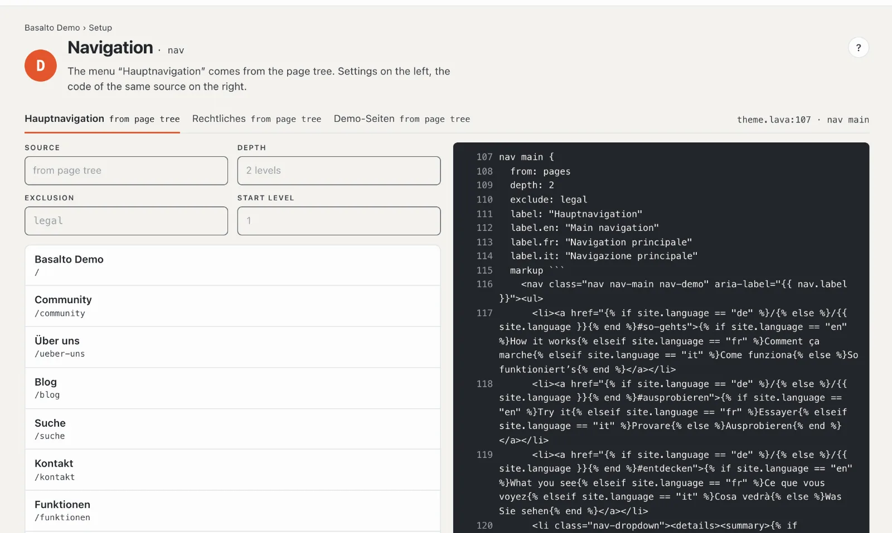
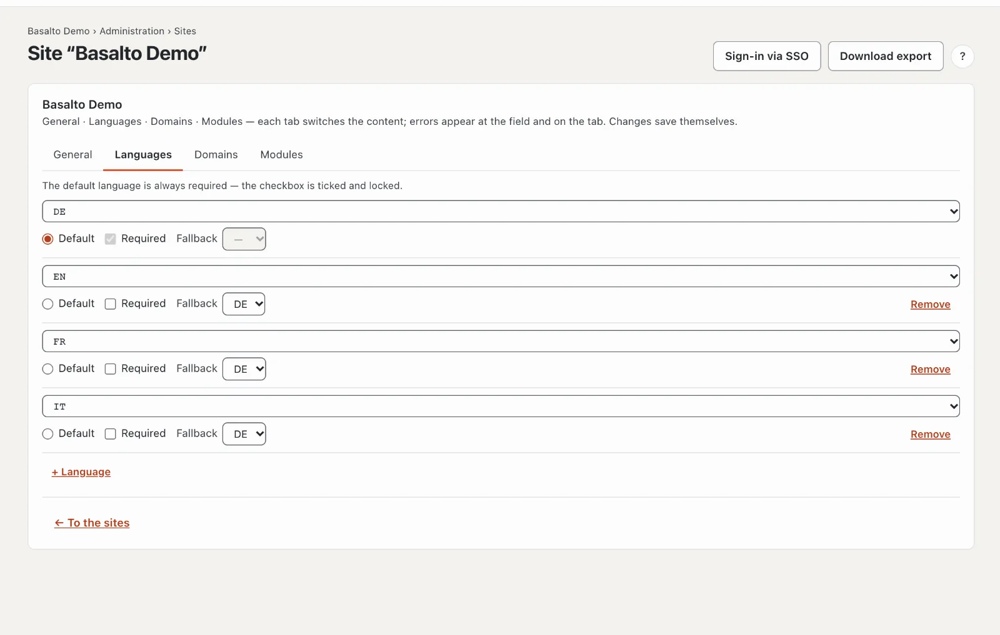
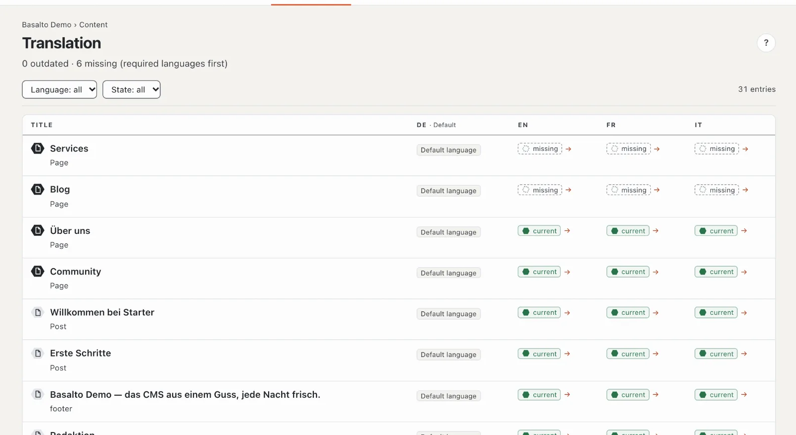

# Menu and languages

Once published, the new page appears in the menu by itself. Here you see where the menu gets its entries from, how
to change the order and how your site gets a second language.

## The menu

In the Starter theme the **main menu follows the page tree**: every published top-level page appears in it, with its
subpages below. So you do not have to maintain the menu.

- **To look at it:** “Setup” mode › “How do people find their way?” › **“Edit menus”**. One tab per menu — main
  navigation, legal and others — with its source and the entries as visitors see them.
- **To change the order:** “Content” mode › **Pages** › **“Move”** on the page (the up-and-down arrow) and choose the
  new place. The menu follows straight away.
- **To take a page out of the menu:** in the page's settings, “Expert” tab, tick **“Hide in the menu (remains
  reachable)”**. The page can still be reached at its address.

The menu only shows published pages. If a page is missing, it is usually still a draft.

Some themes also have **freely maintained menus** whose entries you put together yourself in Setup. More in
[Menus](../einrichtung/menues.md).

## A second language

1. “Administration” mode › **Sites** › your site › **“Languages”** tab.
2. **“+ Language”** and choose the language, for example English.
3. For each language set:
   - **Default** — the main language all translations are made from. There is exactly one.
   - **Required** — without this language Basalto does not approve any content. Leave it unticked at first so that
     you can publish pages before they are translated.
   - **Fallback** — if a translation is missing, visitors see the version in this language, such as German instead
     of an empty page.

The changes save themselves. A language switcher appears on the website as soon as there is a second language.

## Translating the page

1. “Content” mode › **Translation** — the list of all entries with their status per language.
2. In the “Services” row, click **“missing”** in the language's column.
3. **“Create translation from German”**. The German text is on the left for reading, you write the translation on
   the right — field by field, block by block. Basalto saves automatically.
4. The translation goes live like any version: **Submit for approval**, **Approve**, **Publish** — see
   [Your first page](erste-seite.md#4-review-and-publish).

If you change the German text later, the translation shows **“outdated”** until someone updates it. Images and
numbers apply to all languages and are only maintained in the default language.

## If something goes wrong

| You see | Cause | Solution |
| --- | --- | --- |
| The new page is missing from the menu | It is not published yet, or “Hide in the menu” is ticked. | Publish the page or untick the box in the “Expert” tab. |
| The “Languages” tab is missing | Your role does not manage sites. | Ask a person with the Administrator or Owner role. |
| “Create translation from German” is locked | Your role may not edit this language, or there is no German version yet. | Have the role checked or write the German version first. |

## Next

- [Inviting your team](team.md)
- [Translating](../redaktion/uebersetzen.md)
- [Pages and page tree](../redaktion/seiten.md)
