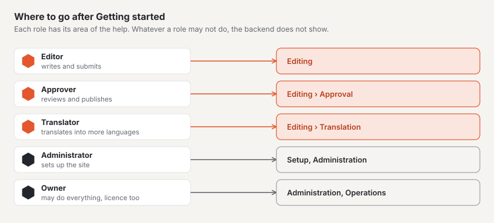

# Where to go next

Your site is running, the first page is live and the team is invited. From here each role goes deeper into its own
part of the help — this page shows where.

## For editors

- [Pages and page tree](../redaktion/seiten.md) — subpages, redirects, trash.
- [Editing content with blocks](../redaktion/bloecke.md) — all blocks, body text, pasting from Word, restoring older
  versions.
- [Media](../redaktion/medien.md) — folders, alt texts, focal point, replacing.
- [Forms](../redaktion/formulare.md) — adapting the contact form, reading submissions.

## For approval and translation

- [Approval and publication](../redaktion/freigabe.md) — review, reject, schedule, take offline.
- [Translating](../redaktion/uebersetzen.md) — translate side by side, update outdated translations.

## For setup

- [Setup](../einrichtung/README.md) — the route in nine stations.
- [Appearance](../einrichtung/aussehen.md) — colours, fonts, logo and switching the theme.
- [Going live](../einrichtung/live-gehen.md) — your own domain, the check report, publishing.

## For administration

- [Administration](../verwaltung/README.md) — sites, users, roles, settings.
- [Updates](../verwaltung/updates.md) — keeping core, modules and themes up to date.
- [Licence](../verwaltung/lizenz.md) — tiers and keys.

## For technology and operations

- [Operations manual](../betrieb/README.md) — hosting, backups, monitoring and commands.
- [Developer documentation](../entwickler/README.md) — themes in Lava, modules and the API.
- [Marketplace](../marktplatz/README.md) — finding or offering themes and plugins.

## Next

- [Getting started with Basalto](README.md)
- [Help for editors](../redaktion/index.md)
