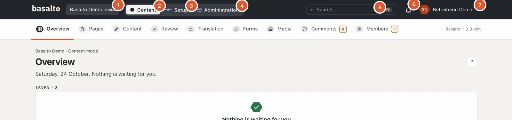
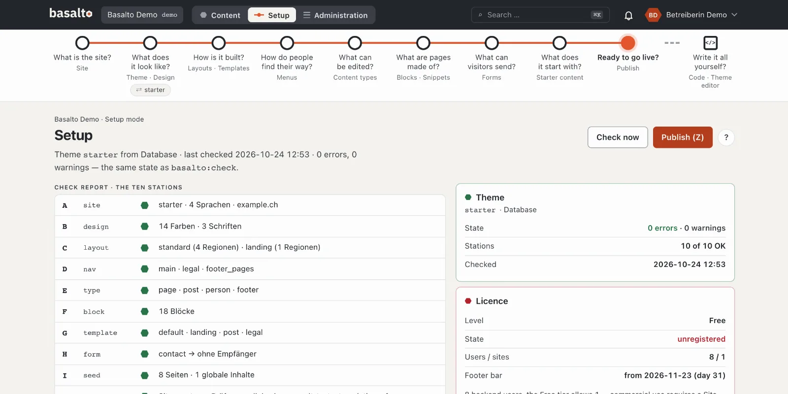
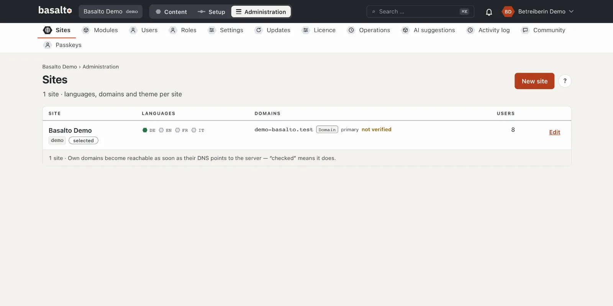
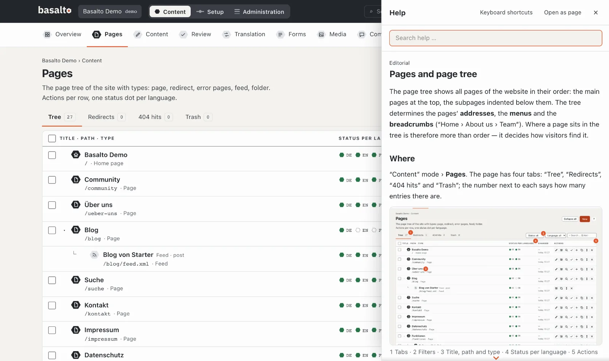

# A tour of the backend

The backend has three **modes**: “Content” for everyday editing, “Setup” for the shape and structure of the site and
“Administration” for sites, users and operations. This tour shows where things are and how to find your way.

## The header

The header is the same in every mode:

1. **The site** — if you work in several sites, switch here.
2. **Content** — pages, blocks, media, translation and review.
3. **Setup** — look, structure, menus and content types of the site.
4. **Administration** — sites, users, roles, settings, updates and licence.
5. **Search** — finds pages, entries, media and users; faster with **⌘K** or **Ctrl+K**.
6. **The bell** — your notifications, for example when a version is waiting for your review.
7. **Your name** — the menu with profile, settings, dark mode, help and “Sign out”.

You only see the modes your role needs: someone who only writes sees “Content”, but neither “Setup” nor
“Administration”.

## The “Content” mode

Below the header are the mode's **stations**:

| Station | What for |
| --- | --- |
| **Overview** | What is waiting for you: versions to review, rejected work, missing translations, notices. |
| **Pages** | The website's page tree — create, order and edit pages. |
| **Content** | Entries without a fixed place in the tree, such as blog posts. |
| **Review** | Everything that should be reviewed or published. |
| **Translation** | What is missing or outdated in other languages. |
| **Forms** | Forms and their submissions. |
| **Media** | Images and files. |
| **Comments**, **Members** | Only if the module is switched on for the site. |

An amber number next to a station means something is waiting for you there. A grey number is for information only.

## The “Setup” mode

Setup guides you through the site with a **route** — nine stations, each with a question: “What is the site?”, “What
does it look like?”, “How is it built?” through to “Ready to go live?”. A dark ring means “fine”, a red ✗ “something
is missing here”. Below it is the **check report** with ten checks. You do not need Setup at first: the Starter theme
is fully set up. More in [Setup](../einrichtung/README.md).

## The “Administration” mode

This is where you look after the installation: **Sites** with languages and domains, **Modules**, **Users** and
**Roles**, **Settings**, **Updates**, **Licence**, **Operations** and the **Activity log** of all changes. More in
[Administration](../verwaltung/README.md).

## Saving

What you change saves itself — there is no “Save” button. Bottom right, “… saved” appears briefly, with a tick at the
field; an error stays until it is fixed. A rejected field does not hold up the others.

- **Immediately:** switches, selections, options and dates.
- **After a short pause:** text and numbers, at the latest when you leave the field.
- **When you leave the field or press Enter:** identifiers, addresses, keys and prices — half a value would take
  effect at once. While it waits, the field says “Enter or leaving the field saves”; **Esc** undoes the change.

There is still a button where something new is created (**“Create”**) or a step is deliberate: submitting, approving,
sending, paying, deleting. Text in such forms is kept as a draft in the browser until it is sent.

## The help

- The round **“?”** at the top right opens the help for the current page — as a panel on the right. The page behind
  it stays usable.
- It is faster with the **?** key or **F1**.
- At the top of the panel you search the whole help; **“Open as page”** shows the help full size, **“Keyboard
  shortcuts”** lists all shortcuts.

## If something goes wrong

| You see | Cause | Solution |
| --- | --- | --- |
| “Setup” or “Administration” is missing | Your role does not allow the mode. | Ask the person who looks after your site. |
| A button is grey with a reason next to it | Your role may not take this step, for example “Your role does not approve”. | Leave the step to the person in charge or have your role changed. |
| Signing in asks for a code every time | Your account has no passkey yet. | Choose “Set up passkey” in the overview. |

## Next

- [Your first page](erste-seite.md)
- [Help for editors](../redaktion/index.md)
