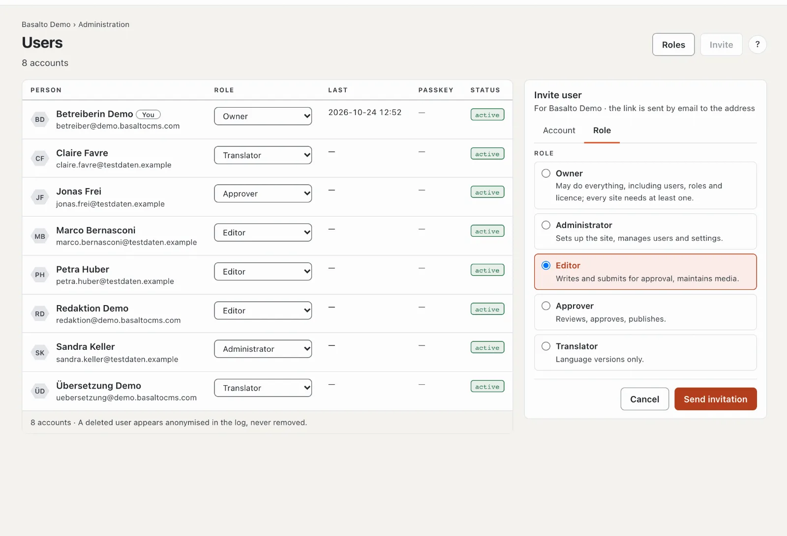

# Inviting your team

Everyone who works with you gets their own account with a **role**: it decides what the person may do in the site.
One invitation is enough — the person signs in with the link from the e-mail, without any password.

## Inviting someone

1. “Administration” mode › **Users** › **“Invite”**. The “Invite user” card opens on the right.
2. **“Account”** tab: the person's **e-mail address**.
3. **“Role”** tab: choose the role — each with one sentence on what it may do.
4. **“Send invitation”**.

The link in the e-mail is valid for 72 hours and can be used once. Until the person opens it, they are listed as
“invited”; **“Resend”** sends a new link.

## Which role?

| Role | May | Suits |
| --- | --- | --- |
| **Editor** | write pages and entries, look after media, submit versions | whoever supplies texts and images |
| **Approver** | review, approve, publish and take offline what was submitted | whoever answers for the website |
| **Translator** | translate content into more languages | translators |
| **Administrator** | everything in the site, including setup, users and settings | whoever looks after the site |
| **Owner** | everything, including the licence; every site has at least one | you |

You can only give roles that may do no more than your own. You change a role later in the list, **“Role”** column —
the change applies at once. Your own roles with finely tuned rights are created under **“Roles”**; more in
[Roles](../verwaltung/rollen.md).

## Good to know

- **Four eyes:** if nobody should approve their own work, switch on the four-eyes principle in the settings. Every
  version then needs a second person.
- **One person, several sites:** someone who already has an account in another site gets an additional role in this
  one with the invitation — exactly one per site.
- **Someone leaves the team:** **deactivate** the account in the person card. Their work and the log are kept.

## If something goes wrong

| You see | Cause | Solution |
| --- | --- | --- |
| The invitation does not arrive | The installation does not send e-mail, or it is in the spam folder. | Check the spam folder; operations sets up e-mail (see the [installation in the operations manual](../betrieb/installation.md)). |
| “invited · expired” | The 72 hours have passed. | **“Resend”**. |
| The role you want is not offered | It may do more than your own role. | Have a person with a higher role send the invitation. |

## Next

- [Where to go next](naechste-schritte.md)
- [Users](../verwaltung/benutzer.md)
