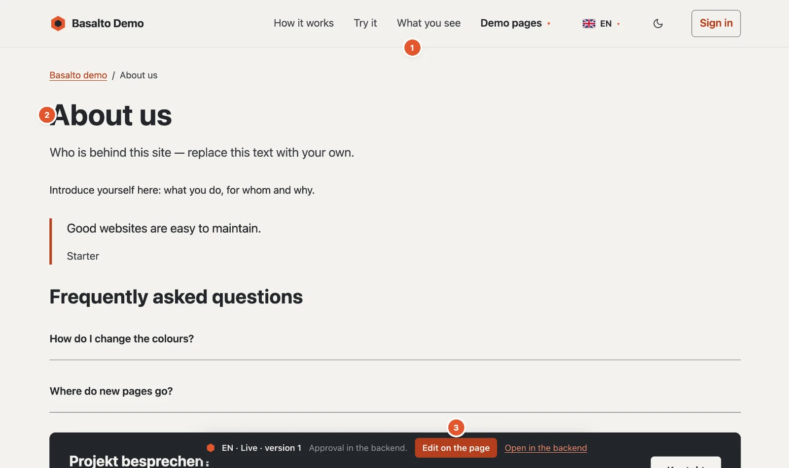
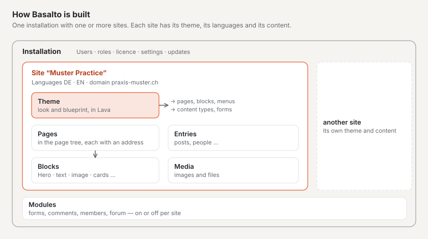

# What is Basalto?

Basalto is a content management system: you look after the content of your website in the browser, and Basalto
delivers it quickly, accessibly and in several languages. The design and blueprint of the website live in a
**theme**; editors work only with content and need no technical knowledge.

1. **The menu** — built from the page tree: a new page appears in it as soon as it is published.
2. **The content** — made of blocks, here a title, text, a quote and questions with answers.
3. **The bar** — visible only to signed-in people: language, status and version of the page, plus **“Edit on the
   page”** and **“Open in the backend”**. Visitors never see it.

## Website and backend

Every Basalto site has two sides:

- **The website** — what your visitors see. It only ever shows **published** content.
- **The backend** at `/admin` — where you create pages, write, upload images, translate and approve. Every change
  starts as a draft and only goes live after approval.

## How Basalto is built

- An **installation** is Basalto on a server. It can run one or more **sites**, each with its own address, languages
  and look.
- A site's **theme** decides its look and blueprint: which blocks there are, which menus, which content types.
  Basalto comes with the **Starter** theme; more are available in the marketplace.
- **Modules** add forms, comments, members or a forum to a site. You switch them on or off per site.

## What sets Basalto apart

| Feature | What it means for you |
| --- | --- |
| **Versions and approval** | Nothing goes live by accident. Every change is a version, and older ones can be restored. |
| **Multilingual from the start** | Translations are made from the default language; Basalto shows what is missing or outdated. |
| **Blocks with a preview** | You build pages from ready-made blocks and watch the page in the live preview as you write. |
| **Sign-in without a password** | With a code by e-mail or a passkey — no password to forget or guess. |
| **Fast and accessible** | The website does without heavy JavaScript; the backend checks colour contrast and requires alt texts. |
| **Roles** | Editor, Approver, Translator, Administrator and Owner — each sees only what it needs. |

## Who it is for

- **Editors:** you look after texts and images without worrying about design or technology.
- **Agencies and web designers:** you set sites up, adapt themes and hand them over to the editors.
- **Developers:** you write themes in the Lava language and extend Basalto with modules.
- **Operations:** you install, back up and update Basalto on your own server or with a hosting provider.

## Next

- [Key terms](begriffe.md)
- [Installing Basalto](installieren.md)
