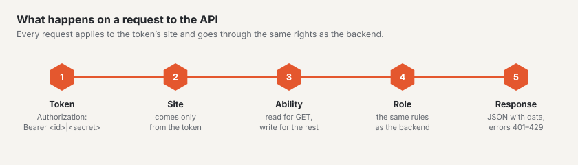

# REST API

Basalto has a REST API for content including approval, media and menus. It speaks JSON, always applies to exactly one
site and checks the same rights as the backend. Base address: `https://<your-site>/api/v1`.



## Creating a token

1. In the backend open your profile (menu under your name) › **“API tokens”** tab.
2. Choose a **name**, the **site** and the **abilities**: `read` for reading (`GET`), `write` for writing (`POST`,
   `PATCH`, `PUT`, `DELETE`). Optionally an **expiry date** — it applies until the end of the day in your profile's
   time zone.
3. The token appears **exactly once**. Copy it and keep it safe; Basalto only stores a checksum.

## How the API decides

- **Site:** every token belongs to exactly one site. The site of a request comes only from the token — there is no
  parameter for it. Content of other sites does not exist for the token (404).
- **Rights:** first the token's ability (`read`, `write`), then the person's **role** in the site — the same rules as
  in the backend: editors create and submit, approvers approve and publish, and the four-eyes principle applies here
  too.
- **Invalid** is a token that has been revoked or has expired (401), or whose person no longer belongs to the site or
  whose account is deactivated (403). A backend session does not replace a token (401).
- **Limit:** 120 requests per minute and token; the `X-RateLimit-*` headers show the state, above that you get 429 with
  `Retry-After`. The limit is in the configuration under `basalto.api.per_minute`.

```bash
export TOKEN='<id>|<secret>'          # from your profile
export B=https://your-site.com/api/v1
H=(-s -H "Authorization: Bearer $TOKEN" -H 'Accept: application/json')
```

## Responses and errors

- **Success:** JSON with `data`; lists also with `links` (`first`, `last`, `prev`, `next`) and `meta`
  (`current_page`, `per_page`, `total`, `last_page`). Times in ISO 8601 (UTC). Deleting answers `204` without content.
- **Errors:** `401`, `403` and `404` with `{"message": "…"}`; `422` with `{"message": "…", "errors": {"field": ["…"]}}`.
  Violations of the approval rules (transition, four-eyes principle, required languages, slug, alt text) are under
  `errors.workflow`.

```bash
curl -s -o /dev/null -w "%{http_code}\n" -H 'Accept: application/json' $B/entries        # 401 without a token
```

## Entries

| Method and path | Ability · right | Purpose |
|---|---|---|
| `GET /entries` | read · belongs to the site | list, newest first; filters `type`, `status`, `locale`, `q` (title), `updated_since` (ISO 8601, `+` as `%2B` or `Z`), `per_page` (1–100, default 25), `page` |
| `GET /entries/{id}` | read · belongs to the site | one entry with the newest and the published version per language; with `?locale=xx` also `data.locale`: the version visitors see (`published`, along the site's fallback, with `resolved`, `fallback`, `url`) and the newest state of that language (`latest`) |
| `POST /entries` | write · edit content | new entry of a type from the theme (`type`, `title`, optionally `slug`, `intro`, `content`, `fields`); the first version is a draft in the default language. Pages are created in the backend's page tree |
| `PATCH /entries/{id}` | write · edit or translate | change in `locale` (otherwise the default language); whatever is missing comes from the newest version. If that is a draft, it is continued — otherwise a new draft is created, as with automatic saving in the editor |
| `POST /entries/{id}/workflow/{step}` | write · per step | `submit`, `withdraw` (edit); `approve`, `reject` with `comment` (approve); `schedule` with `at`, `unschedule`, `publish`, `unpublish` (publish); each in `locale` |
| `DELETE /entries/{id}` | write · edit | to the trash (restore in the backend) |

```bash
curl "${H[@]}" "$B/entries?per_page=2"
# {"data":[{"id":8,"type":"post",…},{"id":7,"type":"person",…}],
#  "links":{…,"next":"https://your-site.com/api/v1/entries?per_page=2&page=2"},
#  "meta":{"current_page":1,"per_page":2,"total":6,"last_page":3,…}}

curl "${H[@]}" "$B/entries/2?locale=en"
# data.locale: requested "en", resolved "de", fallback true, published.title "Über uns"

curl "${H[@]}" -X POST -H 'Content-Type: application/json' \
  -d '{"type":"post","title":"From the API","fields":{"category":"News"}}' $B/entries            # 201

curl "${H[@]}" -X POST -H 'Content-Type: application/json' -d '{"locale":"de"}' $B/entries/309/workflow/submit

curl "${H[@]}" -X DELETE $B/entries/309                                                      # 204
```

## Media

| Method and path | Ability · right | Purpose |
|---|---|---|
| `GET /media` | read · belongs to the site | list; `q` (name, title, credit), `type` (`image`, `document`), `folder_id`, `per_page` |
| `GET /media/{id}` | read · belongs to the site | file, title, credit, alt text per language, dimensions, focal point, state of the image variants, `file_url` |
| `GET /media/{id}/file` | read · belongs to the site | the original file |
| `POST /media` | write · edit content or manage media | upload (multipart `file`, optionally `folder_id`) — the same checks as in the backend: type and size, storage, SVG without script; the image variants are created afterwards in the background |
| `PATCH /media/{id}` | write · as for uploading | change only what is given: `title`, `credit`, `alt` per site language |
| `DELETE /media/{id}` | write · manage media | to the trash |

```bash
curl "${H[@]}" -F "file=@team.jpg;type=image/jpeg" $B/media
# 201 {"data":{"id":4,"name":"team.jpg","width":1600,"height":1000,"variants_state":"pending","alt":{"de":null,"en":null},…}}

curl "${H[@]}" -X PATCH -H 'Content-Type: application/json' -d '{"alt":{"en":"The team in front of the office"}}' $B/media/4
```

## Menus

| Method and path | Ability · right | Purpose |
|---|---|---|
| `GET /navigation` | read · belongs to the site | the theme's menus: `handle`, `label`, `source` (`pages`, `type`, `db`, `theme`), `editable`, `depth` |
| `GET /navigation/{menu}` | read · belongs to the site | in `locale`: `items` as on the website (`label`, `href`, `new_window`, `entry_id`, `children`), `raw` the stored free entries |
| `POST /navigation/{menu}/items` | write · edit content | free entry in a freely maintained menu: `kind` (`entry` with `entry_id` or `url` with `url`), `label` per language, `parent_id`, `visible`, `new_window` |
| `PUT /navigation/items/{id}` | write · edit content | change, with all fields as when creating |
| `DELETE /navigation/items/{id}` | write · edit content | delete; sub-entries move up |

```bash
curl "${H[@]}" -X POST -H 'Content-Type: application/json' \
  -d '{"kind":"url","url":"https://example.com","label":{"en":"Partner"},"new_window":true}' $B/navigation/footer/items   # 201
```

## Forms without a page reload

Pages with a form (``) get a small embedded script. It sends the form with `fetch` and
`Accept: application/json`:

- **Success:** `200 {"message": "<thank-you text>", "redirect": null}` — the thank-you text replaces the form in an area
  with `role="status"`. If the form has a redirect (`redirect: -> /thanks`), the browser goes there.
- **Errors:** `422` with `errors` — a list at the top of the form (`role="alert"`), the message at the field with
  `aria-invalid` and `aria-describedby`, the focus on the first faulty field.
- **Spam** (honeypot field, time check, five submissions per minute and address) gets the same answer as a human and is
  only counted.
- **Without script** the form sends as usual with a redirect.
- **Switching it off** in the theme: `data-basalto-ajax="false"` on an element that surrounds the form.

## What the API cannot do

- Creating or moving pages in the page tree, media library folders and restoring from the trash are only available in
  the backend.
- The addresses of the image variants lead into the backend and require a sign-in; for the API there is `file_url`, the
  original file.
- Modules cannot register their own endpoints under `api/v1` yet.

`php artisan route:list --path=api` shows all routes of the installation.

## Next

- [Modules and plugins](erweiterungen.md)
- [Roles](../verwaltung/rollen.md)
- [Approval and publication](../redaktion/freigabe.md)
