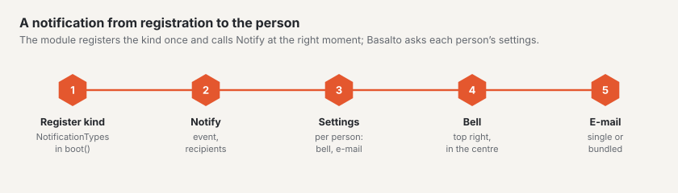

# Notifications

Basalto has a **bell** at the top right of the backend, a **centre** with all
notifications and a profile tab **“Notifications”** where each person switches bell and email on or off per kind. The
core and modules send through the same interface — a plugin needs two steps: register the kind and call `Notify` at the
right moment.



## 1. Register a kind

In the service provider’s `boot()`, through the registry `Basalto\Core\Notifications\NotificationTypes`:

```php
use Basalto\Core\Access\Level;
use Basalto\Core\Notifications\NotificationTypes;

app(NotificationTypes::class)->type(
    'shop.order',                       // key: lowercase with a dot, prefix = module
    'Neue Bestellung im Shop',          // label in the profile (German text = translation key)
    'Shop',                             // group in the profile
    'Auf Rechnung oder mit Karte.',     // description below the label (optional)
    area: 'shop',                       // who receives and configures it (area, see roles and rights)
    level: Level::Edit,                 // … from this level (default: view)
    mail: true,                         // default email (default bell: on)
    icon: 'license',                    // symbol in the hexagon (names as in the menu)
);
```

| Parameter | Meaning |
| --- | --- |
| `area` | Area from `Areas` — the kind only appears for people who see it on one of their sites. Without an area it is **personal** (concerns one’s own account or content) and visible to everyone. |
| `scope` | `NotificationType::BACKEND` (default) or `NotificationType::EXTRANET` — then the area applies within the vendor’s team, and the notification appears in the extranet bell. |
| `bell`, `mail` | Defaults as long as the person sets nothing. |
| `mailRequired` | The email always arrives (invoice, cancellation); only the bell can be switched off. |
| `mailAvailable: false` | The email is set up elsewhere (recipients of a form) — the profile shows a dash instead of a switch. |
| `when` | `Closure(): bool` — only visible while it holds (e.g. SaaS operation only). |

Texts (label, group, description) belong in `lang/{en,it,fr}.json` like all texts of a module.

## 2. Notify

```php
use Basalto\Core\Notifications\Notify;

Notify::make('shop.order')
    ->title('Neue Bestellung :number', ['number' => $order->number])
    ->body('Von :name über :amount.', ['name' => $order->name, 'amount' => $amount])
    ->url(route('basalto.shop.orders.show', $order), 'Bestellung öffnen')
    ->toArea($site)              // everyone on the site with the kind’s area
    ->except($request->user())   // whoever triggered it needs no message
    ->send();                    // number of recipients
```

| Method | Effect |
| --- | --- |
| `make($key)` | Kind from the registry — an unknown key throws an exception (typos show up in tests). |
| `title($text, $params)`, `body($text, $params)` | German text with placeholders; translated into the person’s language when shown or sent. |
| `url($url, $action)` | Target of a click and label of the button in the email. Relative (`/admin/…`) when the request runs on another host. |
| `site($site)` | Which site it belongs to — opening it switches the backend there. `toArea()` sets it itself. |
| `to($users)`, `toArea($site, $area, $level)`, `toExtranet($area, $level)` | Recipients: individual people, everyone with an area on a site, or the vendor’s team. Never deactivated people. |
| `except($user)` | Leave one person out. |
| `collapse($key)`, `titleMany($text)` | Merge unread ones with the same key: ten orders become one line “:count neue Bestellungen”. |

Which channels apply is decided by `NotificationSettings` from the person’s settings: main switch, switches for bell
and email, choice per kind. The bell writes immediately, the email goes through the queue. The message carries only
ready data (no models) — the queue knows no tenant.

## Own email, existing emails

- An own email (attachment, own layout): extend `Basalto\Core\Notifications\BasaltoNotification` and override
  `toMail()`.
- Show an existing required email in the bell as well: use the trait `AlsoInBell` and provide `bellKind()` and `bell()`
  (title, text, address) — as the SaaS invoices, trial, cancellation, domain and export do.

## What the core reports itself

| Key | When | To |
| --- | --- | --- |
| `content.submitted` | version submitted | approval of the site |
| `content.rejected`, `content.approved`, `content.published` | rejected (with comment), approved, published | whoever submitted |
| `forms.submitted` | new submission (bundled per form) | area “Forms” |
| `security.access` | passkey added or removed, API token created | the person themselves |
| `support.access` | the vendor’s support opens the site | area “Settings” |
| `operations.backup_failed` | backup failed (not in SaaS operation) | area “Operations” |
| `account.*` | invoice, trial, cancellation, domain live, export (required emails, SaaS only) | owner and billing |
| `extranet.domains`, `extranet.cancellations` | additional domain requested, account cancels | team in the extranet |

The bundled modules register `comments.posted`, `members.pending`, `licensing.orders`, `marketplace.review` and
`marketplace.reported`.

## Storage and privacy

The bell writes to Laravel’s `notifications` table, extended by `kind`, `scope` and `site_id`. The data export in the
profile lists a person’s notifications; deleting a person removes them. Exporting a site does not include them — they
belong to people, not to the site.

## Next

- [Modules and plugins](erweiterungen.md)
- [Help for editors](../redaktion/index.md#notifications)
