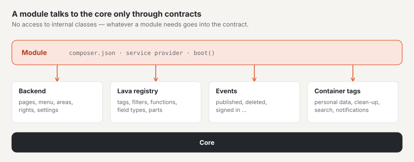

# Modules and plugins

Basalto has **one** extension interface for both: modules come with Basalto (`modules/*`,
`basalto/module-*`), plugins come from third parties — technically they are built the same way. An
extension addresses the core only through public contracts: the backend interface, the Lava registry, domain events and
container tags. Whatever a module needs goes into the contract — no access to internal classes.



Two examples under `modules/`:

- `modules/example` — the smallest module: a backend page, a menu item, a migration and
  Lava extensions.
- `modules/comments` — a real module: Lava tag, frontend route, moderation with a count on
  the menu, privacy and clean-up run.

## Structure of a package

```text
modules/example/
├── composer.json                 package, service provider, manifest
├── src/ExampleServiceProvider.php
├── src/Http/Controllers/…
├── database/migrations/…
├── lang/de/backend.php, lang/en/backend.php, lang/en.json …
└── resources/js/pages/Hello.vue  Inertia page “example::Hello”
```

### `composer.json` with manifest

```json
{
    "name": "basalto/module-example",
    "type": "library",
    "require": { "php": "^8.4", "basalto/core": "*" },
    "autoload": { "psr-4": { "Basalto\\Modules\\Example\\": "src/" } },
    "extra": {
        "laravel": {
            "providers": ["Basalto\\Modules\\Example\\ExampleServiceProvider"]
        },
        "basalto": {
            "module": "example",
            "name": "Beispiel",
            "api": 1,
            "lava": "example",
            "switchable": true
        }
    }
}
```

| Key in `extra.basalto` | Meaning |
| --- | --- |
| `module` | Handle of the module — lowercase letters, digits, `-` and `_`; also the prefix in Lava and the namespace of the Inertia pages |
| `name` | Display name |
| `api` | Version of the extension interface, currently `1` |
| `lava` | Namespace in Lava (same as the handle) |
| `switchable` | Whether the module can be switched on and off per site |
| `requires` | Handles of other modules it needs (e.g. the marketplace `["licensing"]`) — information for people and the marketplace; the core does not enforce it yet |

Laravel finds the service provider via package discovery (`extra.laravel.providers`). The `composer.json` in the
installation's main folder includes all folders under `modules/*` as local packages (`path`).

`Backend::module()` reads the manifest and stores it (`Backend::modules()`). Whether a module is switchable is determined
by the `switchable` parameter of the call — the entry in the manifest is currently informational only (for the
marketplace).

## Service provider

Everything happens in `boot()`. The example module in full:

```php
final class ExampleServiceProvider extends ServiceProvider
{
    public function boot(): void
    {
        $root = dirname(__DIR__);
        $this->loadTranslationsFrom($root.'/lang', 'example');
        $this->loadJsonTranslationsFrom($root.'/lang');
        $this->loadMigrationsFrom($root.'/database/migrations');

        $backend = $this->app->make(Backend::class);
        $backend->pages('example', $root.'/resources/js/pages');
        $backend->module('example', 'example::backend.title', composerJson: $root.'/composer.json');
        $backend->menu('example::backend.title', 'basalto.example', 50, Backend::MODE_CONTENT, module: 'example', icon: 'module');
        $backend->routes(static function (): void {
            Route::get('example', HelloController::class)->name('example');
        });

        $this->app->extend(Registry::class, static function (Registry $registry): Registry {
            $registry->module('example')
                ->function('example.greeting', static fn (mixed $name): string => 'Grüezi '.(string) $name)
                ->tag('example.cart', static function (array $args, array $named): string { /* … */ })
                ->fieldType('example.price', ['input' => 'number', 'step' => 0.05, 'currency' => 'CHF']);

            return $registry;
        });
    }
}
```

## Backend interface: `Basalto\Core\Backend\Backend`

A singleton in the container (`$this->app->make(Backend::class)`).

| Method | Signature | Purpose |
| --- | --- | --- |
| `module` | `module(string $handle, string $label, bool $switchable = true, ?string $composerJson = null, bool $enabledByDefault = true): self` | Register a module; `$label` is a translation key; `$composerJson` supplies the manifest; `$enabledByDefault` false means off by default |
| `menu` | `menu(string $label, string $route, int $order = 100, string $mode = self::MODE_CONTENT, ?string $module = null, ?string $icon = null): self` | Menu item; `$route` is a route name, `$mode` one of `MODE_CONTENT` (Content), `MODE_SETUP` (Setup), `MODE_ADMIN` (Administration). With `$module`, the item disappears when the module is switched off for the site |
| `count` | `count(string $route, Closure $count): self` | Count on the menu item of this route, per site: `fn (Site $site): int` |
| `pages` | `pages(string $namespace, string $directory): self` | Directory with Vue pages under a namespace |
| `routes` | `routes(Closure $routes): void` | Routes under the backend path (`basalto.backend.path`, default `admin`) with the backend middleware (`web`, `auth`, active account, site selection, Inertia) and the name prefix `basalto.` |
| `moduleEnabled` | `moduleEnabled(string $handle, Site $site): bool` | Is the module switched on for this site? |
| `modules`, `menuItems`, `menuByMode`, `counts`, `pageNamespaces`, `path`, `middleware`, `vite` | — | Read access for the core |

An example of `count()` from the comments module — the number of pending comments on the menu:

```php
$backend->count('basalto.comments.index', static fn (Site $site): int => Comment::query()->withoutGlobalScopes()
    ->where('site_id', $site->id)->where('status', CommentStatus::Pending->value)->count());
```

### Routes

`routes()` adds the backend path and the name prefix: `Route::get('example', …)->name('example')` becomes
`/admin/example` with the name `basalto.example` — matching the menu item above. Routes outside the backend (such as
submitting comments from the frontend) are created by the module itself:

```php
Route::post('comments/{entry}', CommentSubmissionController::class)->whereNumber('entry')
    ->middleware(['web', 'basalto.site'])->withoutMiddleware(ValidateCsrfToken::class)->name('basalto.comments.submit');
```

### Areas and rights

Every backend route belongs to an **area** with a group (content, setup, administration). The module registers its
areas in `boot()` and maps its routes by prefix; individual routes can require a higher level:

```php
app(Areas::class)->register('members', 'Mitglieder', Areas::CONTENT, 'members')
    ->map('basalto.members.', 'members')
    ->route('basalto.members.settings', 'members', Level::All);
```

Without an explicit level, GET requires “view”, DELETE “delete” and everything else “edit”. The `GuardAreaAccess`
middleware checks every request, the menu hides entries without the right. Routes without a mapping require
“Settings · all”, and the `AreaCoverageTest` reports them. In code you ask
`Gate::allows('area', [$site, 'members', Level::Delete])` or `Access::allows()`; languages are checked by
`Access::authorizeLocale()`. There is no need any more to “borrow” another ability (such as the site’s `update`). How
operators set up roles: [Roles and rights](../betrieb/rollen.md).

### Inertia pages with a namespace

A controller renders `Inertia::render('example::Hello', [...])`; the part before `::` is the namespace from `pages()`,
the part after it is the path of the page without `.vue`. The core uses `core::…`.

```php
final class HelloController
{
    public function __invoke(Request $request): Response
    {
        $greeting = (new Renderer(app(Registry::class)))->render('{{ example.greeting(name) }}', ['name' => $request->user()->name ?? 'Gast']);

        return Inertia::render('example::Hello', ['greeting' => $greeting]);
    }
}
```

The core builds the pages of all bundled modules into its bundle: `packages/core/resources/js/backend.ts` looks for
`modules/<namespace>/resources/js/pages/<Page>.vue`. The namespace must therefore match the folder name under
`modules/`. A separate build for third-party plugins (`resources/dist` with a manifest via `vite()`) is still
open.

### Switchable per site

To switch switchable modules on and off: Administration › Sites › Edit site › “Modules” tab. The setting is stored in
`sites.settings.modules.<handle>`; without an entry, the module's default applies — usually switched on, switched off by default with `module(…, enabledByDefault: false)` (as with Licence sales and Marketplace, which only run on basaltocms.com). Menu items with `module:`
disappear automatically. **The module checks everything else itself** with `moduleEnabled()` — this is how the comments
module does it in the tag output, in submission and in moderation:

```php
abort_if($site === null || ! $this->backend->moduleEnabled('comments', $site), 404);
```

When switched off, the data remains stored.

## Extending Lava: the registry

Lava only calls what is registered (`Basalto\Lava\Runtime\Registry`, one instance per application). A module extends
the instance in the container and registers **only under its own prefix** — via `module('handle')`, which returns a
`Basalto\Lava\Runtime\ModuleRegistry`. A name without a prefix, with another module's prefix or one that is already
taken throws a `LogicException`. Themes never register anything.

```php
$this->app->extend(Registry::class, static function (Registry $registry): Registry {
    $registry->module('comments')
        ->tag('comments.list', static fn (array $args, array $named, Context $ctx): string => app(CommentsRenderer::class)->render($named, $ctx));

    return $registry;
});
```

| Method of the `ModuleRegistry` | Signature | In Lava |
| --- | --- | --- |
| `function` | `function(string $name, Closure $fn): self` — any parameters; for a filter, the first one is the value | `{{ example.greeting(name) }}`, `{{ preis \| example.money }}` |
| `tag` | `tag(string $name, Closure $fn): self` — `fn (array $args, array $named, Context $ctx): string` | `` |
| `fieldType` | `fieldType(string $name, array $options = []): self` | `field preis: example.price` |
| `property` | `property(string $keyword, string $name): self` | Additional property, e.g. `property('type', 'example.sku')` → `example.sku:` in a `type` |
| `part` | `part(string $name, string $label, array $settings, Closure $render): self` — `fn (array $settings, array $vars, string $lang): string` | Lava part `part warenkorb: shop.cart { … }` |

Notes:

- **Tags return HTML** and escape it themselves (`htmlspecialchars`). `$args` are the positional arguments, `$named` the
  named ones; `$ctx->get('page')` and `$ctx->get('site')` return the page's variables.
- **Errors in a function or tag** (wrong type, missing argument) become a Lava error with a line number; the theme
  never sees a PHP stack. The renderer's limits apply (time, loops, depth).
- **Field types** from modules are known to the checker (`basalto:check`), which suggests them (“`price` — meinten Sie
  `example.price`?”, i.e. did you mean `example.price`?). The options (`['input' => 'number', …]`) are stored by the
  registry (`fieldTypeOptions()`); the backend form does not evaluate them yet.
- **Language server:** registered names appear in completion and hover; the language server reads the signature from
  the closure.

## Domain events

The core fires Laravel events with a stable payload (namespace `Basalto\Core\Events`). A module listens with
`Event::listen(…)`.

| Event | Payload | When |
| --- | --- | --- |
| `EntrySaved` | `Entry $entry, EntryVersion $version` | A language version was saved (draft) |
| `VersionTransitioned` | `EntryVersion $version, EntryStatus $from, EntryStatus $to, ?string $comment` | A version changed its state in the workflow |
| `VersionPublished` | `EntryVersion $version` | A version is live |
| `MediaUploaded` | `Media $media` | A media item was uploaded |
| `MediaTrashed` | `Media $media, int $usages` | A media item was moved to the trash (with the number of entries that still embed it) |
| `MediaRestored` | `Media $media` | A media item was restored from the trash |
| `SiteCreated` | `Site $site` | A site was created |
| `SiteUpdated` | `Site $site, array $before, array $after` | A site's master data changed |
| `UserLoggedIn` | `Authenticatable $user, string $method` | Sign-in to the backend (code, link or Passkey) |

All properties are `public readonly`.

To notify people about an event — in the bell and by email, according to their settings — register a kind and call
`Notify`: see [Notifications](benachrichtigungen.md).

## Privacy: container tags

Personal data in module tables hooks into the core's data access requests, deletion and clean-up run via two container
tags. Both expect a **closure** in the container.

| Tag | Called by | Signature of the closure | Return value |
| --- | --- | --- | --- |
| `basalto.person-data` | `Basalto\Core\Privacy\PersonData` (`basalto:privacy`, profile and user administration in the backend) | `fn (string $email, bool $delete): array` | For a data access request, a list per kind (appended to the report); for deletion, a number per kind |
| `basalto.cleanup` | `basalto:cleanup` (daily at 03:00) | `fn (Settings $settings): array` | Per kind, the number of deleted records; appears in the output and the log |

This is how the comments module connects both:

```php
$this->app->instance('basalto.person-data.comments', (new CommentPersonData)(...));
$this->app->tag(['basalto.person-data.comments'], 'basalto.person-data');
$this->app->instance('basalto.cleanup.comments', CommentPersonData::cleanup(...));
$this->app->tag(['basalto.cleanup.comments'], 'basalto.cleanup');
```

`CommentPersonData::__invoke(string $email, bool $delete): array` returns `['kommentare' => [...]]` or
`['kommentare' => $anzahl]`; `CommentPersonData::cleanup(Settings $settings): array` deletes spam and deleted comments
per site after the retention period `comments.retention_days` (default 365) and returns `['Kommentare' => $anzahl]`. The
email address arrives in lowercase and without whitespace; the search covers all sites.

## Frontend account and protected pages

The **frontend account** belongs to the core (`Basalto\Core\FrontendAccounts`). Licence sales, marketplace and members share it without depending on each other. Older names from licence sales
(`Basalto\Modules\Licensing\Accounts\Customer`, `CustomerAuth`, `CustomerLogin`, `CustomerLoginCode`,
`Frontend\LoginForm`, `Http\CustomerLoginController`, `Http\Middleware\…`, `Notifications\CustomerLoginCodeNotification`)
remain as `class_alias` and are deprecated; new code uses the core names. An alias is the same class (`instanceof`
holds for both names) — only comparisons by the class name as a string (such as
`Notification::assertSentTo(…, OldName::class)`) see the core name.

| Interface | Purpose |
| --- | --- |
| `CustomerAuth::useFor('module', ?Policy::class)` | The module uses the account (in `boot()`). The routes `POST /account/login`, `/account/code`, `/account/logout` and the sign-in page `GET /account/login` only respond on a site when one of the using modules is on. |
| `RegistrationPolicy::opensRegistration(Site)` | May the sign-in create new accounts on the site? Without a policy, yes. If none of the enabled modules allows it, codes only go to addresses with an account (the response to the browser stays the same). |
| `CustomerAuth::current()` · `::available(Site)` · `::MIDDLEWARE` (`basalto.customer`) | Who is signed in (only accounts of the request’s site), whether the account exists on the site, middleware for routes that need an account |
| `LoginForm::render($request, $lang, $path, $intro, $purpose)` | The sign-in form for your own tags; `$purpose` (e.g. `members`) comes back after the code as `CustomerSignedIn::$purpose` |
| Event `Events\CustomerSignedIn` (`customer`, `site`, `purpose`) | After the correct code — the members module uses it to create the membership the first time |

**Areas in the customer account:** the tag `` (Lava part “Customer account”, settings `buy`, `entry`, `catalog`, `start`) shows the whole account: a compact header with greeting, the areas as navigation on the left (number, hint dot), one area at a time on the right — first the overview with “Up next”, a tile per area and “Recently”. Each area has the anchor `#konto-<key>`; an anchor anywhere inside an area (`#lizenz-12`) opens that area. A module contributes an area by registering a class in `boot()` — `app(AccountAreas::class)->add(MyArea::class)` — that implements `Basalto\Core\FrontendAccounts\Hub\AccountArea`:

| Method | Purpose |
| --- | --- |
| `key()` · `position()` | Anchor `#konto-<key>` and order (sites 10, licences 20, installations 30, marketplace 40, community 50, invoices 60, profile 90) |
| `pitch($page)` | For guests: icon, title and one sentence (`AreaPitch`) — or `null` |
| `summary($page)` | Signed in: `AreaSummary` with label, icon, count, tone (`lava`, `warn`), tasks (`AreaTodo`), events (`AreaEvent`), buttons (`AreaAction`) and notices — `null` hides the area |
| `render($page, $summary)` | The content of the section; the account sets frame, heading and anchor |

The area is created afresh for each output and may keep data between `summary()` and `render()`. `AccountPage` provides site, language, path, request, signed-in account and `t()` for texts, `Icons::svg()` the account’s icons. Markup building blocks: `konto-zeilen` with `konto-zeile`, `konto-sechseck`, `konto-chip`, `konto-knopf`, `konto-leer`, `konto-klappe`.

**Protected pages:** The core knows the protection (tab “Access”, `access.protected`, inherited via
`access.children`; `Pages::isProtected()`), shows protected pages in navigation and lists only to those allowed and
never in sitemap, search index and feeds, and answers guests with 401 (signed-in users without access with 403). Who may
see them is decided by a module via `PageAccess::useGate(Gate::class)` with the contract
`Basalto\Core\Content\ProtectedPageGate` (`enabled`, `adminUrl`, `allows`, `denied`, `login`); without a module only
the site’s backend editors see them. A module’s own lists ask `app(PageAccess::class)->mayView($entry)`.

**Data protection:** `PersonData` calls the modules (`basalto.person-data`) first and the core’s frontend accounts
**afterwards** — so a module still finds its data via the account’s email when deleting; it does not have to anonymise
the account.

## Obligations of an extension

What every extension must observe:

1. **Site scope** on every table containing a site's content: column `site_id` and, in the model, the trait
   `Basalto\Core\Sites\BelongsToSite` (global scope on the current site, `site_id` on creation) — plus a test that
   a second site sees nothing.
2. **Translations** for the interface (DE, EN, IT, FR) under `lang/`; menu labels are translation keys.
3. **Migrations** in the package (`loadMigrationsFrom`), never in the core.
4. **Personal data** connected to `basalto.person-data` and, if there are retention periods, to `basalto.cleanup`.
5. **Export:** every table with `site_id` must be included in the site export or excluded with a reason — otherwise a
   test in the core fails. An interface through which modules export their tables themselves is still open; until
   then, the reason is given in `Basalto\Core\Transfer\SiteExporter::EXCLUDED` (as with the comments module).

## Next

- [Lava — the theme language](lava.md)
- [Notifications](benachrichtigungen.md)
- [REST API](api.md)
