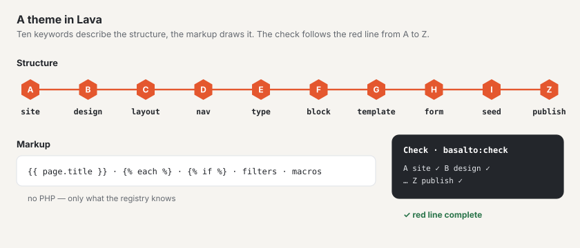

# Lava — the theme language

Lava describes an entire theme in one language: structure (site, design, layouts, menus, content types, blocks,
templates, forms, seed content, publishing) and markup. The markup knows output, loops, conditions,
macros, filters and functions — but no PHP. A theme therefore cannot execute code and cannot register anything;
Lava can only be extended through the registry of the core and the modules ([Modules and plugins](erweiterungen.md)).

The authoritative reference for the syntax is the grammar in `packages/lava/grammar/lava-1.ebnf` (see [Grammar](#grammar)).



## Structure of a theme

A theme is a folder under `themes/` (or under `BASALTO_THEMES_PATH`). Use
`themes/starter` as a template, see [Themes](themes.md).

| File or folder | Required | Purpose |
| --- | --- | --- |
| `theme.lava` | yes | Entry point. Starts with the version line `lava 1` (if it is missing, the checker warns). Can include further `.lava` files with `include "datei.lava"` — only at the top level, only within the folder, without cycles. |
| `<folder>/<name>.lava.html` | no | Markup of an element as a separate file instead of in the fence: `layouts/`, `blocks/`, `templates/`, `navs/`, `parts/`. The file takes precedence over the fence in the definition. |
| `assets/` | no | Stylesheets, scripts, fonts, images — delivered without a build. Allowed extensions: `css`, `js`, `svg`, `woff2`, `woff`, `png`, `jpg`, `jpeg`, `webp`, `avif`, `ico`. The address carries a checksum (`/_theme/{site}/{hash}/{pfad}`); every change gets a new one. |
| `assets/preview.(webp\|png\|jpg\|svg)` | no | Preview image in Setup › Themes (searched in this order). |
| `theme.json` | no | Details for theme management and the package: `label`, `author`, `version`, `license`, `description`. Without `label`, the name from `site` applies; without `version`, `basalto:theme-pack` packs it as `0.0.0`. |

```json
{
    "label": "Starter",
    "author": "Basalto",
    "version": "1.0.0",
    "license": "MIT",
    "description": "Das Beispiel-Theme von Basalto …"
}
```

## The structure part in brief

```lava
lava 1

# Comment to the end of the line (unless “#” starts a colour such as #b53f1d)
site starter {
  name: "Starter"
  languages: de, en            # list, commas optional
  default: de
  domain: example.ch
}

type page {
  label: "Seite"  label.en: "Page"        # language suffix of two lower-case letters
  field title: text required translatable # element with type and flags after “:”
  field content: blocks { allow: hero, text }
  route: /{slug}                           # path with placeholder
  template: default                        # reference to a definition
}

layout landing extends standard {          # modifier after the name
  region hero before main
}
```

- **Elements** have the form `wort name: typ flags { … }`; **properties** have the form `schluessel: werte`.
- **Values:** strings in `"…"` or `'…'`, numbers, `true`/`false`, colours `#rgb` to `#rrggbbaa`, paths `/…`,
  references (bare words) and arrows `->` (target of a menu item or of a link in the seed).
- **Line breaks count:** they end a property. One element per line if only values follow.
- **Markup** goes in a fence after the word `markup` (three backticks before and after, as in Markdown) or in
  a `.lava.html` file (see above). The fence is taken over raw; common indentation is removed.
- **Language variants:** `label.en`, `label.it`, `label.fr` … apply in that language; the value without a suffix is
  German. If a language is missing, Basalto takes English and only then the value without a suffix — a French
  interface therefore shows “Hero” rather than “Bühne” as long as `label.fr` is missing.
- **Logic belongs in the markup:** a value with `{{` or `{%` in a structure part is a warning.

## The ten keywords and the red line A–Z

A theme answers ten questions, one station per question. `php artisan basalto:check` and the Setup area in the backend
show the same line (source: `Basalto\Lava\Diagnostics\Step`, `Basalto\Lava\Theme\Line`).

| Station | Keyword | Question | Properties · child elements |
| --- | --- | --- | --- |
| A | `site` | Who am I? | `name languages default domain redirects timezone` |
| B | `design` | What do I look like? | `space radius images css logo` · `color font images` |
| C | `layout` | Where does what go? | `region`, markup; plus Lava parts `part` |
| D | `nav` | How do people find their way around? | `from items depth start exclude only label` · `item`, markup |
| E | `type` | What content is there? | `label route template` · `field`; plus `global` (`label` · `field`) |
| F | `block` | What are pages made of? | `label group hint` · `field`, markup |
| G | `template` | How is a content entry shown? | `for layout noindex` · `region`, markup |
| H | `form` | How can people reach me? | `label to subject thanks spam submit store redirect webhook retain consent` · `field` |
| I | `seed` | What do I start with? | `page global` and every type name (`post …`, `person …`) |
| Z | `publish` | May it go live? | `seo sitemap robots cookie legal redirects check` · `seo legal redirects` |

**Dark appearance:** a colour in `design` can carry a second value for dark, `color text: #23262b dark #ebe8e3`. It
applies when visitors choose “dark” with ``; without a choice the page is light, even with a dark
operating system. Colours without a dark value apply in both. `basalto:check` also calculates the contrasts of the dark
palette.

**Logo in emails:** the header of every email shows the logo of the site. Gmail and Outlook do not show SVG — so put
the same file as PNG next to the logo (`logo: assets/logo.svg` → `assets/logo.png`) at three times the size: the email
shows a third of the pixels (126 pixels high → 42 pixels). A wide logo (wordmark) stands alone, a sign with the name of the
site next to it; without a PNG the name is shown. A logo from the media library appears if it is a PNG, JPEG or GIF. If
your logo is dark, place it in the PNG on a light, rounded area in `#f6f4f0`, the colour of the email background: the
Gmail app and Outlook darken the email themselves in dark mode, but not images — without the area a dark logo
disappears, with it the logo stands on a light badge.

**Blocks in the palette:** `group` assigns a block to a group of the palette in the editor, `hint` is a sentence
below it — both with language variants like `label`:

```lava
block hero {
  label: "Bühne"  label.en: "Hero"
  group: "Einstieg"  group.en: "Intro"
  hint: "Grosser Titel mit Einleitung, Bild und Knöpfen — oben auf der Seite."
  field title: text required translatable
}
```

Without `group`, the editor sorts by the fields (image and heading with a button → “Intro”, repeaters → “Lists and
grids”, a button without an image → “Actions”, no content fields → “From data”, otherwise “Text” or “Images”); without
`hint`, the field names are shown. The editor draws each card’s **schema** itself from the fields: a heading (`title`,
`heading`) as a thick bar, body text as lines, an image (`image` or a text field `art`, `cover`, `logo`) as an image
area, links as buttons, repeaters as cards, figures, steps or folding questions (by their fields `question`, `value`).
Companion fields such as `art_overlay` or `cta_label` draw nothing of their own.

**Fields in the form:** What editors see in the block form comes from the field — all with language
variants like `label`:

```lava
block hero {
  field title: text required translatable { label: "Titel"  label.en: "Title"  placeholder: "z. B. Willkommen" }
  field cta: link { label: "Knopf" }
  field cta_label: text translatable { label: "Beschriftung des Knopfs"  help: "Leer = Titel der Zielseite"  from: "cta.label" }
  field art_credit: text advanced { label: "Bildnachweis" }
}
```

- `label` — the label. Without one, the editor turns the name into readable text (`cta_label` → “Button · Label”,
  `art_overlay` → “Image · Overlay graphic”); field names in capitals no longer appear.
- `help` — a sentence below the field; `placeholder` — an example in the empty field.
- `from` — the field whose value applies while this one is empty; the empty field shows it as “empty = “…””. A field
  `x_label` next to a link `x` works like this even without `from`. The markup still decides on its own
  (`{{ cta_label | default(cta.label) }}`) — `from` only explains it to editors.
- `pick: image` on a text field (an image address such as `art`) — the form shows the media library as a dialog with
  upload and drag and drop; it stores `media:<id>`, and the markup receives the image’s address. A file under the
  theme’s `assets/` can still be typed in; `asset()` leaves full addresses (`https://…`) unchanged.
- Flag `advanced` — the field is listed under “More options”. Without `advanced` in the block, required fields, filled
  fields and the first field of each kind (text, body text, image, link, nested blocks, repeater) are shown first,
  topped up to three; blocks with up to four fields show everything.

In addition, the top level has `global` (counts towards E), `part` (counts towards C) and `include` (no station). Modules
can register further properties per keyword (always with a prefix, e.g. `example.sku`).

### Status per station

- `✓` — the station is present and free of errors; followed by a summary (e.g. “2 Sprachen”, “11 Blöcke” — “2 languages”, “11 blocks”).
- `✗` — an error in this station (the first one with line and suggestion) or the keyword is missing (“`nav` fehlt” — “`nav` missing”).
- `–` — only for Z: “wartet auf die Schritte davor” (“waiting for the previous steps”), as long as an earlier station has `✗` and `publish` is missing.

“Rote Linie vollständig — bereit für publish” (“red line complete — ready for publish”) appears when all ten stations have `✓` and there is no error.
Warnings (`!`) do not hold up the line.

### What each station checks

The following applies to all stations: an unknown keyword is an **error** with a suggestion (“`desing` — meinten Sie
`design`?”, i.e. “did you mean `design`?”). Unknown properties and child elements are **warnings** with a suggestion — they do not break the theme.

| Station | Errors (`✗`) | Warnings (`!`) |
| --- | --- | --- |
| A `site` | — | unknown property |
| B `design` | colour value not `#rgb`, `#rrggbb` or `#rrggbbaa`; `css` not `.css`, `logo` not `.svg/.png/.webp/.jpg/.jpeg`, font `src` not `.woff2/.woff`; file missing in the theme folder | contrast below WCAG 2.2 AA (4.5:1 for text) for the pairs `text`, `muted`, `link` on `background` as well as `X-text` or `on-X` on `X` |
| C `layout`, `part` | `extends` pointing to an unknown layout; markup syntax; region with a `part`, `nav` or `global` that does not exist; part with an unknown kind; part without `source:` (for `nav`, `global`, `form`, `sitemap`, `list`) or with an unknown source | setting that the kind of part does not know; markup nested more than 6 levels of `each`/`if` deep |
| D `nav` | menu item without target `-> …`; target is not a page from `seed`; `only:`/`exclude:` names an unknown template; `from:` is neither `pages` nor a type; `items:` other than `db`; markup syntax | nesting |
| E `type`, `global` | field without type; unknown field type (core and modules, with suggestion); `blocks { allow: … }` with an unknown block; `relation <type>` with an unknown type (allowed: `form`, `page`, `global` or a type of the theme); unknown `template:` | — |
| F `block` | as E for fields; markup syntax | nesting |
| G `template` | without `for:` or for an unknown type; without `layout:` or unknown layout; region that the layout (including `extends`) does not have; `nav`, `global` or `part` in a region that does not exist; markup syntax | nesting |
| H `form` | form field without a type or with an unknown type; `select`/`radio` without `options:`; the same for fields in `group` | — |
| I `seed` | page with an unknown `template:`; block in `content { … }` that does not exist | `{{`/`{%` in values (logic in structure) |
| Z `publish` | `legal { … }` requires a page that is missing in `seed` | — |

Field types of the core: `text textarea richtext blocks markdown number checkbox bool date datetime select tags image
gallery file link relation repeater slug email url color code seo json` — plus those of the modules (`example.price`).

Form field types: `text email number tel url date textarea select radio checkbox file range hidden explanation group`.

What `basalto:publish` additionally checks against the database (`check: links, images, alt-texts, translations, forms`
and always the red line, legal pages and redirects) is defined in `Basalto\Core\Publish\PublishChecks`.

## Markup

Markup goes in the fence of a `layout`, `nav`, `block`, `template` or `part` (kind `html`) or in the matching
`.lava.html` file.

### Output, comments, variables

```lava
{{ page.title }}                 {# always HTML-escaped #}
{{ raw body }}                   {# unescaped — only for running text from the editor (richtext), the core sanitises it #}
{{ title | upper }}              {# filter #}
{{ count(items) }}               {# function #}
{# Comment, does not appear in the output #}

```

Access with `.` and `[…]` only works on arrays and public properties, never on methods. An unknown name
yields `null`; a function without parentheses is an error.

| Variable | Where | Content |
| --- | --- | --- |
| `site.name`, `site.language`, `site.domain`, `site.logo` | everywhere | site from `site`, current language, logo address |
| `site.cancellation` | everywhere | address of “Cancel contracts here” — empty where nothing can be cancelled |
| `page.*` | pages | `title`, `intro`, fields of the type, `url`, `path`, `locale`, `is_home`, `canonical`, `image`, `alternates` (each with `locale`, `url`), `breadcrumbs` |
| `content` | template markup | the rendered blocks of the page (output with `{{ raw content }}`) |
| `regions.<name>` | layout markup | `true` if the region has content (e.g. ``) |
| field names, `block.name`, `block.index` | block markup | values of the block fields, name and position of the block |
| `nav.name`, `nav.label`, `nav.items` | nav markup | per item `href`, `label`, `current`, `active`, `new_window` |
| `loop.index`, `loop.index0`, `loop.first`, `loop.last`, `loop.length` | in `each` | loop counters |

### Loops and conditions

```lava

  <li>{{ loop.index }}. {{ item.title }}</li>

  <li>Noch nichts da.</li>


{{ key }}={{ value }}

………
```

### Expressions

| Kind | Notation |
| --- | --- |
| Logic | `and` `&&` · `or` `\|\|` · `not` `!` |
| Comparison | `==` `!=` `<` `>` `<=` `>=` · `in`, `not in` (list or substring) |
| Arithmetic | `+` `-` `*` `/` `%` (division by zero is an error) |
| Concatenation | `~` (`"Seite " ~ loop.index`) |
| Conditional | `a if bedingung else b` |
| Literals | numbers, `"…"`/`'…'`, `true`, `false`, `null`, lists `[1, 2]`, maps `{ key: wert }` |

Reserved words: `and or not in if else true false null as with`.

### Macros and includes

```lava
<a class="card" href="{{ href }}">{{ title }}</a>

   {# three equivalent calls #}

{{ card("Kontakt", "/kontakt") }}

       {# reads parts/card.lava.html; “with” passes variables #}
```

`include` reads `<path>.lava.html` from the theme — never outside the folder. If the value after `with` is a map,
its keys become variables; otherwise it is called `item`.

### Tags

A tag is ``; arguments are separated by spaces or commas.

| Tag | Effect |
| --- | --- |
| `` | character set, viewport, design variables of the site and stylesheets of the theme — first in the `<head>` |
| `` | light/dark toggle for visitors (sun/moon, choice stored in the browser) — only when `design` has dark colours |
| `` | title, description, canonical, `robots` and Open Graph details of the page (from `publish.seo` and the page data) |
| `` | content of a region (in layout markup) |
| `` · `` · `` | navigation, Lava part or form at this position |
| `` | image with a variant from `design.images` (WebP with `srcset`, AVIF source, width and height, `loading`) |
| `` | link from a `link` field |
| `` | output text escaped |
| `` · `` | breadcrumbs and language switcher with the standard markup (custom markup via `page.breadcrumbs` and `page.alternates`) |
| `` · `` | sharing: email and networks as ordinary links (nothing goes out before the click), “Copy link” and the device’s sharing; address and title of the page unless given |
| `` · `` · `` | pagination, categories and archive for `entries()` |
| `` | search form and results of the site — by words, regardless of case and accents |
| `` | nested blocks of a `blocks` field (already rendered) |
| `` · `` | see above |
| `` | comments (module `comments`); modules bring their own tags with a prefix |
| `` · `` · `` | sign in/out, sign-in and membership (module `members`, see below) |

An unknown tag fails when rendering, not when checking.

### Member tags

The “Members” module (`members`) brings three tags — also as Lava parts of the same name, i.e. in a region
(`region header: part account`) or as a block of a page. All three output **nothing** when the module is off for the
site. If the module is missing from the installation altogether, a tag fails when rendering (like any unknown tag) —
so in a theme that should also run without the module, it goes inside a condition:

```lava
<div class="header-account"></div>
```

`site.modules` lists the modules switched on for the site (`site.modules.comments`, `site.modules.members` …).

| Tag | Guests | Signed in | Settings |
| --- | --- | --- | --- |
| `` | link “Sign in” (`a.members-link`) to the sign-in page | button “Sign out” (`form.members-link.is-signed-in`) | `login: "/path"` — target of “Sign in”; otherwise the sign-in page from the members’ settings or `/account/login` |
| `` | sign-in with an email code (`section.account-login#konto-anmeldung`) — whoever signs in through it joins according to the site’s rule | “Signed in as … · Sign out” (`form.account-signed-in`) | — |
| `` | like `members.login` | state of the membership (`section.members-panel#konto`): active since …, awaiting approval, blocked, no invitation — or “Become a member” (`form.members-join`) — plus “Sign out” | — |

Protected pages show guests the sign-in by themselves (the site’s 401 error page or a “Sign-in required” page in the
theme’s layout, in place of `page.intro`, otherwise at the start of `<main>`); the theme needs no tag for that. For
guests the output is the same for everyone and may come from the page cache (the first sign-in step carries no CSRF
token); anyone signed in never gets a page from the cache. Style the classes `account-login`, `account-form`,
`account-intro`, `account-status`, `account-signed-in`, `members-panel`, `members-state` (with `is-active`,
`is-pending`, `is-blocked`, `is-none`), `members-join`, `members-link` and the core form classes (`form`, `form-field`,
`form-error`, `form-help`). The Starter theme shows an example.

### Limits

When rendering, the limits are at most 10,000 loop iterations, 2 seconds and nesting (include, macro,
loop, condition) up to depth 8 (`Basalto\Lava\Runtime\Limits`); beyond that, rendering aborts with a Lava error
including the line. The checker already warns from 7 levels of `each`/`if`. A PHP error in a registered function becomes
a Lava error with a line — the theme never sees a PHP stack.

## Lava parts

A **part** is a ready-made building block with settings, defined once and placed in regions or in the markup:

```lava
part main_nav: nav {
  source: main
  label: "Hauptnavigation"  label.en: "Main navigation"
}
part lang_switch: languages

layout standard {
  region header: part main_nav, part lang_switch    # default filling of the region
  region main
  …
}
```

In the markup, the same part is written as ``. Parts count towards station C.

| Kind | Label | Settings | Output |
| --- | --- | --- | --- |
| `nav` | Navigation | `source depth start only exclude label` | the navigation `source`; the settings of the instance override those of the `nav` |
| `breadcrumbs` | Breadcrumbs | — | breadcrumbs of the page |
| `languages` | Language switcher | — | links to the language versions |
| `global` | Global content | `source` | fields of the global content |
| `form` | Form | `source` | the form |
| `sitemap` | HTML sitemap | `source depth start only exclude label` | all levels of the navigation `source` |
| `search` | Search | — | like `` |
| `list` | List | `source per label` | latest content entries of the type `source` |
| `html` | HTML | — | custom markup in the fence of the part |

Modules register their own kinds with a prefix (`shop.cart`), see [Modules and plugins](erweiterungen.md).

What else a region can be filled with (in the layout as a default, in the template per type): `content`, `content.first`,
`content.rest` (the blocks of the page, whole or split), `nav <name>`, `global <name>`, `part <name>`,
`breadcrumbs`, `languages`.

Not to be confused with two other kinds of reuse:

- `include "datei.lava"` at the top level inserts further **structure** into `theme.lava`. A named definition that
  already exists with the same kind and name (such as `nav main`) replaces the earlier one. That way a site’s Lava — it is
  included last — replaces a menu or a block of the theme; the demo uses this for its own main menu.
- `` in the markup includes a **markup file** `parts/karte.lava.html`.

## Filters and functions

Filters and functions are the same list: `{{ wert | name(a, b) }}` calls `name(wert, a, b)`. They are registered
in `Basalto\Lava\Runtime\Registry::standard()`; `entries` is set by the application when rendering a page.

| Name | Call | Result |
| --- | --- | --- |
| `count` | `count(liste)` | number of elements, otherwise `0` |
| `length` | `text \| length` | characters of a text (Unicode) or number of elements |
| `upper`, `lower` | `text \| upper` | upper or lower case (Unicode) |
| `truncate` | `text \| truncate(100, "…")` | shortened to n characters, ending appended (defaults 100 and `…`) |
| `date` | `datum \| date("d.m.Y")` | date in PHP format, default `d.m.Y`; accepts a timestamp or date text |
| `join` | `liste \| join(", ")` | elements joined, default `, ` |
| `first`, `last` | `liste \| first` | first or last element |
| `keys` | `map \| keys` | keys of a map |
| `default` | `wert \| default("–")` | substitute if the value is `null`, empty or an empty list |
| `json` | `wert \| json` | JSON (Unicode and `/` unescaped) |
| `range` | `range(1, 5)` | list from a to b, at most 10,000 elements |
| `url` | `"blog/a" \| url` | address with a leading `/`; `http…` stays unchanged |
| `t` | `text \| t` | the text unchanged — a placeholder, no translation takes place yet |
| `nl2br` | `{{ raw text \| nl2br }}` | escapes and inserts `<br />` — therefore output with `raw` |
| `replace` | `text \| replace("a", "b")` | replaces every occurrence |
| `slug` | `text \| slug` | lower case, everything except `a–z` and `0–9` becomes `-` (umlauts are dropped: “Zürich” → `z-rich`) |
| `entries` | `entries("post", 10)` | published content entries of a type with pagination (per entry, among others, `url`, `title`, `date`, `intro`, `category`, `category_url`, `author`) |
| `asset` | `asset("demo/editor.svg")` | address of a file under the theme’s `assets/` (images, graphics), with checksum — empty if the file is missing |

Functions from modules carry the module’s prefix, e.g. `{{ example.greeting(name) }}` or
`{{ preis | example.money }}`. The completion of the language server shows which names an installation knows.

## Checking: `php artisan basalto:check`

```text
basalto:check [--theme=THEME] [--site=SITE] [--json]
```

| Option | Meaning |
| --- | --- |
| `--theme=` | theme directory relative to the installation, for example `themes/starter` — always give it |
| `--site=` | handle of a site: checks the theme the site actually uses — from the database (`lava_sources`) if it has one, otherwise the folder |
| `--json` | line and findings as JSON (`line`, `diagnostics`) |

The command ends with code 0 if there are no errors, otherwise 1. Warnings do not change the code.

Against the starter theme:

```text
$ php artisan basalto:check --theme=themes/starter
Theme «starter» (Dateien)
A site       ✓ starter · 2 Sprachen · example.ch
B design     ✓ 14 Farben · 3 Schriften
C layout     ✓ standard (4 Regionen) · landing (1 Regionen)
D nav        ✓ main · legal
E type       ✓ page · post · person · footer
F block      ✓ 11 Blöcke
G template   ✓ default · landing · post · legal
H form       ✓ contact → ohne Empfänger
I seed       ✓ 8 Seiten · 1 globale Inhalte
Z publish    ✓ Sitemap true · Prüfungen: links, images, alt-texts, translations, forms
Rote Linie vollständig — bereit für publish.
```

With an error (a template refers to a misspelt layout, shortened):

```text
G template   ✗ Template «default» verweist auf unbekanntes Layout «standart» — meinten Sie «standard»? (Zeile 78)
  ✗ [G] Template «default» verweist auf unbekanntes Layout «standart» (theme.lava:78:1) — meinten Sie «standard»?
```

Every finding names the station, message, file, line and column and — if there is one — a suggestion. Errors when
reading in (missing or circular `include` file) carry no station; the line then shows all stations as
missing.

## Grammar

The complete syntax is available as EBNF in
`packages/lava/grammar/lava-1.ebnf`: structure part, lexis, markup,
expressions and — as a comment — the properties per keyword. Changes within `lava 1` are only
additive; existing forms remain valid, a break would be `lava 2`.

## Next

- [Themes](themes.md)
- [Language server for Lava](sprachdienst.md)
- [Modules and plugins](erweiterungen.md)
