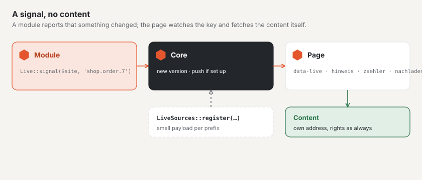

# Live updates in modules

Modules report through the same channel as the forum that something has changed — and pages update themselves without a
module needing JavaScript of its own. The signal carries no content: the page observes a **key** and fetches the new
content through its regular address, with the rights that apply there anyway.



## 1. Send a signal

```php
use Basalto\Core\Live\Live;

app(Live::class)->signal($site->id, 'shop.bestellung.'.$order->id);
```

- Keys consist of lowercase letters, digits, `-` and `_`, separated by dots (at most five parts); the first part is the
  module’s prefix.
- `signal()` waits for a running transaction to finish — the page never fetches the content before it is visible.
- If push is set up, the signal goes to the WebSocket server after the response; an error there aborts nothing.
- The personal keys of accounts are `konto.{id}` (customer accounts) and `benutzer.{id}` (backend, without a site).

## 2. A spot in the markup

`Live::attributes()` returns the attributes for a spot that updates itself — issued when the page is delivered, that is
after your permission check:

```php
$attributes = app(Live::class)->attributes($site->id, 'shop.bestellungen', 'hinweis');
$html = '<p class="hinweis" hidden'.$attributes.'>Neue Bestellungen — <a href="">Aktualisieren</a></p>';
```

| Action | What the island does | Further options |
| --- | --- | --- |
| `hinweis` | shows the (hidden) element as soon as something changes | — |
| `zaehler` | shows a number from the payload, hidden at 0 | `feld` |
| `nachladen` | fetches a fragment and inserts it on click | `quelle`, `nach`, `ziel`, `eins`, `mehr` |
| `schreibt` | shows who is typing (payload `schreibt`), without yourself; each entry expires after its seconds | `ich`, `eins`, `zwei`, `mehr` |

Pass further options as the fourth argument (`['feld' => 'offen']` becomes `data-live-feld="offen"`). `nachladen` calls
`quelle?nach=<nach>` and expects JSON `{anzahl, html, url, nach}`: `html` ends up in `ziel` (CSS selector); without
`html`, the click leads to `url`; `eins` and `mehr` are the texts for the count (`:count`).

If the markup of a mounted page contains such a spot, Basalto attaches the small live update script itself. On other
pages, include it with `Islands::attach($html)`.

## 3. Payload per prefix

To deliver small data with a changed key — a counter, for instance —, register a source in `boot()`:

```php
use Basalto\Core\Live\LiveSources;

app(LiveSources::class)->register('shop', static fn (int $siteId, string $key): ?array => [
    'offen' => Order::query()->where('site_id', $siteId)->where('status', 'offen')->count(),
]);
```

Polling calls the source only for keys that have changed. Everyone who observes the key sees the payload — personal data
belongs on personal keys.

## 4. Your own islands

For JavaScript of your own there are two events on `document`:

| Event | When | `detail` |
| --- | --- | --- |
| `basalto:live` | a version has changed | `{ key, version, data }` |
| `basalto:inhalt` | markup was loaded and inserted | `{ root }` — take over the islands inside it |

## 5. Presence: who is typing, who is editing

`Presence` keeps a short list of who is at a place right now. The core uses it for “who is typing” in the community
(keys `schreibt.…`, class `Typing`) and for “who is editing” in the backend (`bearbeitet.…`).
`update($siteId, $key, $id, $name, $active, $ttl)` checks in or out and sets a signal; `current()` returns the list
with the seconds remaining.

Your own reply field gets “who is typing” with two lines:

```php
$editor = Islands::editor('antwort', 'body', '', $lang, 6, true, ['typing' => Typing::key('shop.'.$id), 'preview' => route('basalto.community.preview', absolute: false)]);
$indicator = Islands::typingIndicator($site->id, 'shop.'.$id, $lang, $profileId);
```

The place needs no source of its own: the core delivers the payload for `schreibt.…`.

## Good to know

- Polling at `/_live` runs without a session and only reads versions from the cache; expensive work belongs in the
  source of the content, not in the signal.
- Only report what everyone who observes the key may see (pending content only once it is approved).
- Setup, interval and push are described in [Setting up live updates](../betrieb/live.md).

## Next

- [Modules and plugins](erweiterungen.md)
- [Notifications](benachrichtigungen.md)
- [Setting up live updates](../betrieb/live.md)
