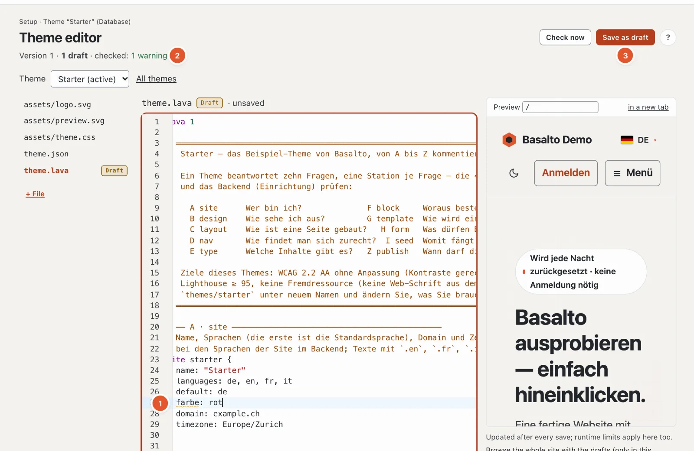

# Language server for Lava

The language server brings the findings of `basalto:check` into the editor — while you type, even for unsaved files —
plus completion, go to definition and explanations. It exists twice with the same core
(`Basalto\Lava\Lsp\LanguageService`): as an LSP server for VS Code and PhpStorm and in the Lava editor of the backend.



## `php artisan basalto:lsp`

```text
basalto:lsp [--stdio]
```

Starts a language server (LSP) over standard input and output. `--stdio` is the default; VS Code appends the
option itself. Standard output belongs to the protocol, PHP messages go to stderr. The server never writes
a file.

| LSP method | Capability |
| --- | --- |
| `textDocument/publishDiagnostics` | findings on opening and on every change; the whole theme (nearest folder with `theme.lava`) is compiled, every finding ends up in its own file |
| `textDocument/completion` | keywords, properties, field types (including modules), kinds of parts, in the markup tags, filters and functions, names from the theme |
| `textDocument/definition` | jump to blocks, parts, layouts, templates, types, navigations, forms, globals and pages from `seed` |
| `textDocument/hover` | explanation of keywords, field types, signature of filters and functions, form of the tags |

Not included: rename, formatting, outline, signature help while typing. The LSP server does not check a theme from the
database — for that there is the Lava editor in the backend (below) and `basalto:check --site=<handle>`.

## Integrating VS Code and PhpStorm

Building, installing and configuring — VS Code extension, settings `lava.phpPath` and `lava.artisanPath`,
TextMate bundle and LSP4IJ for PhpStorm — is described in
`tools/vscode-lava/README.md`. In short:

```sh
cd tools/vscode-lava
npm install && npm run compile && npx @vscode/vsce package
code --install-extension basalto-lava-0.1.0.vsix
```

In PhpStorm, LSP4IJ starts the server with `php $PROJECT_DIR$/artisan basalto:lsp`; the files `*.lava` and
`*.lava.html` are assigned to the language IDs `lava` and `lava-html`.

## The same service in the Lava editor

The theme editor in the backend (Setup › Theme editor, see [Themes](themes.md)) uses the same
`LanguageService` over HTTP:

```text
POST /admin/einrichtung/lava/sprachdienst      Route basalto.setup.lava.language
```

`admin` is the backend path (`basalto.backend.path`). The request runs in the backend session (signed in,
CSRF token, `update` permission on the site). It works on the site’s theme with all open drafts
and the unsaved content of the editor.

| Field | Required | Meaning |
| --- | --- | --- |
| `action` | yes | `diagnostics`, `completions`, `hover` or `definition` |
| `path` | yes | editable path in the theme, e.g. `theme.lava` or `assets/theme.css` (as in the theme editor, see [Themes](themes.md)) |
| `lava_source` | yes (may be empty) | current content of the editor, at most 512 KB |
| `line` | no | line, starting at 1 |
| `character` | no | character, starting at 0, counted in UTF-16 as in the browser |

| `action` | Response |
| --- | --- |
| `diagnostics` | `{"findings": [{file, line, column, character, severity, message}, …]}` |
| `completions` | `{"items": [...]}` |
| `hover` | `{"markdown": "..."}`, without a match `{"markdown": null}` |
| `definition` | `{"location": {...}}`, without a match `{"location": null}` |

The editor (CodeMirror 6) requests the findings after every pause in typing, the suggestions with Ctrl+Space, the
explanation on hover and the definition with F12.

## Next

- [Lava — the theme language](lava.md)
- [Themes](themes.md)
