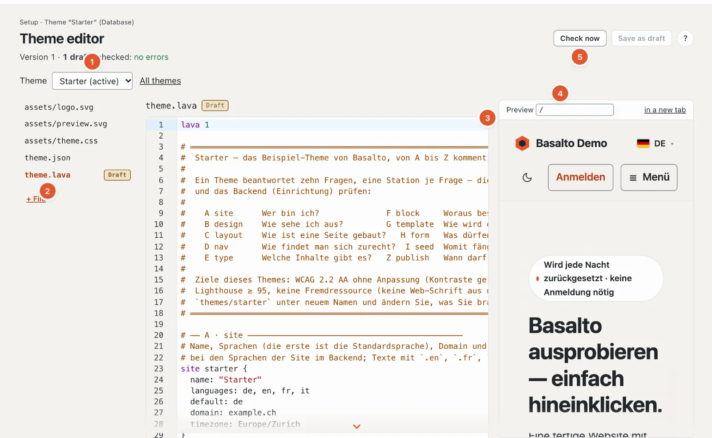

# Themes

A theme is a folder with `theme.lava`, `assets/` and optionally `theme.json` — the language for it is described in
[Lava — the theme language](lava.md). This page shows where themes are located, how to start with the starter theme, how to use design
tokens and starter content, how to pass a theme on as a package and how a site maintains its theme in the database.



## Theme folders

| Setting | Meaning |
| --- | --- |
| `BASALTO_THEMES_PATH` (`basalto.themes_path`) | Folder containing the themes; empty means `themes/` in the project |
| `BASALTO_DEFAULT_THEME` (`basalto.default_theme`) | Theme of a site without its own choice, for example `starter` |
| `BASALTO_DEFAULT_SITE` (`basalto.default_site`) | Site for commands without a handle, e.g. `basalto:tokens` |

Every subfolder with a `theme.lava` counts as a theme. You choose which theme a site uses in the backend under
Setup › Themes; this is also where you find the details from `theme.json`, the preview image, scope and check status of
each theme and — before a switch — what the site would no longer show afterwards. Nothing is deleted when switching.

## Starter theme as a template

`themes/starter` is a fully commented example of all ten stations: two languages (DE, EN),
system fonts, a stylesheet without a build, no script (apart from the small inline light/dark toggle) and no third-party
resource, a dark appearance (`color … dark #…`), contrasts calculated to WCAG 2.2 AA.
It comes with eighteen blocks (including form, post list, search and comments, and for home pages “hero with card”,
“key figures”, “steps”, “choices”, “features” with icons and “notes”), a blog with an Atom feed, legal pages and
starter content. “Image with graphic” (`visual`) lays a transparent graphic over an image — a photo with a diagram, as
the demo shows; “hero with card” and “choices” can do the same with `art` and `art_overlay`.

```sh
cp -R themes/starter themes/mein-theme
php artisan basalto:check --theme=themes/mein-theme
```

Then adjust name, author and version in `theme.json`, and name, languages and domain in `site`.

## Design tokens

Every colour, font, spacing value and the radius from `design` becomes a CSS variable (`--color-text`, `--font-body`,
`--space-3`, `--radius`). `` writes them into the head of every page — with the colour variant the site has
chosen (`palette`, see [Lava](lava.md)) and, on top, the site's overrides from Setup › Design.

```text
basalto:tokens [--tailwind] [<site>]
```

| Argument / option | Meaning |
| --- | --- |
| `<site>` | Handle of the site, otherwise `BASALTO_DEFAULT_SITE`, otherwise the first site |
| `--tailwind` | as `@theme { … }` for Tailwind 4 instead of `:root { … }` |

```text
$ php artisan basalto:tokens --tailwind
@theme {
 --color-text: #23262b;
 --color-background: #f6f4f0;
 …
```

For a theme that builds its CSS with Tailwind: `php artisan basalto:tokens --tailwind > themes/x/assets/tokens.css`.

## Starter content: `seed`

Station I (`seed`) creates pages with title, slug, template and blocks per language, plus global content and entries
of custom types (`post willkommen { … }`, `person redaktion { … }`) — published, so that the site is ready after the
first go-live without manual work.

```text
basalto:seed <site>
```

Seeding is **idempotent**: every entry carries a fixed UUID derived from the site and the seed name. Whatever already
exists remains untouched (including changed or deleted entries), missing languages are added. The output lists every
entry created and, at the end, “Seed: n angelegt, m schon vorhanden” (Seed: n created, m already present; the console
output is in German).

If a theme’s seed has changed (new texts, new blocks), `basalto:seed <site> --auffrischen` brings the change to an
existing site: entries that are still exactly as the seed created them (all versions without an author) are seeded
again; whatever someone edited or deleted in the backend stays.

`php artisan basalto:publish <site>` applies the seed as well, checks the site and switches it live; `--ohne-seed`
leaves out the seed, `--dry-run` only checks.

If the site has its own Lava (Lava editor, “site” layer), it may bring its own `seed`. Entries with the same name replace
the theme’s at their position — `page home { … }` in the site’s Lava is the new home page, `global footer { … }` the new
footer. The demo does exactly that with the starter theme.

## Theme packages

A package is a ZIP for distribution and the marketplace: all files of the theme folder under `<name>/`, plus
`manifest.json` and — with a key — `signature`.

```text
basalto:theme-pack <name> [--output=ORDNER] [--key=SCHLUESSEL]
basalto:theme-verify <zip> [--public-key=SCHLUESSEL]
```

| Command · option | Meaning |
| --- | --- |
| `theme-pack <name>` | Folder under `themes/`; writes `<name>-<version>.zip` (version from `theme.json`, otherwise `0.0.0`) |
| `--output=` | Target folder, default `storage/app/themes` |
| `--key=` | Secret Ed25519 key, Base64 or path to a file containing Base64 |
| `theme-verify <zip>` | Checks every file against the manifest |
| `--public-key=` | Public Ed25519 key, Base64 or file — only then is the signature checked |

The manifest (format 1):

```json
{
    "format": 1,
    "name": "starter",
    "version": "1.0.0",
    "files": {
        "assets/theme.css": "7430…1dd5",
        "theme.lava": "c858…1a8e"
    }
}
```

`files` contains the SHA-256 checksum of each file; files whose name begins with `.` are left out of the package. The
signature is Ed25519 over `manifest.json`, Base64-encoded. `theme-verify` reports an error if a file has been changed,
is missing from the package or is not listed in the manifest, if `theme.lava` is missing and — with `--public-key` — if
the signature is missing or does not match. Without `--public-key`, “signiert” (signed) only shows that a signature is
attached.

```text
$ php artisan basalto:theme-pack starter --output=/tmp/pakete --key=/tmp/secret.key
/tmp/pakete/starter-1.0.0.zip · 5 Dateien · signiert
$ php artisan basalto:theme-verify /tmp/pakete/starter-1.0.0.zip --public-key=/tmp/public.key
Paket in Ordnung: starter 1.0.0 · 5 Dateien · signiert
```

A key pair can be generated with libsodium, for example:

```sh
php -r '$k = sodium_crypto_sign_keypair();
  file_put_contents("secret.key", base64_encode(sodium_crypto_sign_secretkey($k)));
  file_put_contents("public.key", base64_encode(sodium_crypto_sign_publickey($k)));'
```

`theme-pack` does not check the Lava — run `basalto:check` beforehand.

## The site's theme library and the Lava editor

Besides the bundled themes in the `themes/` folder (shared by all sites of the installation, read-only in the backend),
every site has its own **theme library** in the database: any number of own themes, each with text files,
images and fonts, drafts and versions. This way themes can be added, edited and removed even where the disk is
ephemeral (Laravel Cloud) or the folder belongs to all customers (SaaS).

| Part | Storage |
| --- | --- |
| Entry | `site_themes` (name, label, origin `ordner` · `kopie` · `paket` · `marktplatz`, signature) |
| Text files | `lava_sources` with `scope = theme:<id>` |
| Images and fonts | default disk under `theme-assets/<site>/<theme>/…`; paths with checksum in `site_themes.assets`, so pages build URLs without reading the files |
| Drafts, versions | `theme_drafts`, `theme_versions` with `site_theme_id` |

Which theme a site shows is still stored in `sites.theme`. If an own theme has the same name as a folder, it takes
precedence over the folder — that is how “Copy into the database” works; images and fonts it lacks then come from the
folder.

### “Themes” station

**Setup › Themes** (`/admin/einrichtung/themes`) shows “Own themes” and “Bundled themes”. Anyone who may edit the site
may switch, add and remove themes.

| Action | What happens |
| --- | --- |
| **Add theme › Upload package** | ZIP with `manifest.json` (at most 20 MB, 800 files, 50 MB unpacked). Checksums and — if present — the signature are verified with the product or marketplace key. Name from the manifest; if taken (also by a folder), with a counter (`starter-2`) |
| **Create copy** | of any theme (own or folder) with all files, images and fonts, under a new name |
| **From the marketplace** | “Marketplace” module: a theme arrives signed as a new own theme; installing the same theme again arrives as drafts (update) |
| **Switch to this theme** | as before, with a report of what the site would no longer show |
| **Preview** | the whole site with this theme in your own session |
| **Download as package** | own theme with images, folder theme as it is (unsigned) |
| **Remove** | own theme with its files, images, drafts and versions — not the active one, unless a folder of the same name steps in |
| **Hide** | take a bundled theme off the list for this site (`sites.settings.themes.hidden`); not the active one |

In the log: `theme.add`, `theme.copy`, `theme.remove`, `theme.hide`, `theme.show`, `theme.asset`, `site.theme`.

### Theme editor

**Setup › Theme editor** (`/admin/einrichtung/theme-editor`) edits every own theme — the active one or, with
`?theme=<name>`, one the site does not show yet (selection at the top). Files on the left, code in the middle, preview
on the right.

| Step | What happens |
| --- | --- |
| **Copy into the database** | if the site shows a folder theme: creates an own theme of the same name with its text files; version 1 records the initial state |
| **Edit** | every change is a draft per file (deleting a file is a draft without content). Editable are paths ending in `.lava`, `.html`, `.json`, `.css`, `.js`, `.svg`, `.txt`, `.md`, at most 512 KB, UTF-8; `theme.lava` cannot be deleted |
| **Check before saving** | a draft is only saved if the whole theme compiles without errors with it — otherwise response 422 with the findings at the text. Warnings are included but do not block |
| **Conflict** | anyone saving with an outdated state (checksum `base` does not match) gets 409 instead of a silent overwrite |
| **Preview** | any page of the site with the drafts (also of an inactive theme), rendered in the backend (`vorschau-seite?pfad=/…`); or the whole site with drafts in your own session — the site itself remains unchanged |
| **Submit**, **Publish** | as before, with the four-eyes principle (`four_eyes`); every publication is a version of the theme. Images are re-cut only when image variants of the active theme change |
| **Versions**, **Discard** | the last 50 versions per theme; an earlier one comes back as drafts |
| **Images and fonts** | upload (`woff2`, `woff`, `png`, `jpg`, `jpeg`, `webp`, `avif`, `ico`, at most 5 MB per file, 40 MB in total) into a folder under `assets/`, delete — takes effect immediately, without a draft |
| **Export**, **Import** | package of the theme with images; an import arrives as drafts (text) and immediately (images) |
| **Back to the folder** | only for an own theme named like a folder: the site shows the folder again, the own theme stays in the library as `<name>-eigen` with its drafts and versions |

The code editor is CodeMirror 6 with Lava highlighting and the same language server as in VS Code — findings after every
pause, suggestions with Ctrl+Space, explanations on hover, F12 to go to the definition (see
[Language server for Lava](sprachdienst.md)).

> Still open: CSS drafts only appear in the preview after publishing, because the theme assets read the live version.

### Checking a database theme

```sh
php artisan basalto:check --site=<handle>
```

checks the theme that the site actually uses (header line “(Datenbank)” or “(Dateien)”, i.e. database or files).

## `basalto:lava-import`

```text
basalto:lava-import <site> [--theme=THEME] [--scope=theme|site]
```

Copies a file theme as records into `lava_sources` without the backend — for example when setting up a site on a
server without a writable disk. With `--scope=theme` the files go into the site's theme library, into the own theme
named like the site's theme (created if missing).

| Argument / option | Meaning |
| --- | --- |
| `<site>` | Handle of the site |
| `--theme=` | Theme directory relative to the installation, for example `themes/starter` — always give it |
| `--scope=` | `theme` (default): the site's theme · `site`: the site's own additions, which are included under `site/…` at the end of `theme.lava` (e.g. custom content types from the backend) |

Existing records with the same path are overwritten; non-UTF-8 files are skipped. Unlike “Copy into the database” in
the editor, the command creates **no version**.

## Next

- [Lava — the theme language](lava.md)
- [Appearance: themes, design and image variants](../einrichtung/aussehen.md)
- [Marketplace for authors](../marktplatz/autoren.md)
