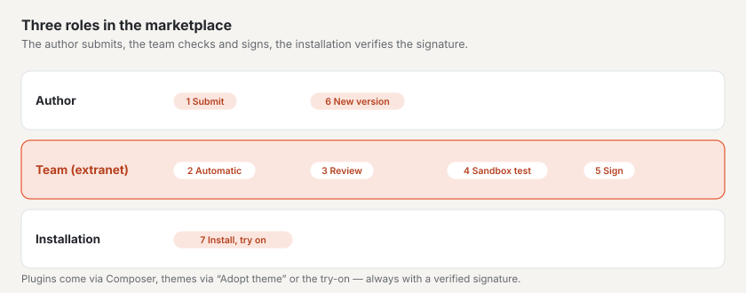

# Marketplace for authors

In the marketplace on basaltocms.com you offer themes and plugins for Basalto. Every submission is checked
automatically, reviewed by hand and signed by basaltocms.com on approval — only then does it appear in the catalogue. An
entry is free or costs a one-off price per installation — you choose when submitting. An entry with a price appears in
the catalogue once basaltocms.com enables sales and your Stripe account is connected ([Selling](#selling)).



> **Terms:** whoever submits agrees to the author terms
> ([Author terms](../../recht/en/autoren-bedingungen.md), in the product under `/_recht/<language>/autoren-bedingungen`).
> They are a draft, legal review pending. The time and version of the agreement are stored with every version.

## Author account

1. On the **“Author account”** page on basaltocms.com, enter your email address. There is no password: you receive a
   code by email; the first time, this creates your customer account (the same as for buying a licence).
2. **“Create author profile”:** “Name as author” (person, company or studio — this is how it appears in the
   catalogue), town, website.
3. The author account is an **area of your customer account** (next to purchases, licences and community); the
   “Author account” page leads there. At the top are the figures (in the catalogue, installations, in review), then
   **“Your entries”** as cards: kind, state (“in the catalogue”, “in review”, “rejected”, “waiting for sales to
   start”), version, offer, installations and downloads, plus **“View in catalogue”**, **“New version”** and the
   panels **“Change offer”**, **“Check report”** and **“Versions”**. Below that **“Submit”**, as soon as there is
   something to sell **“Sales per month”** and **“Payout”**, and finally the author profile and the **“Composer
   token”**.
4. **“Up next”** in the account overview shows what you should do — for example resubmit a rejected version or connect
   the payout account; **“Last”** shows approvals and rejections.

You do not see other authors' entries in the author account, and a package name belongs to the author who submitted
it first.

## Package formats

A submission is a ZIP. The marketplace recognises from the content whether it is a theme or a plugin.

### Theme

A theme package in the format of `basalto:theme-pack` ([Themes](../entwickler/themes.md#theme-packages)): the files of
the theme folder and `manifest.json` with the SHA-256 checksum of every file.

```sh
php artisan basalto:check --theme=themes/mein-theme   # check the Lava first
php artisan basalto:theme-pack mein-theme              # → storage/app/themes/mein-theme-1.0.0.zip
```

- **Name:** the folder name — lower-case letters, digits and hyphens, at most 64 characters.
- **Version** from `theme.json` (`version`), as a version number such as `1.2.0`; without it, `theme-pack` packs
  `0.0.0`.
- **Details** from `theme.json`: `label` (title in the catalogue), `description`, `license`, `preview` (path to a
  preview image in the package: SVG, PNG, JPG or WebP, at most 1 MB), `requires` (minimum version of Basalto, such as
  `{"basalto": ">=1.3.9"}` — the entry shows it under “Requires”; without it, `>=1.0` applies).
- **Required:** `category` — one of `firma`, `portfolio`, `gastro`, `verein`, `magazin`, `onepager`,
  `shop` — and at least one image: `screenshots` (list of paths in the package, 1–6 images, PNG, JPEG or WebP, each at
  most 1 MB) or `preview`.
- **Optional:** `homepage`, `docs`, `support` (https addresses). A `seed` with starter content shows the theme in the
  sandbox and in the showcase with content instead of empty. The languages from `site { languages: … }` become the
  languages of the sandbox and showcase site — starter content in several languages is visible there in all of them.

```json
{
    "label": "Fjord",
    "description": "Calm and clear, with dark mode.",
    "version": "1.0.0",
    "license": "MIT",
    "category": "firma",
    "preview": "assets/preview.svg",
    "screenshots": ["assets/screens/start.webp", "assets/screens/kontakt.webp"],
    "docs": "https://example.ch/fjord"
}
```

- **No PHP:** the check rejects files ending in `.php`, `.phtml` or `.phar` — themes are data.
- Your own signature is not needed; basaltocms.com signs again on approval.

### Plugin

A Composer package as a ZIP: `composer.json` at the root or in the only folder at the root (like the ZIP archive a code host delivers).
Structure and interface as for modules ([Modules and plugins](../entwickler/erweiterungen.md)).

```json
{
    "name": "hersteller/karten",
    "version": "1.0.0",
    "type": "basalto-plugin",
    "license": "MIT",
    "description": "Karten als Lava-Tag",
    "require": { "php": "^8.4", "basalto/core": "*" },
    "autoload": { "psr-4": { "Hersteller\\Karten\\": "src/" } },
    "extra": {
        "laravel": { "providers": ["Hersteller\\Karten\\KartenServiceProvider"] },
        "basalto": {
            "module": "karten", "name": "Karten", "api": 1,
            "category": "inhalte",
            "icon": "assets/icon.svg",
            "screenshots": ["assets/screens/block.png"],
            "adds": { "blocks": ["Karte"], "forms": [], "types": [], "pages": [], "settings": ["Map provider"] }
        }
    }
}
```

| Field | Rule |
| --- | --- |
| `name` | valid Composer name `vendor/package`, lower case |
| `version` | required — the marketplace reads the version from here (`1.2.0`, a leading `v` is allowed) |
| `type` | `library`, `basalto-plugin` or `basalto-module` |
| `extra.basalto` | `module` (handle: a–z, 0–9, `-` and `_`, starting with a letter, at most 40 characters), `name` (display name), `api` = `1` |
| `extra.laravel.providers` | at least one service provider |
| `autoload.psr-4` | otherwise a note: classes cannot be loaded |
| `license` | if it differs from the licence chosen when submitting, there is a note |
| `extra.basalto.category` | required: `inhalte`, `formulare`, `shop`, `marketing`, `medien`, `mitglieder`, `anbindung` or `entwicklung` |
| `extra.basalto.icon` | SVG, PNG or WebP in the package, at most 256 KB — otherwise a note; the catalogue shows the initial letter |
| `extra.basalto.screenshots` | 1–6 images in the package (PNG, JPEG, WebP, each at most 1 MB) — otherwise a note |
| `extra.basalto.adds` | what the plugin adds to the site: `blocks`, `types`, `forms`, `pages`, `settings` (each a list of names) — the catalogue shows it along the stations of the setup route; otherwise a note |
| `homepage`, `support.docs`, `support.issues` | https addresses for website, docs and support |

## What the automatic check checks

On upload, the marketplace immediately checks the package and whether name and version can be recognised; errors
appear at the field. The full check then runs in the queue and ends in the **check report** with seven steps. Nothing
from the package is executed.

| Step | Checked | Rejected if |
| --- | --- | --- |
| **Package** | readable ZIP, size, paths | over 10 MB packed or 50 MB unpacked, over 2,000 files; **zip slip** (paths with `..`, absolute paths, drive letters, backslashes); symbolic links |
| **Manifest** | theme: manifest and checksums, Lava compiler; plugin: `composer.json`, `php -l` on every PHP file, blocklist | manifest missing or not matching, compiler errors, syntax errors, forbidden calls, invalid fields |
| **Tests** | themes: the compiler instead of tests; plugins: whether tests are included | — (included tests are never run; the review reads them) |
| **Quality check** | themes: WCAG 2.2 AA contrast (light and dark, also per colour variant), dark mode, colour variants (`palette`, own badge), third-party resources (`src`, `<link href>`, `url()`, `@import` on foreign servers), weight of the assets, starter content; plugins: PHPStan (level 5, static), write access, tests | — (notes only; the figures appear as badges in the catalogue) |
| **Sandbox** | we install the submission in a throwaway installation with sample content and try it out | whatever doesn’t work there, with a note |
| **Signature** | open until approval | — |
| **Review** | by hand | reason for rejection |

**Blocklist** (via the PHP tokenizer; comments and strings do not count): `exec`, `shell_exec`, `system`, `passthru`,
`proc_open`, `popen`, `pcntl_exec`, `pcntl_fork`, `dl`, `create_function`, `eval` and the backtick operator lead to
rejection. Writing past Flysystem (`file_put_contents`, `fopen`, `fwrite`, `unlink`, `rename`, `copy`, `mkdir`,
`chmod`, `symlink` and others) results in a **note** — only storage disks are allowed.

**Notes** do not reject, but the review sees them: warnings from the Lava compiler, an incomplete red line, missing
tests, missing `autoload.psr-4`.

## Submitting

**“New submission”** in the author account opens a window in four steps — **Package**, **Details**, **Offer**,
**Check and submit**. “Next” checks the fields of the step; drag the ZIP file onto the field or choose it, and the window
immediately shows the kind, name and version of the package. Before sending, the last step summarises package, short
description and offer. If the marketplace reports an error, the window reopens at the step concerned. **“New version”**
on an entry opens the same window with its details. The fields:

| Field | |
| --- | --- |
| “Package (ZIP)” | required, at most 10 MB |
| “Offer” | **“Free”** or **“Sell”** — with “Sell” also “Price per installation” and “Currency” ([Selling](#selling)) |
| “Licence” | with “Free” per entry: MIT, GPL-3.0-or-later, LGPL-3.0-or-later, Apache-2.0, BSD-3-Clause or the Basalto Marketplace licence; with “Sell” always the Basalto Marketplace licence |
| “Short description” | one line for the card in the catalogue; empty = from the package |
| “Description” | plain text; blank lines separate paragraphs |
| “What’s new” | changes in this version |
| Agreement | “I agree to the terms for authors.” — without it, the marketplace accepts nothing |

The marketplace accepts at most 30 submissions per hour per IP address.

## Review and rejection

| State | Meaning |
| --- | --- |
| **being checked** | the automatic check is running |
| **in review** | check passed, the review follows (usually within two to three working days) |
| **published** | approved, signed, in the catalogue and in the Composer repository |
| **rejected** | automatically (the marked places in the check report) or in the review with a reason |

After the automatic check we test the submission in a **sandbox** — an installation of its own just for this test,
with the theme’s starter content or the starter theme. It is deleted afterwards. Only a passed sandbox test allows
approval; with “failed”, our note appears in the reason for rejection.

In the catalogue every entry carries its **quality check**: the figures of the automatic check and “Sandbox-tested on …”.
Approved themes get a **showcase** — a site with their starter content that visitors try on live.

You receive an email in your language about every decision. On approval, title, texts, licence and preview image of
the version are carried over to the entry. After a rejection, fix the issues and upload again with **“Submit again”**
on the same entry.

## Ratings

Buyers and users rate entries with 1–5 stars and text; the average appears on the card in the catalogue (“★ 4.6 (12)”)
and the catalogue can be sorted by “Rating”. You can’t rate your own entries. You receive an email for every new
rating. Signed in to the customer account, every rating on the entry’s page has **“Reply publicly”** — saving it empty
removes the reply. Inappropriate ratings (advertising, insults, personal data) are hidden by the basaltocms.com team
with a reason; they then don’t count towards the average.

## Versions

- Every submission is a version of an entry. For a new version, choose **“Submit again”** on the entry — the package
  must carry the same name.
- A version number that is already being checked, in review or published cannot be submitted again — increase the
  number. You may reuse a rejected number.
- The catalogue shows the highest published version; Composer receives all published versions.

## Composer token

Under **“Composer token”**, create a token with **“Generate token”**; the user name is the email address of the
account, the password is the token. A new token invalidates the old one. Everyone who installs plugins from the
marketplace needs the token — even without entries of their own ([Marketplace for installations](installieren.md)). With
your token you also get your own paid versions without buying them.

## Selling

You can choose “Sell” when submitting right now — even before basaltocms.com enables sales (the author terms announce
this 30 days in advance). An approved entry with a price **waits** until it can be sold: it is not in the catalogue, has
no entry page and cannot be downloaded, not even for free. Your author account then shows **“waiting for sales to
start”** or, once sales are open, **“waiting for the payout account”**. As soon as both are in place, the entry appears
by itself.

### Connecting Stripe Connect

Payouts go through **Stripe Connect** with an **Express account**: Stripe verifies your identity, records your bank
account and pays out your share directly. basaltocms.com sees neither bank nor ID details.

1. In the author account, **“Payout”** tab → **“Connect with Stripe”**. basaltocms.com creates the account and sends you to
   Stripe’s onboarding.
2. Fill in your details with Stripe. Afterwards you return to the author account; if the link has expired, basaltocms.com
   creates a new one.
3. Stripe keeps the state up to date (event `account.updated`):

| State | Meaning |
| --- | --- |
| **not connected** | no Stripe account yet |
| **details missing** | onboarding not finished, or Stripe requires more details — **“Complete details with Stripe”** |
| **connected ✓** | details submitted, Stripe is still checking; your entries with a price appear in the catalogue |
| **payouts active ✓** | Stripe pays out on its payout schedule |

**“Open Stripe dashboard”** shows payouts, bank account and tax details at Stripe.

### Price

In the submission, choose **“Sell”**, then **“Price per installation”** (e.g. `59` or `59.50`) and **“Currency”** (CHF,
EUR or USD) — between 5 and 5000.

- A paid entry is always under the **Basalto Marketplace licence**; the marketplace switches the licence itself.
- The price applies with the **approval** of the version, like texts and licence.
- For an approved entry, change the offer with **“Change offer”**: free or sell, price and currency. It applies to the
  current version and all new ones; older versions keep their price, and anyone who has installed it keeps their copy.
  Selling this way only works under the Basalto Marketplace licence — if the entry is under a free licence, submit a
  new version under the marketplace licence.
- A purchase is **one-off per installation** and includes **one year of updates**: all versions released up to one
  year after the purchase. After that, the buyer gets new versions only with a new purchase.
- The entry can only be bought while Stripe allows transfers to your account — otherwise the entry shows “Currently not
  for sale”.

### Commission

basaltocms.com keeps **10 percent of the price excluding VAT**; free entries carry no commission. Example without VAT:
price CHF 59.00 → commission CHF 5.90 → **CHF 53.10 for you**. If basaltocms.com is liable for VAT, the commission applies
to the net amount and the VAT stays with basaltocms.com. basaltocms.com announces a different commission to all authors
by email at least 30 days in advance; until it applies, it is shown in the “Sales” tab. You are the seller: the receipt
names you, basaltocms.com arranges the purchase.

Technically, every purchase is a **destination charge**: Stripe charges the buyer on the basaltocms.com account, keeps the
commission (and VAT) there as `application_fee_amount` and transfers the rest to your Express account. basaltocms.com
bears the Stripe fees; they do not reduce your share. On a full refund, Stripe reverses your share and the buyer loses
access.

### Sales and payout

- **“Sales”** tab: totals per month (by month of payment, per currency) with revenue, commission and payout amount,
  followed by the latest sales. You do not see any buyer details.
- **“Payout”** tab: state of Stripe Connect, the current month (“CHF 1,550 sales · 10 % commission · CHF 1,395”), the
  **next payout** and the latest payouts. Stripe sets the date and amount of a payout (payout schedule, waiting
  period); basaltocms.com shows it as soon as Stripe schedules it (`payout.created`). Until then, the open share from your
  purchases is shown — as an estimate.

## Next

- [Marketplace](README.md)
- [Themes](../entwickler/themes.md)
- [Modules and plugins](../entwickler/erweiterungen.md)
