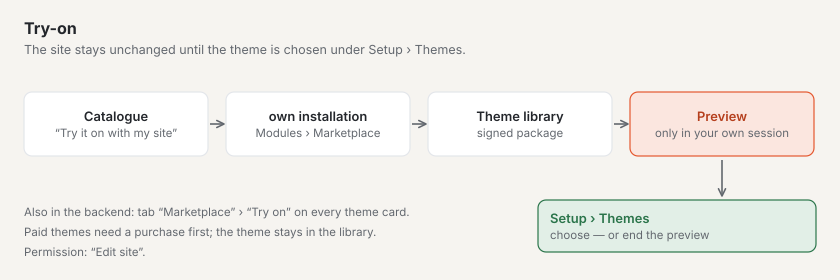

# Marketplace for installations

Every Basalto installation sees the catalogue of the basaltocms.com marketplace in the backend. Plugins reach the
installation via Composer, themes as a signed package via “Adopt theme” — there is no ZIP upload for code. You buy
paid entries on basaltocms.com first ([Buying](#buying)).

## Administration › Modules

**Administration › Modules** (`/admin/module`) — only for owners and administrators of the site. Two tabs:

| Tab | Content |
| --- | --- |
| **Modules** | installed modules and plugins, their state on this site (“on for this site” or “off …”) and what they need; “To the site” leads to the switch |
| **Marketplace** | catalogue of basaltocms.com with a Themes/Plugins filter and search; “Install” opens the installation dialog |

Modules are not switched here but per site under **Administration › Sites › Edit site › “Modules” tab**.

A **card** in the “Marketplace” tab shows name, author, price (“free” or e.g. “CHF 59”), stars with the number of
ratings, installations and the **quality check**: figures from the automatic check as markers — ✓ met, ✗ not met, ○ no
data (themes e.g. WCAG 2.2 AA contrast, dark mode, no third-party resources; plugins e.g. PHPStan, writes only via
Storage, with tests) and “Sandbox-tested on …”. Only themes have **“Try on”**.

The core reads the catalogue without a token via `GET <BASALTO_MARKETPLACE_URL>/marketplace/api/entries` and keeps it
in the cache for ten minutes; **“Reload”** fetches it at once. If basaltocms.com cannot be reached, the tab shows
“Marketplace unreachable” and tries again after one minute — the rest of the backend does not wait for it. The core
takes only known fields from the response and builds every address itself from `BASALTO_MARKETPLACE_URL`.

## Buying

Paid entries show their price in the catalogue (“CHF 59”) instead of “free”. You buy on basaltocms.com in the customer
account — the same account as for licences and the Composer token.

1. On the entry’s page, **“Buy CHF 59”**. Without signing in, you first go to the **customer account** (code by email,
   no password); there, **“Continue to purchase”** takes you back to the entry.
2. Signed in, fill in **“For which installation?”** (domain or name — shown on the receipt) and buy. You pay with
   **Stripe Checkout** using the payment methods basaltocms.com has enabled at Stripe.
3. As soon as Stripe confirms the payment (usually within seconds), the purchase appears in the customer account under
   **“Marketplace purchases”**: date, amount, installation, **updates until**, the **receipt** as a PDF and, for themes,
   the signed package. The receipt also arrives by email, in the language of the purchase.

What a purchase includes:

- **one-off per installation** — for another installation you buy again;
- **one year of updates:** all versions released up to one year after the purchase. After that, Composer and “Adopt
  theme” deliver no newer versions; a new purchase adds another year. You may keep using the versions you have;
- the author’s **Basalto Marketplace licence**. Returns within 14 days under the terms — access ends with the refund.

Without a purchase, basaltocms.com answers a paid version with **403** (with token) or **401** (without).

## Installing a plugin

The installation dialog shows the commands to copy (“Copy commands”). Run them in the installation:

```sh
composer config repositories.basalto composer https://basaltocms.com/composer
composer config http-basic.basaltocms.com <E-Mail> <Token>
composer require hersteller/karten:^1.0
php artisan migrate
```

- **Token:** the user name is the email address of your customer account on basaltocms.com, the password is the token
  from the **author account** (sign-in by code, also without entries of your own;
  [Composer token](autoren.md#composer-token)). Without a valid pair, the marketplace's Composer repository answers with 401 and Composer
  asks for credentials.
- `composer config http-basic…` writes the token into `auth.json` in the project folder. This file does not belong in
  version control (`/auth.json` is in `.gitignore`); on Laravel Cloud, store it as the secret `COMPOSER_AUTH`.
- Composer checks the SHA-1 checksum of the package when downloading (`dist.shasum`). The package additionally
  contains the marketplace's manifest and signature (`basalto-manifest.json`, `basalto-signature`).
- After `migrate`, the plugin appears under **Modules**; if it is switchable, switch it on for the site.
- A separate build for backend pages (Vue) of third-party plugins is still open
  ([Modules and plugins](../entwickler/erweiterungen.md#inertia-pages-with-a-namespace)).

Updates work as for any Composer package: `composer update hersteller/karten`, then `php artisan migrate`.

The Composer repository delivers **paid plugins** only to a buyer’s token: for each token, `packages.json` lists only the
versions it may obtain (all free ones, paid ones up to the end of the update year). So buy with the same customer
account whose token is in `auth.json`.

## Trying on a theme



On a theme’s page in the catalogue: **“Try it on with my site”** — enter the address of your Basalto site, then
**“Continue to …”**. In your own installation, **Administration › Modules › Marketplace › Try-on** asks for
confirmation; **“Try it on with my site”** fetches the theme (signed) into the [theme library](../entwickler/themes.md)
and shows the site with it in your own session. The site stays unchanged until the theme is chosen under **Setup ›
Themes**. In the “Marketplace” tab the same **“Try on”** button sits on every theme card, along with each entry’s
quality check.

- While fetching, it shows “Fetching …”. For paid themes the try-on points out that a purchase is needed first; if the
  theme does not exist (any more), it says so.
- Afterwards a banner “Preview with theme …” shows that you are looking at a preview. You end it via the banner or under
  **Setup › Themes**; that is also where you choose the theme for the site. The theme stays in the library even when you
  end the preview.
- Trying on needs the right to edit the site.

## Adopting a theme

For a theme, the dialog shows **“Adopt theme”**. Basalto

1. downloads the package from `<BASALTO_MARKETPLACE_URL>/marketplace/themes/<name>/<version>.zip` (at most 10 MB),
2. compares the SHA-256 checksum with the catalogue,
3. checks the manifest and the **signature of the marketplace key** with the public key in the core — without a valid
   signature, nothing is adopted,
4. creates the files as **drafts** in the theme editor (**Setup › Theme editor**).

They are published there like every theme change, after preview and approval ([Themes](../entwickler/themes.md)).
Until then, the current theme stays live.

Basalto downloads **paid themes** with the email and token of your customer account — from
`BASALTO_MARKETPLACE_EMAIL` and `BASALTO_MARKETPLACE_TOKEN` or, if they are missing, from `auth.json`
(`http-basic.<host>`, as for Composer). The credentials are only sent to `BASALTO_MARKETPLACE_URL`. If the dialog
reports “No purchase of this theme …”, the purchase with this account is missing or the update year is over. Without
an installation of your own with `.env` (for example on the SaaS), download the signed package in the customer
account.

## Rating

On an entry’s page, **“Ratings”** shows the average with the distribution of stars and other people’s ratings — marked
**“purchased”** (paid entry, purchase on record) or **“installed”** (download via Composer or “Adopt theme” with email
and token on record).

Signed in to the customer account: choose stars (1–5), optionally a title, then **“Your experience”** (10–2000
characters) and **“Publish rating”**. Paid entries can only be rated by people who bought them. There is one rating per
customer account and entry; **“Update rating”** replaces it (an author’s reply is then dropped), **“Delete my rating”**
removes it. Below the rating appears the first name with the initial of the last name from the customer account —
never the email address.

Below every other person’s rating is **“Report rating”** — also without a customer account: choose a reason
(“Advertising or spam”, “Offensive or demeaning”, “Contains personal data”, “Doesn’t belong to this entry”, “Other”),
optionally a note, then **“Send report”**. One report per person and rating counts; whoever wrote the rating won’t learn
who reported it. From three open reports a rating is temporarily hidden until the team decides.

## Settings

| Variable | Meaning | Default |
| --- | --- | --- |
| `BASALTO_MARKETPLACE_URL` | address of the marketplace for the catalogue, theme packages and the Composer commands shown | `https://basaltocms.com` |
| `BASALTO_MARKETPLACE_PUBLIC_KEY` | public Ed25519 key for the signature check — only for tests or a marketplace of your own | empty: `Core::MARKETPLACE_PUBLIC_KEY` |
| `BASALTO_MARKETPLACE_EMAIL`, `BASALTO_MARKETPLACE_TOKEN` | email and token of the customer account for paid themes — as a secret, never in a version-controlled file | empty: from `auth.json` |

To try it against a local product site, set `BASALTO_MARKETPLACE_URL=https://basalto.localhost`; the host for
`http-basic` then includes a port if the address has one.

## Next

- [Appearance: themes, design and image variants](../einrichtung/aussehen.md)
- [Updates](../verwaltung/updates.md)
- [Marketplace](README.md)
