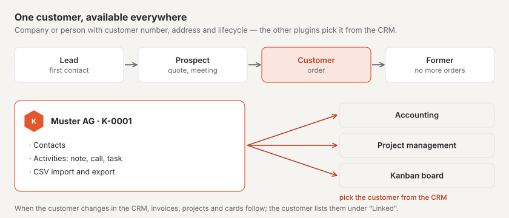
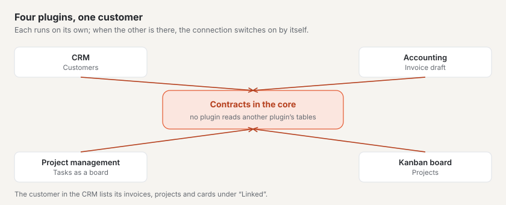

# “CRM” plugin

With the “CRM” you keep your customers in one place: companies and persons with customer number, address, contact
persons, activities and their lifecycle stage — from the first contact to the former customer. If you also have the
“Accounting”, “Project management” or “Kanban board” plugins, they pick customers straight from the CRM. The plugin is
paid — CHF 99 with one year of updates — and comes from Basalto.

## Install and switch on

1. Buy it on basaltocms.com — once per installation ([Buying](installieren.md#buying)).
2. In the backend under **Administration › Modules › Marketplace**, click **“Install”** for “CRM”
   ([Installing a plugin](installieren.md#installing-a-plugin)).
3. Switch it on under **Administration › Sites › Edit site › “Modules” tab**. It is off by default.

Afterwards **“CRM”** appears under **Content**. The number next to it counts the open tasks due today or earlier.

## Create a customer

1. Under **CRM**, click **“New customer”**.
2. Choose the **Type**: **Company** or **Person**. For a company enter the **Company name**, for a person **First name**
   and **Last name** — they then form the name.
3. Choose the **Lifecycle** (see below) and tick **“Also a supplier”** if you also buy from this customer.
4. Add address, email, phone and, if you like, **UID**, **Language**, **Website**, **Responsible** and **Notes**.
5. **“Create”**.

The CRM assigns the **customer number** itself: “K-0001”, “K-0002” and so on, without gaps. The customer then opens;
everything you change there saves itself.

| Field | What is checked |
| --- | --- |
| **Country** | two-letter ISO code, for example CH, LI, DE, AT, FR or IT; empty means Switzerland |
| **Postcode** | Switzerland and Liechtenstein: four digits from 1000 to 9658 · Austria: four digits · Germany, France, Italy: five digits · other countries: up to 12 characters |
| **UID** | if it starts with “CHE”, it has the form CHE-123.456.789, optionally followed by “MWST” |
| **Email** | a valid address; it is stored in lower case |

## Lifecycle

| Stage | Meaning |
| --- | --- |
| **Lead** | first contact, no conversation yet |
| **Prospect** | you are in talks or have sent a quote |
| **Customer** | there is an order — this is the default |
| **Former customer** | no order at the moment |

Change the stage on the customer or for several at once: select them in the list and choose **“Lifecycle: …”** at the
bottom.

## Contact persons

For a company, record under **Contact persons** the people you deal with: first name, last name, **Function**, email
and phone. One of them is the **Main contact** — the first one automatically; tick **“Main contact”** on another one to
switch. A click on a contact person opens it for editing; it can also be deleted there.

**Good to know:** With the “Project management” plugin, the email address of a contact person opens this customer’s
projects in the website’s customer account.

## Activities and tasks

Under **“Record activity”** you note what has happened with the customer or is still to come:

| Type | For |
| --- | --- |
| **Note** | what you want to remember |
| **Call**, **Meeting**, **Email** | conversations with date and optionally a contact person |
| **Task** | something to do — with **“Due on”** |

Open tasks are listed first on the customer; once the date has passed they turn red. **“Mark as done”** completes a
task. The key figure **“Tasks due”** above the list and the number next to the menu entry count all open tasks due today
or earlier.

## Find customers

The list shows all customers that are not archived, by name. The **search** finds names, customer numbers, towns, email
addresses, UID and contact persons — umlauts and upper or lower case do not matter: “zurich” finds Zürich. Several words
must all occur (“anna keller”). You can also filter by **Lifecycle** and under **List** by **Active**, **Suppliers** or
**Archive**.

## Archive instead of delete

Customers are not deleted but archived — on the customer with **“Archive”** or for several in the list. An archived
customer can still be viewed and changed but no longer appears in any selection of the other plugins; invoices, projects
and cards keep it. Under **List › Archive** you bring it back with **“Restore”**.

## Import and export

Under **CRM › Import and export**:

- **“Export all customers”** downloads all customers that are not archived as a CSV file.
- **“Download template”** gives a file with the columns and a sample row.
- **“Import a list”** accepts a CSV file.

The file uses semicolons as separators and is saved in UTF-8 — in Excel as “CSV UTF-8”. The columns are called
**Customer number**, **Type**, **Company name**, **First name**, **Last name**, **Lifecycle**, **Supplier**, **Email**,
**Phone**, **Website**, **Street and number**, **Postcode**, **Town**, **Country**, **UID**, **Language** and **Notes**;
the header row may also be in German, French or Italian, and not every column has to be present. When importing:

- A row with a **known customer number** or **email address** changes that customer instead of creating a duplicate.
  Empty cells and missing columns leave its details as they are.
- All other rows become new customers with the next customer number.
- A row with errors — such as a wrong postcode — is skipped; the message names it with its row number. The other rows
  are imported.

**Good to know:** values that Excel would read as a formula (such as a phone number starting with “+”) get an
apostrophe in front in the export. It is removed again on import.

## Working with other plugins

As soon as a customer is created, the other plugins can pick it — without any further step:

| Plugin | What it does with the customer |
| --- | --- |
| **Accounting** | customers as debtors for invoices, suppliers as creditors |
| **Project management** | projects per customer; the email addresses of customer and contact persons open the projects in the customer account |
| **Kanban board** | attach cards to customers |

If you change the name or address in the CRM, the other plugins take over the change. What they know about a customer —
invoices, projects, cards — is listed on the customer under **“Linked”**.

## Data protection

- **Access and erasure** per email address are handled by the administration under “Administration › Users” (or
  `php artisan basalto:privacy`): the information lists customers with this address including activities and contact
  persons. Erasure removes contact persons with this address; a customer who is a person loses name, address, phone,
  notes and activities — the customer number remains so that invoices and projects keep their reference. For a company
  only the email address is removed.
- The **export of a site** does not take the customers along — use the CSV export for that.

## If something goes wrong

| Sign | Cause | Solution |
| --- | --- | --- |
| “Postcodes in Switzerland and Liechtenstein have four digits (1000–9658).” | postcode and country do not match | enter the right ISO code under **Country**, such as DE for Germany |
| “A company needs a company name.” | type “Company” without company name | enter the company name or choose the type “Person” |
| A customer is missing from the selection in accounting or a project | it is archived, or the CRM is off for this site | restore it under **List › Archive** or switch on the CRM under the site’s “Modules” |
| “The file has no recognisable header row …” | the first row names no known columns | download the template and use its header row |
| Umlauts are wrong after the import | the file is not saved in UTF-8 | choose “CSV UTF-8” in Excel |
| A customer exists twice after the import | neither customer number nor email address matched | archive the duplicate; next time include the **Customer number** column from the export |

## Next

- [For installations](installieren.md)
- [Marketplace](README.md)
- [“Club fees with QR-bill” plugin](plugin-vereinsbeitraege.md)
