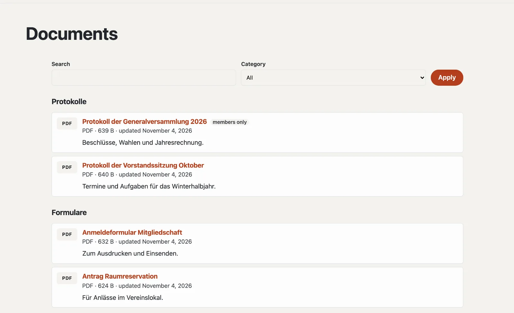

# “Documents and downloads” plugin

With “Documents and downloads” you offer files for download: minutes, forms, price lists, statutes. Visitors find them
by category on a page of their own; if you upload a new version, the link stays the same. Documents marked “Members
only” can only be downloaded by signed-in members. The plugin is free and comes from Basalto.



## Install and switch on

1. In the backend under **Administration › Modules › Marketplace**, click **“Install”** for “Documents and downloads”
   ([Installing a plugin](installieren.md#installing-a-plugin)).
2. Switch it on under **Administration › Sites › Edit site › “Modules” tab** for the sites — it is off by default.

Afterwards the **“Documents”** tab appears under **Content**.

## Create the documents page

1. **Pages › New** (or an existing page), name for example “Downloads”.
2. **“Expert”** tab › **“Mount a module”** › **“Documents”**, save.
3. Publish the page as usual.

The page shows all documents by category, with a search from six documents on. `?kategorie=<id>` shows only one
category — handy as a link from the menu.

## Upload a document

Under **Content › Documents**, **“Upload document”**: choose the file, a title (empty: from the file name) and a
category. It is on the documents page straight away. PDF, Word, Excel, PowerPoint, OpenDocument, RTF, text, CSV, ZIP
and images (JPEG, PNG, WebP) up to 20 MB are allowed.

| In the document | |
| --- | --- |
| Title, description | per site language |
| Category | for the groups on the documents page |
| Members only | guests see the document with a padlock and sign in to download it |
| Show on the documents page | without the tick the document is **hidden** — its link then does not work |
| Address under the documents page | suggested from the title |
| **Upload new version** | replaces the file, the link stays; the last five versions remain under “Earlier versions” |

The **“Downloads”** column counts how often a file was downloaded.

## Categories

Under **Content › Documents › Categories** you create categories with a name, an ID (for `?kategorie=` and Lava) and an
order. Without categories, all documents appear in one list. If you delete a category, its documents remain — without
a category.

## Members only

With the **“Members”** module, guests see a “Members only” document with a padlock and sign in to download it
([Members](../redaktion/mitglieder.md)). If the module is off, nobody except the editorial team can download such a
document.

## Documents on other pages

The Lava part **“Documents”** shows the documents of a category on any page: under **Setup › Layouts › “Parts” tab**,
**“+ Instance”** (category, number, heading), or in the theme:

```lava

```

## Good to know

- Downloads go through the site, not through a direct path to the file — so access and counter always apply.
- PDF files and images open in the browser; everything else is downloaded.
- Files do not go along with a site’s export; move them with the backup.

## Next

- [Members](../redaktion/mitglieder.md)
- [For installations](installieren.md)
- [Marketplace](README.md)
