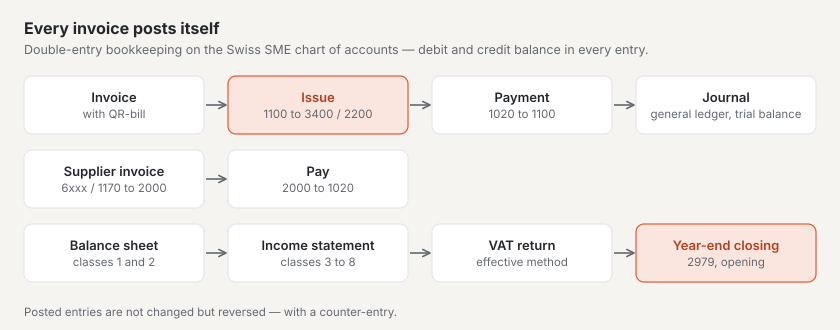

# “Accounting” plugin

With “Accounting” you keep your company’s books in Basalto: double-entry bookkeeping based on the Swiss SME chart of
accounts with journal, general ledger and trial balance, debtors and creditors, invoices with the Swiss QR-bill,
supplier invoices, payments, balance sheet, income statement, VAT return using the effective method and year-end
closing. The plugin is paid — CHF 149 with one year of updates — and comes from Basalto.

## Install and switch on

1. Buy it on basaltocms.com — once per installation ([Buying](installieren.md#buying)).
2. In the backend under **Administration › Modules › Marketplace**, click **“Install”** for “Accounting”
   ([Installing a plugin](installieren.md#installing-a-plugin)).
3. Switch it on under **Administration › Sites › Edit site › “Modules” tab**. The plugin is off by default.

Afterwards **“Accounting”** appears under **Content**. The number next to it counts the overdue invoices.

## Enter company and account

Under **Accounting › Settings** you enter the details for every invoice and the QR payment part. They save themselves.

| Field | |
| --- | --- |
| **Company name**, **Street**, **House number**, **Postcode**, **Town**, **Country** | sender of the invoice and “Account / Payable to” in the payment part; Switzerland or Liechtenstein |
| **IBAN or QR-IBAN** | the company’s account. With a QR-IBAN every invoice carries a **QR reference**, with an ordinary IBAN a **Creditor Reference (RF)** |
| **BESR-ID** | only if your bank has issued one for the QR-IBAN — otherwise leave it empty |
| **UID/VAT number** | appears on every invoice, for example “CHE-123.456.789 MWST” |
| **Liable for VAT** | without the tick new items carry no VAT and the invoice states “Not liable for VAT.” |
| **VAT rate of new items**, **Income account of new items** | defaults for items — also for invoices handed over by other plugins |
| **Account for payments** | the bank account payments are posted to (1020 Bank by default) |
| **Payment term (days)** | sets “Payable by” when an invoice has no date of its own (30 by default) |
| **Sentence on the invoice** | for example a thank-you for the order |

## Create the first financial year

Entries always belong to an open financial year. Under **Accounting › Financial years** enter the **Start** and
**End** and choose **“Create”**. The first financial year creates:

- the **chart of accounts** with the common accounts of the Swiss SME chart of accounts, from 1000 Cash and 1020 Bank
  through 1100 Trade receivables, 2000 Trade payables and 2200 VAT owed to 3400 Revenue from services, 6000 Premises
  expenses and 2979 Annual profit or loss;
- the **VAT rates** from 2024: output tax 8.1 % (UN81), 2.6 % (UR26) and 3.8 % (UB38), input tax on materials and
  services (VM81, VM26, VM38, account 1170) and on investments and other operating expenses (VI81, VI26, account 1171),
  each with its box of the VAT return.

Under **Chart of accounts** you add your own accounts (numbers with four to six digits) and rename existing ones. The
**type** — assets, liabilities and equity, income, expenses or closing — follows from the class and determines whether
the account appears in the balance sheet or in the income statement. An account without the tick **“Offer in selection
lists”** keeps its entries but no longer appears in any selection. If a tax rate changes, better create a new VAT code
and set the old one to inactive — posted amounts keep their rate.

## Debtors and creditors

**Debtors and creditors** lists the personal accounts: **debtors** receive your invoices, **creditors** send you
invoices. The **Open items** column shows what is still outstanding; a click opens the personal account with its
invoices.

- **Without a CRM** you create personal accounts here: type, name or company, contact person, address, email and
  UID/VAT number. The accounting assigns the number itself (“DEB-0001”, “KRE-0001”).
- **With the “CRM” plugin** you choose a customer straight from your customer list on an invoice. The personal account
  is created on first use; you maintain name and address in the CRM and the accounting follows every change. For
  supplier invoices you can choose the customers marked as **“Supplier”** in the CRM. A personal account that existed
  before the CRM links itself to the customer with the same email address.

## Write an invoice

1. In the **Accounting** overview, under **“New invoice”**, choose the **Debtor** and a **Title** and click **“Create
   draft”**.
2. In the draft, under **“Add item”**, enter the text, **Quantity**, **Unit**, **Price excl. VAT**, **VAT** and
   **Income account** and click **“Add”** — as many items as needed. The totals work themselves out: the VAT per rate
   on the sum of its items, rounded to the centime.
3. At the top, add an **Invoice date**, **Payable by** and an **Introduction** if you wish — if left empty, the day of
   issue and the payment term from the settings apply. **“Preview (PDF)”** shows the invoice marked “Draft”.
4. **“Issue”**: the invoice gets the year’s next number (“2027-0001”), its payment reference and is posted — trade
   receivables on the debit side, income and VAT owed on the credit side.

If something is still missing — items, debtor, account details or an open financial year for the invoice date — the
draft names it under **“Not ready yet”**. **“PDF”** opens the issued invoice with the QR payment part for sending. A
draft can be deleted; an issued invoice without payment can only be **reversed**: a counter-entry cancels the entry,
and the invoice stays in the list with the status **Cancelled**.

## Record payments

In an open invoice, under **“Record payment”**, enter the **Amount** (the open amount is suggested) and **“Received
on”** and click **“Record”**. The accounting posts the account for payments against the receivables. Partial payments
are possible; once the amount is covered, the invoice is **Paid**. The overview list filters by **Open**, **Drafts**,
**Overdue**, **Paid**, **Cancelled** and **All**.

## Record supplier invoices

Under **Supplier invoices**, in **“Record supplier invoice”**, choose the **Creditor** and enter the text, **Invoice
date**, **Amount incl. VAT**, **Expense account** and the **Input tax** rate. **“Record and post”** works out the input
tax from the amount and posts the expense and input tax (1170 or 1171) against the payables. In the supplier invoice,
**“Record payment”** posts the payment from the account for payments; without a payment it can be reversed.

## Post by hand

The **Journal** lists all entries of a financial year with **Voucher no.**, date, text, **Debit**, **Credit** and
source. Under **“Record journal entry”** you post yourself — as a journal entry “debit to credit”:

1. Enter the **Date**, **Voucher** and **Text**.
2. Choose the **Debit** account and the **Credit** account and enter the **Amount incl. VAT**.
3. Optionally choose a **VAT code**: with output tax the tax share goes from the income account to 2200, with input
   tax from the expense or fixed asset account to 1170 or 1171.
4. **“Post”** — the entry gets the next voucher number.

Debit and credit must balance in every entry. Posted entries are never changed: open a wrong entry and choose
**“Reverse”** — a counter-entry with debit and credit swapped cancels it, then post correctly.

## General ledger and reports

- **General ledger:** a click on an account in the **Chart of accounts** shows all its entries in the selected
  financial year with **Contra account** and running **Balance**; the new year starts with the opening entry.
- **Trial balance:** debit, credit and balance per account — total debits equal total credits.
- **Balance sheet:** assets (current and non-current assets) and liabilities and equity (current and non-current
  liabilities, equity) at the end of the financial year, with the **Previous year**. As long as the year is not closed,
  the result appears as the line **“Profit/loss (not closed)”** under equity.
- **Income statement:** income and expenses by classes 3 to 8, with the previous year; at the end the **Annual profit**
  or **Annual loss**.

The reports choose the financial year at the top of the list; a click on an account opens its general ledger.

## VAT return

Under **VAT return** the accounting calculates using the **effective method** with **agreed consideration** — the date
of the invoice or entry counts. Choose the **quarter**, the **half-year** or the **whole year**. The list shows the boxes
of the form of the Federal Tax Administration (ESTV) with amounts excl. VAT:

| Box | |
| --- | --- |
| **200** | Total agreed consideration (revenue in class 3) |
| **289** | Turnover without VAT code — check tax-exempt and excluded turnover here (boxes 220 to 280) |
| **299** | Total taxable turnover |
| **303**, **313**, **343** | Supplies at 8.1 %, 2.6 % and 3.8 % with the tax |
| **399** | Total tax due |
| **400**, **405**, **479** | Input tax on materials and services, on investments and other operating expenses, total |
| **500** or **510** | amount payable or credit balance |

The return is an aid: compare the figures with the ESTV form before submitting, and enter reductions of
consideration, input tax corrections and boxes 220 to 280 yourself.

## Close the financial year

Under **Financial years**, the oldest open year shows **“Close”**. The year-end closing

1. transfers the result with a closing entry to account **2979 Annual profit or loss**,
2. locks the year — no more entries are possible afterwards,
3. creates the following year if it is missing and opens it with the balances of the balance sheet (opening entry).

You then post the appropriation of profit — for example from 2979 to 2970 Profit or loss carried forward — yourself in
the new year. The income statement of the closed year still shows the result.

## With CRM and project management

- **CRM:** you choose customers and suppliers from the CRM; the customer in the CRM lists their invoices with number,
  amount and status under “Linked”.
- **Project management:** tracked time of a project arrives in the accounting as an invoice draft — with the default
  VAT rate and the default income account. The draft states which plugin it comes from. If you delete it or reverse the
  invoice, project management releases the time for billing again.

## In the customer account

Customers see the **“Invoices”** area in their customer account with their issued invoices — all whose debtor carries
their email address, and with the CRM also the invoices to the company they belong to as a contact person. Open invoices
appear under “Up next”, and the PDF with the QR payment part can be downloaded.

## Data protection and retention

- **Information** per email address (under “Administration › Users” or `php artisan basalto:privacy`) lists the personal
  accounts and invoices.
- **Deletion:** invoices, entries and personal accounts are business records and must be kept for ten years. They
  remain with name and address; the email address is deleted so that the invoices no longer appear in the customer
  account. Personal accounts without any invoice or entry are removed entirely.
- The **export of a site** does not take the accounting along — it stays with the original site.

## Good to know

- Invoices are calculated to the centime, without rounding to five centimes — the QR-bill is paid electronically.
- Accounting takes work off your hands but does not replace the legal obligations of bookkeeping and VAT. If in doubt,
  have the chart of accounts, the closing and the VAT return checked by your fiduciary.
- Payroll, fixed asset accounting, the net tax rate method and currencies other than CHF and EUR are not included.

## If something goes wrong

| Sign | Cause | Solution |
| --- | --- | --- |
| **“No financial year yet”** | there is no financial year yet | create the first one under **Financial years** |
| **“Account details missing”** | the company’s name, IBAN, postcode or town is missing | complete them under **Settings** |
| **“Not ready yet”** in the draft | items, debtor, account details or financial year are missing | complete the steps named |
| “There is no financial year for …” | the date lies outside all financial years | create the matching financial year or correct the date |
| “The financial year … is closed” | the date lies in a closed year | post in the open year |
| “Debit and credit do not balance” | an entry does not balance | check the amounts of the lines |
| “Output tax needs an income account …” | the VAT code does not match the accounts | post output tax codes with an income account, input tax codes with an expense or fixed asset account |
| **“Reverse”** is missing | the invoice already has a payment | first clarify whether the payment is refunded; post a credit note by hand |
| No CRM customer in the selection | the CRM is off for this site or the customer is archived | switch the CRM on or restore the customer in the CRM |

## Next

- [“CRM” plugin](plugin-crm.md)
- [“Project management” plugin](plugin-projektmanagement.md)
- [Marketplace for installations](installieren.md)
- [Marketplace](README.md)
