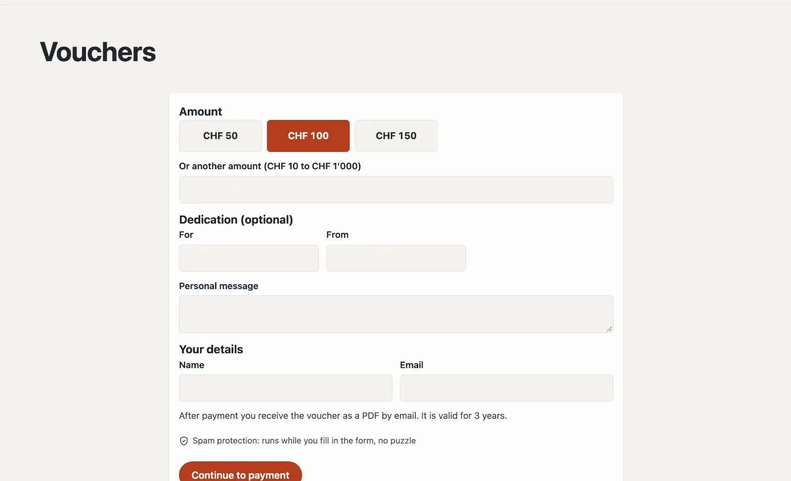

# “Sell vouchers” plugin

With “Sell vouchers” you offer gift vouchers online: choose an amount, add a dedication, pay by card or TWINT through
your own Stripe account — and straight afterwards the voucher arrives in the inbox as a PDF with a code. In the
backend you redeem it in full or in part and see the remaining value. The plugin costs CHF 99 with one year of updates
and comes from Basalto.



## Install and switch on

1. Buy it in the marketplace on basaltocms.com ([Buying](installieren.md#buying)), then in the backend under
   **Administration › Modules › Marketplace**, click **“Install”** for “Sell vouchers”
   ([Installing a plugin](installieren.md#installing-a-plugin)).
2. Switch it on under **Administration › Sites › Edit site › “Modules” tab** for the sites — it is off by default.
3. Connect your Stripe account under **Administration › Payments** ([Payments](../verwaltung/zahlungen.md)).

Afterwards the **“Vouchers”** tab appears under **Content**.

## Create the voucher page

**Pages › New**, name for example “Vouchers”, **“Expert”** tab › **“Mount a module”** › **“Vouchers”**, publish.
There visitors choose an amount (or another one within your limits), write **For**, **From** and a **personal
message** if they wish, and enter their name and email. **“Continue to payment”** leads to Stripe.

After payment:

- the buyer receives an email with the voucher as a PDF (amount, dedication, code, valid until, your address),
- the page shows the code and **“Download voucher (PDF)”**,
- your team receives a “Voucher sold” message.

If nothing is paid, the order lapses — no voucher is created.

You place a teaser with the amounts as buttons on any page with the Lava part **“Vouchers”**:

```lava

```

## Set up sales

At the bottom of **Content › Vouchers** under **“Sales”**:

| Setting | |
| --- | --- |
| Amounts to choose from | separated by commas, e.g. 50, 100, 150 |
| Free amount allowed, from, up to | another amount within these limits |
| Valid (years) | from the purchase; have the period checked legally for your business |
| Note on the voucher | e.g. “Redeemable in the restaurant and at the bar” |

## Redeem

At the top of **Content › Vouchers** under **“Redeem”**: **code** (hyphens, spaces and lower case do not matter) and
**amount**, if you wish a note such as “Invoice 1043”. Basalto deducts the amount and shows the remaining value; it
does not allow more than the remaining value, nor an expired or cancelled voucher. With a remaining value of 0 the
voucher is **used up**.

A voucher’s page shows every redemption with date, amount, note and person, plus the **PDF**, **“Extend by one year”**
and **“Cancel”**. You issue a refund for a cancellation in the Stripe Dashboard.

## Vouchers without online purchase

**“Issue a voucher”** at the bottom of **Content › Vouchers** creates a valid voucher — sold at the till or given
away —, with the PDF by email if you wish. Issuing and redeeming also work without payments set up.

## Privacy

The buyer’s name and email and the dedication are stored. If you delete a person’s details under
**Administration › Users** ([Users](../verwaltung/benutzer.md)), the voucher stays valid. Two years after expiry the
nightly clean-up removes the personal details; orders never paid are removed after one day.

## Next

- [Payments](../verwaltung/zahlungen.md)
- [For installations](installieren.md)
- [Marketplace](README.md)
