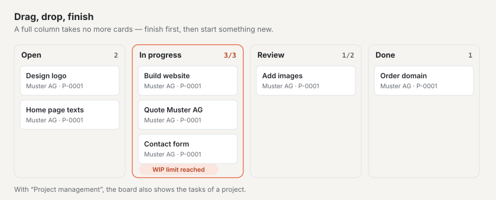

# “Kanban board” plugin

With the “Kanban board” you plan work using the Kanban method: cards move from column to column, from “Open” to
“Done”, and a **WIP limit** (work in progress — at most this many cards in a column at a time) makes sure that what
has been started gets finished first. Cards carry a responsible person, a due date and labels; with the plugins “CRM”
and “Project management” you attach them to customers and projects. The plugin is free and comes from Basalto.

## Install and switch on

1. In the backend under **Administration › Modules › Marketplace**, click **“Install”** for “Kanban board”
   ([Installing a plugin](installieren.md#installing-a-plugin)).
2. Switch it on under **Administration › Sites › Edit site › tab “Modules”** for the sites that should use it — it
   is off by default.

The menu item **“Kanban board”** then appears under **Content**. The number next to it is the number of open cards
whose due date has passed.

## Create a board

1. Under **Content › Kanban board**, enter a **Name** and, if you like, a **Description** in the form **“New board”**.
2. Click **“Create”** — the board opens.

Every new board comes with four columns and three labels, which you can adjust afterwards under **“Settings”**:

| Column | WIP limit | |
| --- | --- | --- |
| **Open** | none | everything that has not been started |
| **In progress** | 3 | |
| **Review** | 2 | |
| **Done** | none | counts as done — cards get their completion date here |

The labels are called **Urgent** (red), **Waiting** (yellow) and **Idea** (lava).

## Add and move cards

- **Add:** Below every column there is the field **“+ Add card”**. Type a title and press Enter — the card appears at
  the bottom of the column.
- **With the mouse:** drag a card and drop it where you want it, in the same or another column.
- **With the keyboard:** below every card there are four arrow buttons, which you reach with the Tab key — **←** and
  **→** move the card to the column on the left or right (at the bottom), **↑** and **↓** move it up or down by one
  place.
- **Open:** a click on the title opens the card.

The board shows the new state straight away. On narrow screens the columns are stacked.

Each card shows its title, below it the customer and project, the labels, the due date — in red when it has passed
and the card is not in a done column — and the responsible person.

## The WIP limit

At the top right of every column you see how many cards it holds, with a limit for example **“2/3”**. Once the limit
is reached, the column takes no more cards: neither moving nor “Add card” works, and the board reports **“The column
“In progress” has reached its WIP limit (3).”** First finish a card and move it on — that is how the Kanban method
works.

- Reordering inside a full column and moving cards out always works.
- If you lower the limit below the number of cards already in the column, the column gets a red border until enough
  cards have moved on.
- Empty or 0 means: no limit.

## Edit a card

A click on the title opens the card. It saves itself.

| Field | |
| --- | --- |
| **Title**, **Description** | what it is about |
| **Responsible** | a person who works in the backend of this site — they get a notification |
| **Due on** | once the date has passed, it appears in red on the board (except in a done column) |
| **Label “…”** | the labels of the board to tick |
| **Customer** | only with the plugin “CRM”: a customer from your customer list |
| **Project** | only with the plugin “Project management”: a running project |

At the top you find **“Go to board”**, **“Archive”** and **“Delete”**.

## Set up columns and labels

On the board, **“Settings”** opens:

- **Board:** name, description and up to six **labels** with a colour (grey, green, yellow, red, lava). If you rename
  a label, it stays on its cards; if you empty the name, it disappears from them.
- **Columns:** a click on a column opens its name, **WIP limit** and **“Cards here count as done”**. **“Move left”**
  and **“Move right”** change the order. A column can only be deleted once no card is left in it — not even an
  archived one.
- **New column:** name, WIP limit, done — **“Create”** adds it on the right.
- **Archived cards:** **“Restore”** puts them back at the bottom of their column, as long as the WIP limit allows it.

## With CRM and project management

The Kanban board works on its own. If the other plugins are installed and switched on for the site, their data joins
in by itself:

- **With the [“CRM” plugin](plugin-crm.md)** you choose the **customer** on a card. If its name changes in the CRM,
  the card follows. In the CRM, the customer lists its open cards among the linked records.
- **With the [“Project management” plugin](plugin-projektmanagement.md)** you choose the **project**; the project shows
  its cards in the same way. In addition, **“As Kanban board”** in a project opens its tasks as a board: the columns
  are the states of the tasks, moving changes the state, and the tasks stay in project management. You set the WIP
  limits of these boards below the board under **“WIP limits”**. The overview lists such boards under **“More
  boards”**.

If a plugin is missing, the card has no field for it, and a note says what the plugin would add. Whatever is already
attached to a card is kept and shown at the top of the card.

## Archive and delete

- **Boards** are archived in the overview (tick them, then **“Archive”**) or under **“Settings”**. The filter
  **“Archive”** shows them; **“Restore”** brings them back. A board can only be deleted permanently from the archive —
  with all its columns and cards.
- **Cards** are archived from the card; they disappear from the board and are listed under **“Settings”** with the
  archived cards.

## Notifications

When a card is assigned to you, the bell shows **“Card assigned”** — by e-mail too if you wish
([Notifications](../redaktion/index.md#notifications)). Anyone who assigns a card to themselves gets no message.

## Good to know

- Boards and cards belong to their site. They are not included when a site is exported — they are work in progress
  with people and references to other plugins.
- Who may create and move cards is controlled by the area **“Kanban board”** in the roles
  ([Roles](../verwaltung/rollen.md)).

## If something goes wrong

| Sign | Cause | Solution |
| --- | --- | --- |
| “The column “…” has reached its WIP limit (…).” | the column is full | first finish a card in it and move it on — or raise the limit under “Settings” |
| The fields **Customer** or **Project** are missing | the plugin “CRM” or “Project management” is not installed or is off for the site | install it or switch it on under Edit site › “Modules” |
| “The column still has cards …” | there are cards in the column, including archived ones | move or delete the cards, then delete the column |
| “As Kanban board” is missing in the project | the Kanban board is off for the site | switch it on under Edit site › “Modules” |
| An archived card cannot be restored | its column has reached the WIP limit | make room in the column or raise the limit |

## Next

- [“CRM” plugin](plugin-crm.md)
- [“Project management” plugin](plugin-projektmanagement.md)
- [For installations](installieren.md)
- [Marketplace](README.md)
