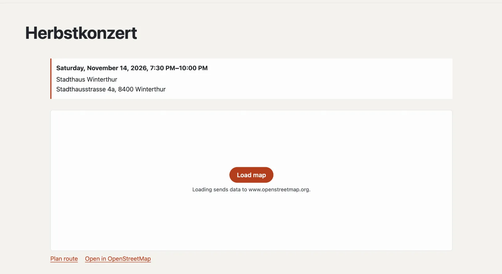

# “Map without tracking” plugin

“Map without tracking” shows a place on an OpenStreetMap map — but only once the visitor clicks on it. Until then the
page loads nothing from a third-party server. Basalto finds addresses in Switzerland itself, once, through the search
of the federal geodata (geo.admin.ch). Below the map are “Plan route” and “Open in OpenStreetMap”. The plugin is free
and comes from Basalto.



## Install and switch on

1. In the backend under **Administration › Modules › Marketplace**, click **“Install”** for “Map without tracking”
   ([Installing a plugin](installieren.md#installing-a-plugin)).
2. Switch it on under **Administration › Sites › Edit site › “Modules” tab** for the sites — it is off by default.

## Place a map

The map is a Lava part: under **Setup › Layouts › “Parts” tab**, click **“+ Instance”** for “Map” and fill in the
settings. Insert the instance in a page’s editor with **“+ Lava part”** — for example on the “Contact” page — or into a
region of a layout ([Structure: layouts, parts and templates](../einrichtung/aufbau.md)).

| Setting | |
| --- | --- |
| Address | e.g. “Stadthausstrasse 4a, 8400 Winterthur” — Basalto looks up the place once and remembers it |
| Label | shown in bold below the map, e.g. “Town hall” |
| Zoom | 3 (far out) to 19 (front door), 16 by default |
| Height | in pixels, 200 to 800, 360 by default |

In the theme it works directly; instead of an address, coordinates also work:

```lava


```

With the [“Events” plugin](plugin-veranstaltungen.md), every event with an address shows its map automatically.

## Check and correct places

Under **Content › Map places** every address that shows a map is listed with the place found and its source.

| Action | Effect |
| --- | --- |
| **Check address** | looks up an address in advance — so you see whether it is found |
| **Latitude, longitude** | set manually, e.g. for an entrance behind the building; the source becomes “by hand” and Basalto stops looking it up |
| **Search again** | asks geo.admin.ch again; manually set coordinates are replaced |
| **Forget** | removes the place; Basalto looks it up again the next time a map is shown |

geo.admin.ch knows addresses, places and names in Switzerland. If the search does not find an address, a link “Search
on OpenStreetMap” appears instead of the map; Basalto tries again after seven days. If the service is not responding,
Basalto remembers nothing and tries again on the next request.

## Privacy

- Until **“Load map”** is clicked, the visitor’s browser contacts no third-party server. Anyone who has allowed
  “External content” in the cookie settings sees the map straight away.
- Only with the click does the map load from OpenStreetMap (www.openstreetmap.org); OpenStreetMap then receives the IP
  address and the browser’s details. Mention this in your site’s privacy policy.
- The geo.admin.ch search is done by Basalto’s server — with the address from the block, never with visitors’ data.
  The places found go along with a site’s export.

## Next

- [“Events” plugin](plugin-veranstaltungen.md)
- [For installations](installieren.md)
- [Marketplace](README.md)
