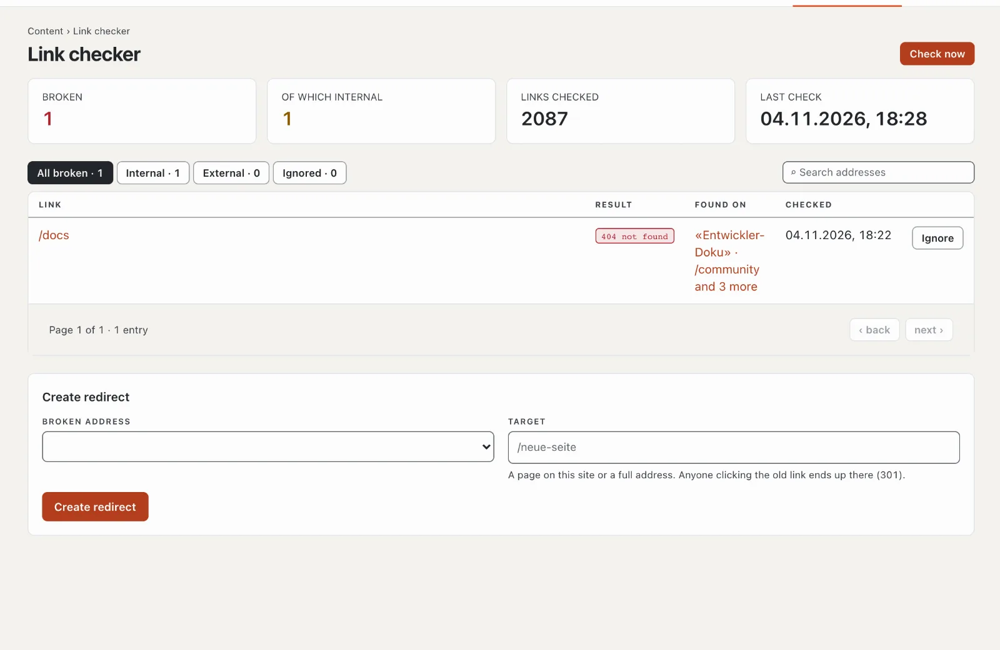

# “Link checker” plugin

The link checker finds broken links and images on your site — to your own pages that no longer exist and to external
addresses that no longer respond. It shows which page the link is on and, for internal errors, creates a redirect with
one click. The plugin is free and comes from Basalto.

## Install and switch on

1. In the backend under **Administration › Modules › Marketplace**, click **“Install”** for “Link checker”
   ([Installing a plugin](installieren.md#installing-a-plugin)).
2. Switch it on under **Administration › Sites › Edit site › “Modules” tab** for the sites — it is off by default.

Afterwards the **“Link checker”** tab appears under **Content**.

## When it checks

- **Every night** between 1 and 5 a.m. (the site’s time zone), by itself — provided the installation’s schedule is
  running ([Operations](../verwaltung/betrieb.md)).
- **At any time** with **“Check now”**. Large sites take a few minutes; the page shows how far the check has got.

All published pages in all languages are checked: links, images and embedded files. Basalto checks internal addresses
directly, without a detour over the network; it queries external addresses politely, one after the other.

## Read the results

| Column | |
| --- | --- |
| Link | the broken address |
| Result | e.g. “404 not found”, “410 removed”, “Timed out”, “No connection” |
| Found on | the pages the link is on — a click opens them |

At the top you choose **“All broken”**, **“Internal”**, **“External”** or **“Ignored”**; the search filters by address.

## Fix a broken link

- **Correct it on the page:** open the page and adjust the link in the editor. At the next check it disappears.
- **Create redirect** (internal addresses only): the old address then forwards permanently (301) to a new target — a
  page of the site or a full address. The redirect then also appears under **Pages › Redirects**.
- **Ignore:** for links that are intentional or only occasionally fail to respond. Under “Ignored” you bring them back
  with **“Report again”**.

## In the statistics

Under [Statistics](../verwaltung/statistik.md), the **Link checker** tab shows broken links after the last check with the number of pages they appear on, compared with the previous period.

## If something goes wrong

| Sign | Cause | Solution |
| --- | --- | --- |
| “Not checked yet” stays | the installation’s schedule is not running | set up cron ([Operations](../verwaltung/betrieb.md)) or “Check now” |
| an external page is “broken” but opens in the browser | it blocks automated requests | “Ignore” |
| the check takes long | many pages or slow external servers | it continues in stages; reload later |

## Next

- [Redirects](../redaktion/seiten.md#redirects)
- [For installations](installieren.md)
- [Marketplace](README.md)
