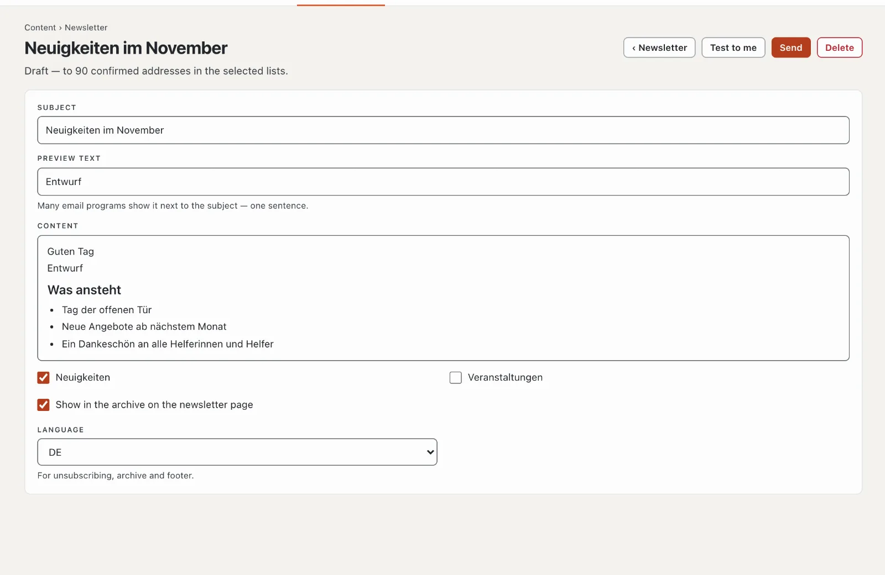

# “Newsletter” plugin

With “Newsletter” you write to your subscribers regularly: subscription with confirmation by email (double opt-in),
several lists to choose from, unsubscribing with one click and an archive of the issues on your website. Sending goes
through a sending service such as Brevo, Mailjet or Infomaniak. The plugin costs CHF 99 with one year of updates and
comes from Basalto.



## Install and switch on

1. Buy it in the marketplace on basaltocms.com ([Buying](installieren.md#buying)), then in the backend under
   **Administration › Modules › Marketplace**, click **“Install”** for “Newsletter”
   ([Installing a plugin](installieren.md#installing-a-plugin)).
2. Switch it on under **Administration › Sites › Edit site › “Modules” tab** for the sites — it is off by default.

Afterwards the **“Newsletter”** tab appears under **Content**.

## Set up

1. **Newsletter page:** **Pages › New**, name for example “Newsletter”, **“Expert”** tab › **“Mount a module”** ›
   **“Newsletter”**, publish. Visitors subscribe, confirm, unsubscribe and read the archive there.
2. **Lists:** under **Content › Newsletter › Lists and sending** at least one list, such as “News”.
   **“Selectable when subscribing”** makes it public; only the team fills internal lists.
3. **Sending service:** same page, further down. Simple hosting allows only about a hundred emails per hour — so
   newsletters go through a service:

| Service | What you enter |
| --- | --- |
| Brevo | SMTP login and SMTP key from your Brevo account |
| Mailjet | API key as username, secret key as password |
| Infomaniak | address and password of a mailbox at Infomaniak |
| Own SMTP server | server, port (587 or 465), username, password |

For Brevo, Mailjet and Infomaniak, Basalto fills in server and port itself. The **sender address** must be verified
with the service, and your domain needs SPF and DKIM for the service — otherwise newsletters end up in spam. Set
**Emails per minute** according to your plan. **“Check connection”** signs in to the server once. The password stays
encrypted on the server; left empty, the stored one remains.

## Subscribe and unsubscribe

- The **subscription** is on the newsletter page and, as the Lava part **“Newsletter sign-up”**, on any page, for
  example in the footer:

```lava

```

  With `list: "Veranstaltungen"` the part subscribes to that list only; otherwise visitors choose among the public ones.
- After submitting, the person receives an email with **“Confirm subscription”**. Only then are they subscribed; the
  link is valid for seven days. Basalto keeps the proof: time of consent, page of the subscription, time of
  confirmation.
- **Unsubscribing** takes one click: through the link at the bottom of every issue (with a button on the newsletter
  page) or through the unsubscribe button that email programs such as Gmail show next to the sender.

## Send an issue

1. **Content › Newsletter** › **“New issue”** with the subject.
2. **Preview text** (one sentence that many email programs show next to the subject), **content** in the editor, tick
   the **lists**. Changes save themselves.
3. **“Test to me”** sends the issue to your own address.
4. **“Send”** — the question names the number of recipients. Then sending starts at the pace of the service; the page
   shows how many were sent and how many failed, with the reason.

With **“Show in the archive on the newsletter page”** the issue appears in the archive after sending — and every email
has the link **“View in browser”**. **“Copy as a new issue”** takes a sent issue as a template.

## Subscribers

**Content › Newsletter › Subscribers** shows **Subscribed**, **Awaiting confirmation** and **Unsubscribed**, with a
search, a filter by list, bulk actions (unsubscribe, delete) and **“Confirmed as CSV”**. **“Add an address”** sends the
request for confirmation — or subscribes the person straight away if they have demonstrably agreed in writing.

## Privacy

The nightly clean-up deletes unconfirmed subscriptions after seven days and unsubscribed ones after 30 days. A
person’s addresses are part of **information** and **deletion** under **Administration › Users**
([Users](../verwaltung/benutzer.md)). Subscribers do not go along with a site’s export — their consent applies to the
previous site.

## In the statistics

Under [Statistics](../verwaltung/statistik.md), the **Newsletter** tab shows new subscriptions, unsubscriptions, issues sent and emails sent — subscriptions per list, compared with the previous period.

## If something goes wrong

| Sign | Cause | Solution |
| --- | --- | --- |
| “No connection to the sending service” | username, password or port wrong | check the access with the service, port 587 or 465 |
| emails arrive in spam | sender not verified, SPF/DKIM missing | verify the domain with the service, set the DNS records |
| sending stops | the installation’s schedule is not running | set up cron ([Operations](../verwaltung/betrieb.md)) |

## Next

- [Users](../verwaltung/benutzer.md)
- [For installations](installieren.md)
- [Marketplace](README.md)
