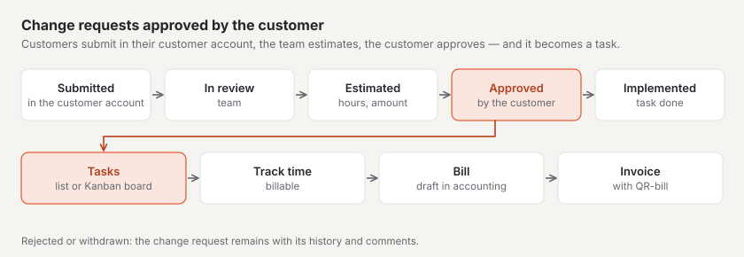

# “Project management” plugin

With “Project management” you run projects for your customers: milestones, tasks, tracked time and budget in one place.
Your customers submit **change requests** in their customer account, see your **effort estimate** and approve it — it
then becomes a task. It works together with the “CRM”, “Accounting” and “Kanban board” plugins by itself. The plugin is
paid — CHF 129 with one year of updates — and comes from Basalto.

## Install and switch on

1. Buy it on basaltocms.com — once per installation ([Buying](installieren.md#buying)).
2. In the backend under **Administration › Modules › Marketplace**, click **“Install”** for “Project management”
   ([Installing a plugin](installieren.md#installing-a-plugin)).
3. Switch it on under **Administration › Sites › Edit site › “Modules” tab** — it is off by default.

Afterwards **“Projects”** appears under **Content**. The number next to it counts the change requests that have just
come in and are waiting for your team.

## Create a project

1. Under **Content › Projects**, enter the **name** in the **“New project”** form.
2. Choose or enter the **customer**, and if you like the **hourly rate** and **budget (hours)**.
3. **“Create”** — the project gets the site’s next number and opens.

The list shows the running projects (scheduled, active, paused); the buttons above it filter by **Completed**,
**Archive** and **All**, the search finds name, number and customer. At the top are the key figures: running projects,
open tasks, change requests with the team and those waiting for the customer’s approval.

## Details, budget and access in the customer account

On a project’s page, the **details** save themselves:

| Field | |
| --- | --- |
| **Customer** | with the “CRM” plugin a choice from your customer list, otherwise a name |
| **State** | Scheduled, Active, Paused, Completed or Cancelled |
| **Project lead**, **Start**, **End** | who is responsible and when the project runs |
| **Hourly rate**, **Currency** | applies to newly tracked time and suggests the amount of an estimate |
| **Budget (hours)**, **Budget (CHF)** | the key figures at the top compare the tracked time with it |
| **Show in the customer account** | customers with access see the project and submit change requests |
| **Access in the customer account (email addresses)** | one address per line — whoever signs in to the customer account with one of them sees the project |

The **Hours** and **Amount** key figures show the usage next to the budget. From 80 % they turn yellow with the note
“More than 80 % of the budget has been used”, above 100 % red.

**Archive** takes a project out of the lists and the customer account; **Restore** brings it back.

## Milestones and tasks

- Create **milestones** with a date under **“New milestone”**. **“Reached”** records the date; a missed date shows as
  **overdue**.
- **Tasks** have a status — **Open**, **In progress**, **Review**, **Done** —, a responsible person, a due date, an
  **estimate** (as 2:30 or 2.5 hours) and optionally a milestone. A click opens the task; it saves itself.
- Selected tasks change their status together with **“Status: …”** in the bar at the bottom, or are deleted.

## Tasks as a Kanban board

If the “Kanban board” plugin is installed and switched on, **“As Kanban board”** appears at the top of the project page.
The tasks show up there as cards in four columns — one per status — with milestone, estimate, due date and responsible
person. Drag a card into another column and the task’s status changes; the order is kept. You set WIP limits in the
Kanban board. Without the plugin, the project shows its tasks as a list.

## Track and bill time

1. On the project page under **“Track time”**, enter the **date**, **duration** (1:30 or 1.5), optionally a **task**
   and a **text**; **“Billable”** is ticked.
2. **“Record”** — the time appears in the **“Tracked time”** list and counts towards the budget. The project’s hourly rate is
   stored with the time; if it changes later, the old rate stays for time already tracked.

**Billing with the “Accounting” plugin:** **“Bill time”** passes all billable time not yet billed on as a **draft
invoice** — one line per task with the hours, the hourly rate and the period. You check and issue the invoice in
accounting; VAT, number and QR-bill are added there. The time then shows the invoice and can no longer be deleted. If
the draft is deleted or the invoice is cancelled, the time is open again.

**Without accounting**, **“Time as CSV”** downloads all of the project’s time as a table (semicolon, opens correctly in
Excel).

## Change requests with customers

A change request is a requested change to a project. It goes through these statuses:

| Status | Whose turn | What happens |
| --- | --- | --- |
| **Submitted** | your team | submitted in the customer account or recorded by the team |
| **In review** | your team | you clarify the request |
| **Estimated — awaiting approval** | the customer | your effort estimate (hours and amount) is with the customer |
| **Approved** | your team | the customer has approved the estimate — a task with the estimate has been created |
| **Implemented** | — | all tasks of the change request are done |
| **Rejected** | — | rejected by you, or the estimate was rejected by the customer |
| **Withdrawn** | — | the customer withdrew it before approval |

Every change request gets a consecutive number within the project and a priority following the MoSCoW method: **Must
have**, **Should have**, **Could have** or **Won’t have this time**.

### In the customer account

Customers with access see the **“Projects”** section in their customer account: per project the change requests with
status and history.

1. Open **“Submit a change request”**.
2. Enter the **title**, **“What should change?”**, and if they like **“Why?”**, **“How important?”** and **“Wanted
   by”**.
3. **“Send”** — your team receives a message.

When an estimate is available, it appears in the customer account under “Up next”. The customer chooses **“Approve
estimate”** or **“Reject”**; as long as nothing is approved, they can **withdraw** the change request. They write
comments directly on the change request. With every new status and with your replies, the person who submitted it
receives an email.

**Access is granted** to whoever signs in with an address from **“Access in the customer account”** — and with the
“CRM” plugin to every address of the customer and their contacts.

### In the backend

Under **Content › Projects › Change requests** you find all change requests, filtered by whose turn it is: **With the
team**, **With the customer**, **Approved**, **Completed**. A click opens one:

- **“Start review”**, **“Reject”** and — once approved — **“Mark as implemented”**.
- **“Estimate effort”**: hours, amount (empty: hours × hourly rate) and a **note for the customer**. **“Send estimate”**
  sets the status to “Estimated” and notifies the customer. A new estimate replaces the old one as long as nothing is
  approved.
- **“Comment”**: with **“Internal”** only your team sees it, otherwise the customer does too.
- The **history** shows every change of status and all comments.

Your team can also record a change request on the project page, for example after a phone call.

## With other plugins

| Plugin | What it adds |
| --- | --- |
| [CRM](plugin-crm.md) | choose customers from your customer list; when a customer changes in the CRM, the project follows; contacts have access in the customer account; the customer in the CRM lists its projects |
| [Accounting](plugin-finanzbuchhaltung.md) | tracked time as a draft invoice in one click |
| [Kanban board](plugin-kanban.md) | a project’s tasks as a board; cards can be attached to projects |

Under **Administration › Modules**, “Project management” shows which plugins it works with.

## Notifications

Your team receives **“New change request”**, **“Change request decided”** (approved, rejected, withdrawn) and
**“Comment on a change request”** — in the bell and, if set, by email. Who receives them depends on the permission for
the “Projects” area ([Notifications](../redaktion/index.md#notifications)).

## Data protection

- **Access and erasure** per email address are handled by the administration under “Administration › Users” (or
  `php artisan basalto:privacy`): the information lists the projects with access, the submitted change requests and the
  comments. Erasure removes the address from the access list and replaces name and address on change requests and
  comments; the change requests themselves remain as part of the project.
- The **export of a site** takes no projects — they stay with the previous site.

## If something goes wrong

| Sign | Cause | Solution |
| --- | --- | --- |
| The customer does not see the project in the customer account | the address is missing under “Access in the customer account”, “Show in the customer account” is off or the project is archived | enter the address, tick the box, restore the project |
| “Bill time” is missing | the “Accounting” plugin is not there or is off for the site — or there is no open billable time | switch the plugin on or use “Time as CSV” |
| “As Kanban board” is missing | the “Kanban board” plugin is not there or is off for the site | install it from the marketplace and switch it on |
| “Enter the duration as 1:30 or 1.5.” | duration in another form | hours and minutes with a colon, or hours with a decimal point |
| “Billed time cannot be deleted” | the time belongs to an invoice | cancel the invoice in accounting — the time is then open again |
| “This is no longer possible in this status.” | the change request has already been decided | look at the history; submit a new change request |

## Next

- [“CRM” plugin](plugin-crm.md)
- [“Accounting” plugin](plugin-finanzbuchhaltung.md)
- [“Kanban board” plugin](plugin-kanban.md)
- [For installations](installieren.md)
