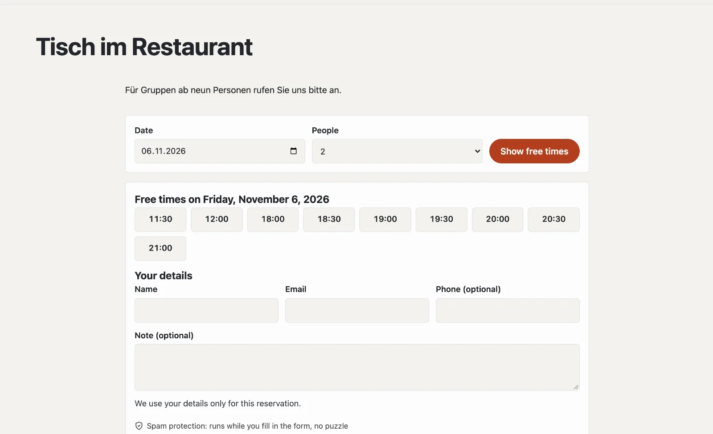

# “Reservations and appointments” plugin

With “Reservations and appointments” your guests book online: a table in the restaurant, a consultation, a room. You
set when bookings are possible and how many places there are; guests choose a day and time, receive a confirmation
with a calendar entry and a reminder, and cancel themselves through their link. If you wish, they pay a deposit
through your Stripe account. The plugin costs CHF 149 with one year of updates and comes from Basalto.



## Install and switch on

1. Buy it in the marketplace on basaltocms.com ([Buying](installieren.md#buying)), then in the backend under
   **Administration › Modules › Marketplace**, click **“Install”** for “Reservations and appointments”
   ([Installing a plugin](installieren.md#installing-a-plugin)).
2. Switch it on under **Administration › Sites › Edit site › “Modules” tab** for the sites — it is off by default.

Afterwards the **“Reservations”** tab appears under **Content**.

## Define what can be reserved

An **offer** is what guests reserve — “Table in the restaurant”, “Consultation in the shop”, “Meeting room”. Under
**Content › Reservations › Offers and times** you create one from a template and then adjust it:

| Template | intended for |
| --- | --- |
| Tables | groups, several at a time, confirmed immediately |
| Appointment for one person | one reservation per time, without asking for the number of people |
| Room | one reservation per time, on request |

| Setting | |
| --- | --- |
| Times per weekday | as “11:30-14:00, 18:00-22:00” — the gap in between is a break, empty means closed |
| Duration (minutes) | how long a reservation occupies the places |
| Start every (minutes) | e.g. 30: 18:00, 18:30, 19:00 … |
| Places at a time | for tables the number of people, for appointments usually 1 |
| Largest group online | larger groups contact you directly; 1 = without asking for the number of people |
| Notice (minutes) | the shortest notice for a reservation |
| In advance (days) | how far into the future |
| Self-cancellation until (hours before) | after that only directly with you |
| Confirmation | **immediately** (the reservation applies straight away) or **on request** (you accept or decline) |
| Deposit | fixed or per person; 0 = none |
| Bookable online | without the tick the offer is paused |

**Closed** (same page): holidays, public holidays, private events — from the first to the last day, for one offer or
all. Existing reservations in that period remain; the note says how many there are.

## Create the reservation page

1. **Pages › New** (or your existing “Reserve” page).
2. **“Expert”** tab › **“Mount a module”** › **“Reservations”**, save and publish.

With one offer, guests reserve directly on this page; with several, they choose the offer first. A day without a free
time names the next free days. Fully booked times are struck through.

Quick booking from any page — for example the home page — with the Lava part **“Reserve”** (day and people, continuing
on the reservation page) or in the theme:

```lava

```

## What guests receive

| When | Email |
| --- | --- |
| confirmed immediately | confirmation with calendar entry (.ics) and link to their own reservation |
| on request | acknowledgement of receipt; later confirmation or refusal |
| before the appointment | reminder (adjustable: 2 hours, one day or two days before, or none) |
| cancelled or changed | notification with the new details |

Under the link to their own reservation, guests see its state, download the calendar entry and **cancel** themselves
until the deadline. Your team receives a message about new reservations, requests and cancellations (bell and email,
adjustable in the profile).

## Manage reservations

**Content › Reservations** shows one day (paging with **“‹ Previous day”**, **“Today”**, **“Next day ›”**) or
**“All upcoming”**, **“Requests”** and **“Earlier”**, with a search by name, email or phone. The number in the menu
shows the open requests.

- **Confirm**, **Decline** and **Cancel** individually or in bulk — guests receive an email.
- **Enter a reservation** for phone calls and walk-in guests: confirmed straight away, email only with an email
  address. The team may enter reservations outside the times and beyond the places; if a time is then overbooked, the
  note says so.
- In a reservation you change the offer, day, time and number of people; if you wish, the guest receives the new
  details. The **internal note** is only seen by the team.

## With a deposit

A deposit goes through your own Stripe account ([Payments](../verwaltung/zahlungen.md)): after submitting, the guest
is taken to Stripe, and the time stays reserved for them meanwhile. After payment the reservation applies (or waits
as a request); if they cancel or do not pay, the place becomes free again when the checkout expires. You issue a
refund for a cancellation in the Stripe Dashboard. Without payments set up, guests reserve without a deposit.

## Privacy

Guests enter a name, email and, if they wish, a phone number and a note. After a period (by default 365 days after the
appointment, adjustable) the nightly clean-up replaces these details; day, time and number of people remain for your
figures. The reservations of an email address are part of **information** and **deletion** under
**Administration › Users** ([Users](../verwaltung/benutzer.md)). Reservations do not go along with a site’s export;
the offers do.

## If something goes wrong

| Sign | Cause | Solution |
| --- | --- | --- |
| “This day cannot be reserved online” | the day is before the notice or after “In advance” | check the offer’s settings |
| no times on a weekday | no times entered, or closed | check the times and “Closed” |
| no reminders | the installation’s schedule is not running | set up cron ([Operations](../verwaltung/betrieb.md)) |

## Next

- [Payments](../verwaltung/zahlungen.md)
- [For installations](installieren.md)
- [Marketplace](README.md)
