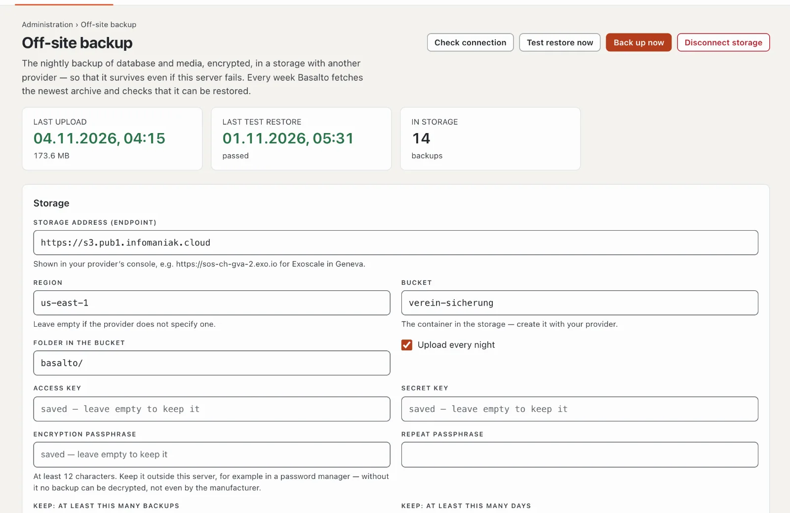

# “Off-site backup” plugin

Basalto backs up the database and media on its own server every night. If the server fails, that backup is gone with
it. “Off-site backup” uploads every backup, encrypted, to a storage with another provider, tidies up old backups there
and checks every week that the newest one can be restored. The plugin costs CHF 79 including one year of updates and
comes from Basalto.



## Install

1. Buy it in the marketplace on basaltocms.com ([Buying](installieren.md#buying)), then in the backend under
   **Administration › Modules › Marketplace** click **“Install”** for “Off-site backup”
   ([Installing a plugin](installieren.md#installing-a-plugin)).
2. The plugin applies to the whole installation — there is no switch per site. Afterwards **“Off-site backup”** appears
   under **Administration**. Everyone who sees **Administration › Operations** sees it too.

The plugin needs the PHP extension “sodium”; most hosting providers have it on. If it is missing, the page shows the
notice **“Encryption not possible”** — your hosting provider enables it in the PHP settings.

## Set up the storage

You need an S3-compatible storage with a provider other than your hosting provider, for example Infomaniak Swiss
Backup or Exoscale.

1. With the provider, create a **bucket** — the container for the backups — and S3 credentials (access key and secret
   key) that may write, read and delete in the bucket. With Infomaniak Swiss Backup and with Exoscale, endpoint, region
   and credentials are shown in the provider’s console.
2. Under **Administration › Off-site backup**, fill in the **“Storage”** section:

   | Field | What goes in |
   | --- | --- |
   | **Storage address (endpoint)** | the S3 address, e.g. `https://sos-ch-gva-2.exo.io` for Exoscale in Geneva |
   | **Region** | e.g. `ch-gva-2` for Exoscale; leave empty if the provider does not specify one |
   | **Bucket** | the bucket’s name |
   | **Folder in the bucket** | `basalto/` by default — with a folder each, several installations fit into one bucket |
   | **Access key**, **Secret key** | the credentials from step 1 |
   | **Encryption passphrase**, **Repeat passphrase** | at least 12 characters — read the next section |
   | **Keep: at least this many backups**, **… days** | 14 backups and 30 days by default, see [Retention](#retention) |
   | **Upload every night** | on by default |

3. **“Save and check”**: Basalto writes a small file to the bucket, reads it and deletes it again. Only if that works
   is anything saved; otherwise the reason appears at the endpoint.

The page never shows saved keys or the passphrase again — leaving a field empty keeps it. **“Check connection”** repeats
the check at any time. **“Disconnect storage”** removes the connection; the backups in the storage remain.

## Keep the passphrase safe

Basalto encrypts every backup on your server before it leaves — the storage provider only sees encrypted data, not even
file names. The key is derived from the passphrase (Argon2id); the data is encrypted with XChaCha20-Poly1305 from the
libsodium library.

- Keep the passphrase **outside this server**, for example in a password manager. **Without it no backup can be
  decrypted** — not even by Basalto. If it is only on the server, it is lost with it.
- Keep the installation’s `APP_KEY` as well: without the same key, encrypted details in the restored database cannot be
  read ([Backup](../betrieb/backup.md)).
- If you change the passphrase, older backups in the storage still need the previous one. Keep both until the older
  backups have dropped out of retention.

## What happens every night

1. At **03:15 UTC** Basalto backs up the database and media on the server ([Backup](../betrieb/backup.md)).
2. At **04:15 UTC** the plugin encrypts the newest backup and uploads it as `basalto-backup-YYYYMMDD-HHMMSS.zip.enc`
   to the folder in the bucket. It then compares the size in the storage with the uploaded file. A backup that is
   already in the storage is not uploaded again.
3. Finally it applies the retention.

The encrypted copy is created briefly in the installation’s `storage/app` folder — it needs as much free space there as
the backup is large. The plugin uploads backups from the standard folder `storage/app/backups`, where the nightly
backup writes them; backups you place elsewhere by hand with `--path` are not included.

**“Back up now”** creates a new backup straight away and uploads it — in the background. After a few minutes the result
appears in the **History**: time, type, backup, size, state and message. At the top the page shows the **Last upload**,
the **Last test restore** and how many backups are **In storage**. If **Upload every night** is off, the page shows
**“Paused”**; “Back up now” and the test restore still work.

## Retention

Only what exceeds **both** limits is deleted from the storage: the newest backups according to **Keep: at least this
many backups** always remain, as do all backups from the last days according to **Keep: at least this many days**. With
the defaults of 14 and 30, at least the newest 14 backups remain plus all from the last 30 days. The plugin does not
touch other files in the folder.

## The weekly test restore

Every Sunday at **05:30 UTC** the plugin fetches the newest backup from the storage, decrypts it while downloading and
checks it with Basalto’s restore check: manifest, size and SHA-256 of every file.

- **With SQLite** the test restore loads the database into a throwaway database and opens it (integrity check and
  count check).
- **With MariaDB, MySQL or PostgreSQL** the test restore only checks that the database dump is complete — header,
  final line and core tables. Nothing is loaded into a database; so restore a backup into an empty database by hand
  from time to time ([Restoring](../betrieb/backup.md#restoring)).

**“Test restore now”** starts it straight away. In the history it appears as **Test restore** with **“OK”** or
**“failed”** and the checks under **Message**; **Administration › Operations** also shows the state of the last check.

## Alarm

If an upload or a test restore fails, everyone who sees **Administration › Operations** receives the notification
**“Off-site backup failed”** in the bell and by email — with the reason. The email is on by default; anyone who does
not want it switches it off in their **Profile** on the **“Notifications”** tab. The page itself also shows the
reason at the top as **“Last upload failed”** or **“Last test restore failed”**.

## Fetch a backup back

Fetching and decrypting works on the server’s console:

```sh
php artisan basalto:ausser-haus-holen --liste                              # what is in the storage
php artisan basalto:ausser-haus-holen                                      # the newest
php artisan basalto:ausser-haus-holen basalto-backup-20261104-031500.zip   # a specific one
php artisan basalto:ausser-haus-holen --ziel=/srv/restore                  # into another folder
```

By default the decrypted ZIP lands in `storage/app/backups`; if a file with the same name is already there, it is left
untouched. Then continue as under [Restoring](../betrieb/backup.md#restoring): first
`php artisan basalto:backup-verify <archive>`, then restore.

### After losing the server

1. Reinstall Basalto and install the plugin.
2. Under **Administration › Off-site backup**, enter the storage and the passphrase, then run
   `php artisan basalto:ausser-haus-holen`.
   Or without setting it up: download the file in the provider’s console, put it on the server and run
   `php artisan basalto:ausser-haus-holen --datei=/path/basalto-backup-20261104-031500.zip.enc --passphrase-fragen`
   — the command asks for the passphrase.
3. Continue as under [Restoring](../betrieb/backup.md#restoring) — with the old installation’s `APP_KEY`.

`--passphrase-fragen` also helps when an older backup still needs the previous passphrase.

## In the statistics

Under [Statistics](../verwaltung/statistik.md), the **Off-site backup** tab shows backups uploaded, restore tests passed and failures, compared with the previous period.

## If something goes wrong

| Sign | Cause | Solution |
| --- | --- | --- |
| “No connection to the storage: …” when saving | endpoint, region, bucket or keys are wrong, or the keys may not write to the bucket | compare the details with the provider’s console; give the keys the right to write, read and delete in the bucket |
| “Encryption not possible” | the PHP extension “sodium” is missing | have your hosting provider enable it in the PHP settings |
| “There is no backup on the server …” | the nightly backup is not running | check the scheduler’s cron entry ([Hosting](../betrieb/hosting.md)); **Administration › Operations** shows the state |
| “Back up now” or “Test restore now” brings no result | the queue is not being processed | check the scheduler’s cron entry; failed jobs are listed under **Administration › Operations** |
| “Decryption failed: wrong passphrase or modified file.” | the backup is encrypted with another passphrase | enter the earlier passphrase with `--passphrase-fragen` |
| “The encrypted backup is incomplete.” in the test restore | the file in the storage is cut off | **“Back up now”**, then **“Test restore now”**; if the error persists, ask the provider |
| The upload fails for large backups | not enough free space in `storage/app` for the encrypted copy | free up space or book more space with your hosting provider |

## Next

- [Backup](../betrieb/backup.md)
- [Operations](../verwaltung/betrieb.md)
- [For installations](installieren.md)
- [Marketplace](README.md)
