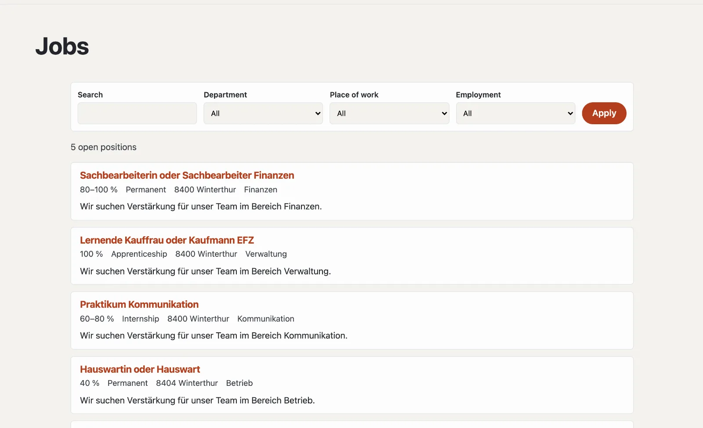

# “Job vacancies” plugin

With “Job vacancies” you advertise open positions: with workload, employment, place of work and start date, on a
jobs page of their own with a filter. Applications come in through a form of the site or, if you wish, through a link
of your own. Search engines get structured data for every open position. The plugin is free and comes from Basalto.



## Install and switch on

1. In the backend under **Administration › Modules › Marketplace**, click **“Install”** for “Job vacancies”
   ([Installing a plugin](installieren.md#installing-a-plugin)).
2. Switch it on under **Administration › Sites › Edit site › “Modules” tab** for the sites that should use it — it is
   off by default.

Afterwards the **“Jobs”** tab appears under **Content**.

## Create the jobs page

1. **Pages › New** (or an existing page), name for example “Open positions”.
2. **“Expert”** tab › **“Mount a module”** › **“Jobs”**, save.
3. Publish the page as usual.

| Address below the page | What appears |
| --- | --- |
| (the page itself) | open positions, newest first; from four positions on with search and a filter by department, place of work and employment |
| `<address>` | one position with all details and the application |

A position that is no longer advertised stays reachable under its address — with a note that it is no longer open,
and without the application.

## Advertise a position

Under **Content › Jobs** you create a position with its **Title**. It is a **draft** at first; then the form with all
details opens. Changes save themselves.

| Field | |
| --- | --- |
| Title, short text, description | per site language; the short text shows in the list and to search engines |
| Workload from, to (%) | e.g. 80–100 % |
| Employment | permanent, fixed-term, apprenticeship, internship, contract work or volunteer work |
| Department, place of work | for the filter and the structured data |
| Partly from home | appears with the key facts |
| Start date | empty means “by arrangement” |
| Advertised until | after that the position disappears from the list by itself |
| Contact person, contact person’s email | appear with the position |
| Application link | only if applications go through an application portal |

| Button | Effect |
| --- | --- |
| **Publish** | the position appears on the jobs page |
| **Mark as filled** | it disappears from the list |
| **Advertise again** | a filled position is open again |
| **Withdraw** | a draft again |
| **Duplicate** | a copy as a draft — handy for similar positions |

## Applications

Without a link of its own, the site’s application form appears below every open position:

1. Under **Content › Jobs**, **“Create application form”** — it contains name, email, phone, message, CV (PDF) and
   further documents.
2. You can adapt it under **Content › Forms** (“bewerbung”).
3. Choose another form at the bottom of **Content › Jobs** under **“Application”**.

Applications are submissions of the form: you find them under **Forms › Submissions**, with the page of the position
they came from. The “Applications” column in the list counts them per position. They are kept and deleted like all
submissions ([Forms](../redaktion/formulare.md)).

## Open positions on other pages

The Lava part **“Open positions”** shows the newest open positions — for example on the home page: under
**Setup › Layouts › “Parts” tab**, click **“+ Instance”** (number, heading), then place it in a region or insert it in
a page’s editor with **“+ Lava part”**. In the theme it also works directly:

```lava

```

## Search engines and privacy

Every open position carries structured data (schema.org `JobPosting`: title, description, employment, place of work,
employer, advertised until) and is listed in the sitemap. The plugin itself stores no applications — they are kept
with the form submissions. The positions go along with a site’s export.

## Next

- [Forms](../redaktion/formulare.md)
- [For installations](installieren.md)
- [Marketplace](README.md)
