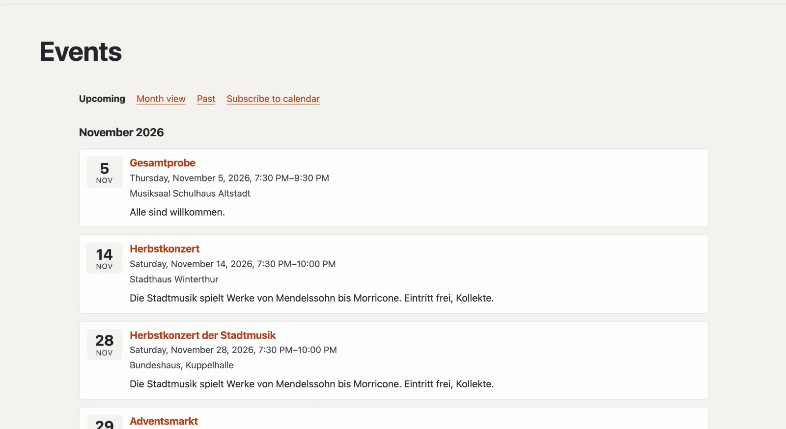

# “Events” plugin

With “Events” you announce dates: concerts, rehearsals, courses, markets. Visitors see them as a list and as a month
view, add single events to their calendar or subscribe to the site’s whole calendar. Search engines get structured
data for every event. The plugin is free and comes from Basalto.



## Install and switch on

1. In the backend under **Administration › Modules › Marketplace**, click **“Install”** for “Events”
   ([Installing a plugin](installieren.md#installing-a-plugin)).
2. Switch it on under **Administration › Sites › Edit site › “Modules” tab** for the sites that should use it — it is
   off by default.

Afterwards the **“Events”** tab appears under **Content**.

## Create the events page

For visitors to see the dates, a page needs the plugin mounted:

1. **Pages › New** (or an existing page), name for example “Events”.
2. **“Expert”** tab › **“Mount a module”** › **“Events”**, save.
3. Publish the page as usual.

The plugin now answers the page itself and every address below it — in your theme’s layout, with the page’s title. If
the page is missing, the list in the administration points it out.

| Address below the page | What appears |
| --- | --- |
| (the page itself) | upcoming events by month |
| `monat` | month view with paging; on narrow screens as a list of days |
| `archiv` | past events, newest first |
| `kalender.ics` | calendar to subscribe to — upcoming events and those of the last 90 days |
| `<address>` | one event with all details |
| `<address>.ics` | the same, to add to your own calendar |

An event from today stays under “Upcoming” all day; at midnight (the site’s time zone) it moves to the archive.

## Enter events

Under **Content › Events** you create an event with **Title** and **Start**. It is a **draft** at first; then the
form with all details opens. Changes save themselves.

| Field | |
| --- | --- |
| Title, short text, description | per site language; if a language is missing, the default language appears. The short text shows in lists and to search engines |
| Start, end | in the site’s time zone; without an end the event lasts until midnight |
| All day | only the date counts, the time is not shown |
| Venue, address | for the page, the calendar, search engines and “Plan route” |
| Link | registration or further information |
| Address below the events page | suggested from the title, e.g. `herbstkonzert` |

| Button | Effect |
| --- | --- |
| **Publish** | visitors see the event |
| **Cancel event** | it stays visible, marked “Cancelled”; calendar subscriptions remove it at the next sync |
| **Withdraw** | a draft again |
| **Duplicate** | a copy as a draft — handy for recurring events |

The list shows “Upcoming”, “Past”, “Drafts” and “All”, with search and bulk actions (publish, withdraw, delete).

## Upcoming events on other pages

The Lava part **“Upcoming events”** shows the next dates — for example on the home page: under **Setup › Layouts ›
“Parts” tab**, click **“+ Instance”** for “Upcoming events” (number, heading), then place it in a region or insert it
in a page’s editor with **“+ Lava part”** ([Structure: layouts, parts and templates](../einrichtung/aufbau.md)). In
the theme it also works directly:

```lava

```

## With the map

If the [“Map without tracking” plugin](plugin-karte.md) is also installed and switched on, the page of an event with an
address shows its map — only after a click.

## Search engines and privacy

Every event carries structured data (schema.org `Event`: name, times, place, status, organiser) and is listed in the
site’s sitemap. The plugin stores no personal data; the events go along with a site’s export.

## Next

- [“Map without tracking” plugin](plugin-karte.md)
- [For installations](installieren.md)
- [Marketplace](README.md)
