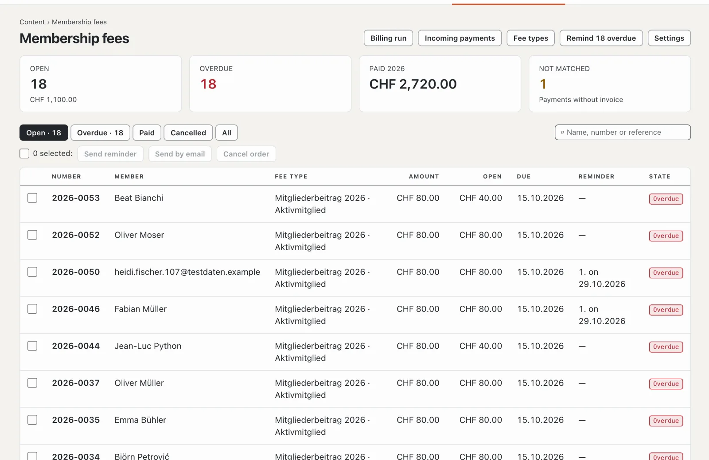

# “Club fees with QR-bill” plugin

With “Club fees with QR-bill” you invoice your club’s members for their fees: every member has a fee type, and a
billing run creates the invoices as PDFs with a QR payment part and sends them by email — or prepares them as a
combined PDF for printing. On top come reminders in three stages and incoming payments from the bank file in
camt.054 (ISO 20022) format. The plugin is paid — CHF 129 with one year of updates — and comes from Basalto.

## Install and switch on

1. Buy it on basaltocms.com — once per installation ([Buying](installieren.md#buying)).
2. In the backend under **Administration › Modules › Marketplace**, click **“Install”** for “Club fees with QR-bill”
   ([Installing a plugin](installieren.md#installing-a-plugin)).
3. Switch it on under **Administration › Sites › Edit site › “Modules” tab** — together with the **“Members”** module:
   fees go to the site’s active members ([Members](../redaktion/mitglieder.md)). Both are off by default.

Afterwards **“Membership fees”** appears under **Content**. The number next to it counts the overdue invoices.

## Enter club and account

Under **Membership fees › Settings** you enter the details for every invoice and the QR payment part. They save
themselves.

| Field | |
| --- | --- |
| **Name of the club**, **Street**, **House number**, **Postcode**, **Town**, **Country** | sender of the invoice and “Account / Payable to” in the payment part; Switzerland or Liechtenstein |
| **IBAN or QR-IBAN** | the club’s account. With a QR-IBAN every invoice carries a **QR reference**, with an ordinary IBAN a **Creditor Reference (RF)** — incoming payments match both automatically |
| **BESR-ID** | only if your bank has issued one for the QR-IBAN — otherwise leave it empty |
| **Currency** | CHF or EUR |
| **Payment term (days)** | suggests “Payable by” in the billing run (30 by default) |
| **Reminder deadline (days)** | after this time the next reminder is possible; the reminder states this deadline (14 by default) |
| **Maximum emails per hour** | 80 by default — many hosts allow around 100 emails per hour |
| **Sentence on the invoice** | for example a thank-you for the member’s loyalty |

If the name, IBAN, postcode or town is missing, the overview shows **“Account details missing”** and no billing run is
possible.

## Create and assign fee types

Under **Membership fees › Fee types**, **“New fee type”** creates a name and an amount, for example “Active member” with
CHF 80 or “Passive member” with CHF 40. Clicking a fee type opens it: name, amount, a **description** just for you,
**“Selectable in new billing runs”** and the order.

Below are the active members with their fee type and delivery. Filter by fee type, **“Without fee type”**,
**“Exempt”** or **“By post”**, select members and choose in the bar at the bottom:

| Button | Effect |
| --- | --- |
| **Fee type: …** | the member pays this fee type |
| **Exempt** | no invoice, for honorary members for instance |
| **Invoice by post** | the invoice goes into the combined PDF for printing instead of by email |
| **Invoice by email** | back to email — the default |

## Start a billing run

Under **Membership fees › Billing run** you see at the top how many members are active, how many are still **without
fee type** (they receive no invoice) and how many emails are waiting.

1. In the **“New billing run”** form, enter the **title** — it appears on the invoice, such as “Membership fee 2027” —
   plus **year**, **invoice date** and **“Payable by”**.
2. Tick the fee types to be invoiced.
3. Leave **“Send invoices by email right away”** ticked or send later.
4. **“Create invoices”**.

Every active member with one of the selected fee types receives an invoice with the next number of the year
(“2027-0001”) and its payment reference. Name and address come from the member’s customer account as they are at the
time of the run; the invoice appears in the language of the customer account. Members who are exempt, waiting for
approval or blocked receive none. Members who already have an invoice with the same title in the same year are skipped —
so you can repeat the same run later for new members.

## By email or by post

- **By email:** the email states the amount and the deadline, with the PDF and its QR payment part attached. The emails
  go out gradually, at most as many per hour as set; the rest follows in the next hour. Under **“Previous runs”**,
  **“Send by email”** sends all open invoices of a run that have not yet gone out by email.
- **By post:** in the **“By post”** column, **“Combined PDF”** opens all invoices of the run for members with “Invoice
  by post” — one A4 page per invoice, the payment part at the bottom with the line for separating it.
- **A single invoice:** open it in the list, then **“PDF”** or **“Send by email”**.

## Keeping track of invoices

The **Membership fees** overview shows the number and amount of open invoices, the overdue ones, the amount of paid
invoices of the current year and the payments without invoice. The list filters by **Open**, **Overdue**, **Paid**,
**Cancelled** and **All** and searches by name, number or reference. An invoice is **Open**, **Partly paid**,
**Overdue**, **Paid** or **Cancelled**. For several selected invoices there are **“Send reminder”**, **“Send by email”**
and **“Cancel”** — a cancelled invoice stays in the list with a note.

## Sending reminders

Once “Payable by” has passed, an open invoice can be reminded:

- at the top of the overview with **“Remind … overdue”** for all at once,
- for selected invoices with **“Send reminder”** in the bar,
- in an invoice with **“Send reminder”**.

There are three stages. The next one is possible only once the **reminder deadline** has passed since the last one. The
reminder carries the title “Reminder 1” (or 2 or 3), the date of the reminder, a new deadline and the amount outstanding
after partial payments — in the QR payment part as well. Members with email receive it by email; with “Invoice by
post” the invoice PDF now shows the reminder for printing.

## Incoming payments from the bank file

1. In e-banking, download the credit notification in **camt.054 (ISO 20022)** format as XML — usually under documents
   or account statements.
2. Under **Membership fees › Incoming payments**, choose the file at **“Import bank file”** and click **“Import”**.
3. The message states how many payments were matched, how many were not, how many were partial payments and how many
   had already been imported.

A credit with the reference of an open invoice is booked automatically: if the amount covers it, the invoice is
**Paid** (with the booking date); otherwise it stays open and the remainder becomes the new amount outstanding. Each
booking counts only once, even if you upload a file twice. The plugin skips debits and reversals.

Payments without a matching reference — or for an invoice already paid or cancelled — are listed as **“not
matched”**. Open one, enter the **invoice number** under **“Match invoice”** and choose **“Match”**. A payment imported
by mistake can also be deleted there.

## Payments by hand

Paid in cash at the general meeting? In the invoice under **“Record payment”**, enter the amount (the amount
outstanding is suggested), **“Received on”** and a **note**, then **“Record”**. An invoice’s payments are listed at the
bottom of it.

## In the customer account

Members see the **“Membership fees”** area in their customer account with their invoices, the status and the PDF —
with the QR payment part as long as an invoice is open. Open invoices also appear under “Up next”.

## Data protection and retention

- **Access and erasure** per email address are handled by the administration under “Administration › Users” (or
  `php artisan basalto:privacy`): the information lists fee type and invoices. Erasure removes the assignment; the
  invoices remain as accounting records with number, amount and status, but without name and address.
- **Retention:** ten years after the end of the invoice year, the nightly clean-up removes invoices together with their
  payments.
- The **export of a site** takes only the fee types; invoices and payments stay with the previous site.

## In the statistics

Under [Statistics](../verwaltung/statistik.md), the **Membership fees** tab shows payments received, open amounts, invoices issued and reminders, compared with the previous period.

## If something goes wrong

| Sign | Cause | Solution |
| --- | --- | --- |
| **“Account details missing”** | the club’s name, IBAN, postcode or town is missing | complete them under **Settings** |
| “This is not a valid IBAN from Switzerland or Liechtenstein.” | typing error or account abroad | check the IBAN — the QR-bill requires an account in Switzerland or Liechtenstein |
| A member receives no invoice | not active, exempt, without fee type or already an invoice with the same title in the same year | check the status under **Content › Members** and the **“Without fee type”** filter |
| Emails wait for a long time | the hourly allowance has been reached | wait — the rest goes out in the next hour |
| “This is not a bank file in camt.054 format (ISO 20022).” | a PDF, CSV or another format was uploaded | download the credit notification as camt.054 (XML) in e-banking |
| A payment is “not matched” | transferred without a reference or with a wrong one | enter the invoice number under **“Match invoice”** |
| “Send reminder” is missing | not yet due, the deadline since the last reminder is still running or the 3rd reminder has already been sent | remind later or contact the member directly |

## Next

- [Members](../redaktion/mitglieder.md)
- [For installations](installieren.md)
- [Marketplace](README.md)
