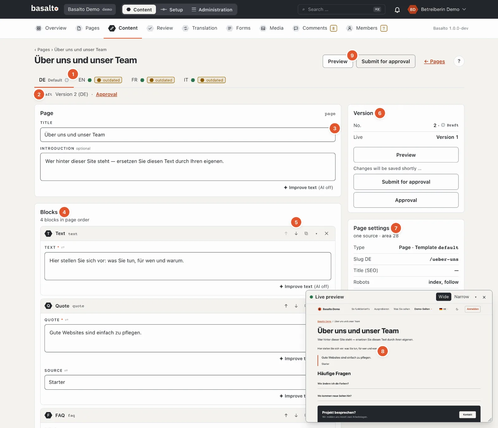
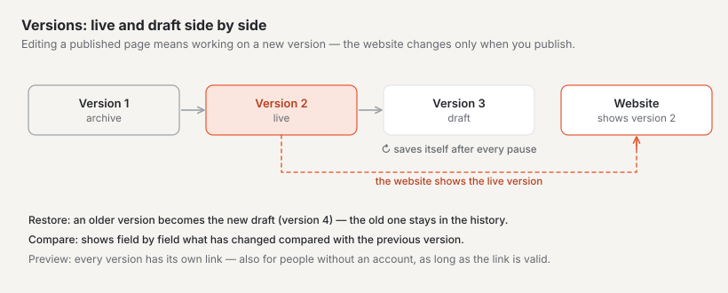
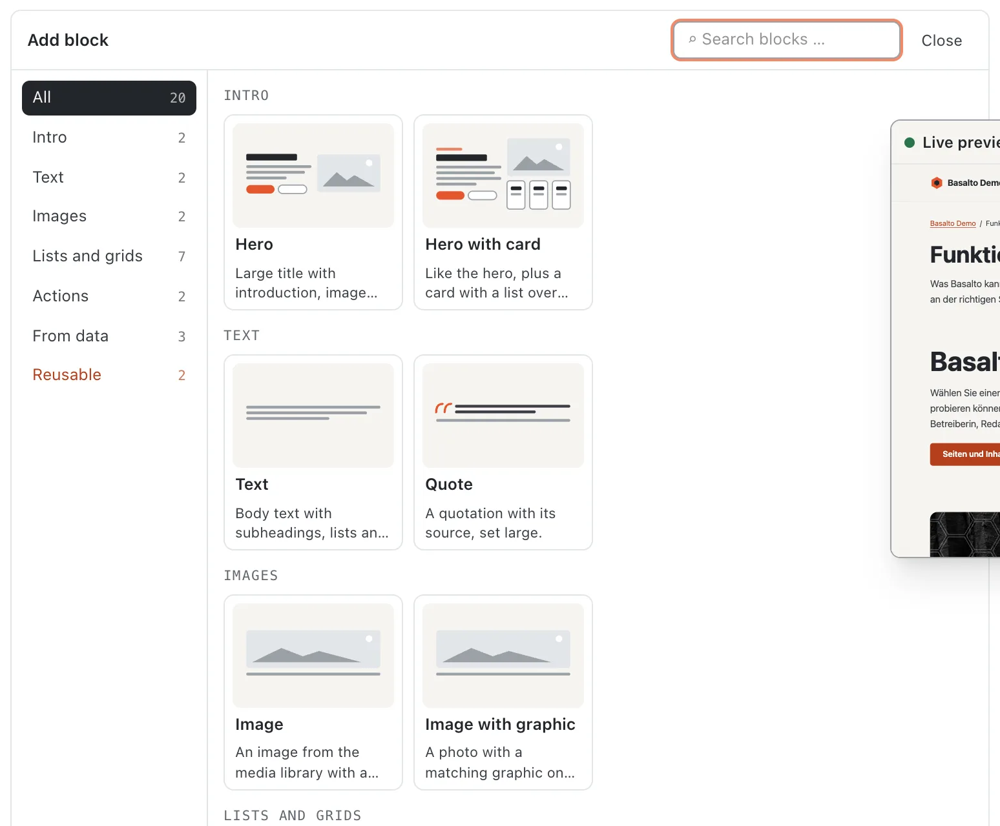
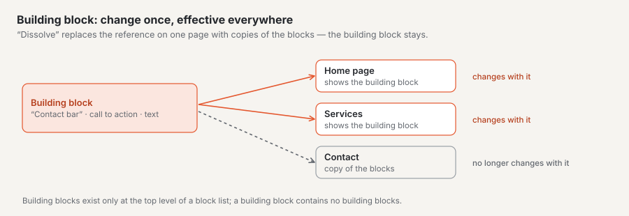
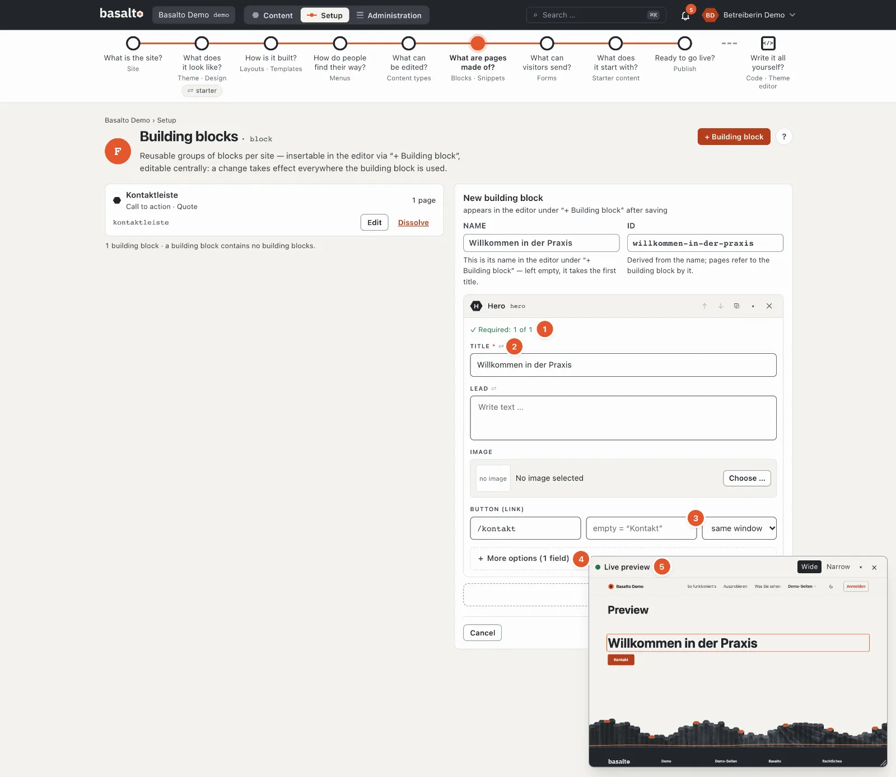
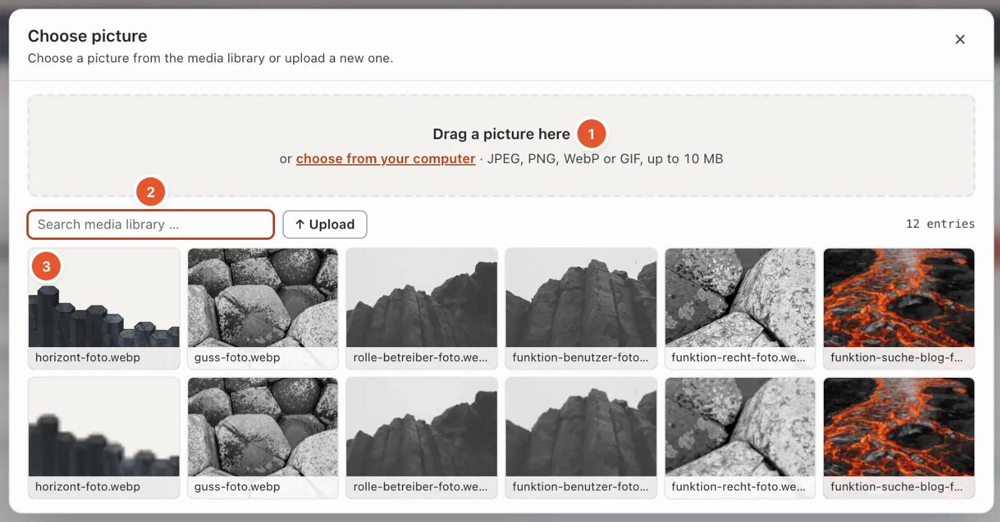
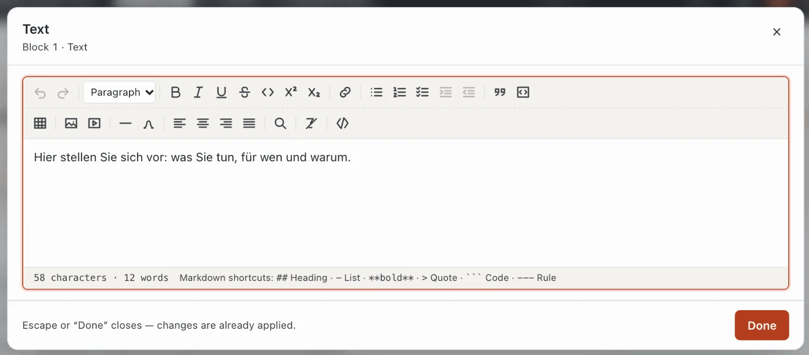
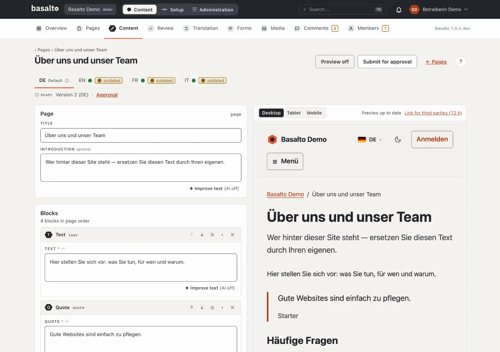
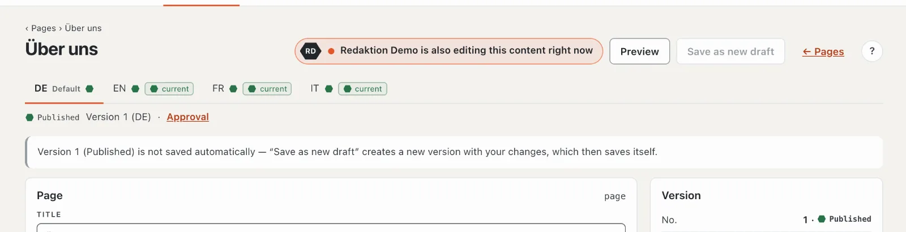

# Editing content with blocks

The content of a page consists of **blocks**: text sections, images, stages, forms and whatever else your site’s theme offers. You put the blocks together in the editor; Basalto saves every change by itself.

## Where

- For pages: “Content” mode › **Pages**, the **“✎ Edit content”** button in the page’s row.
- For other content (for example blog posts): “Content” mode › **Content**, choose the type, **“edit”** on the entry.
  You create a new entry there with **“New entry”**.

### The “Content” list

At the top there is a tab with the number of entries for every **content type** of the theme. A warning sign on a tab
means: the theme no longer has this type — the entries stay saved but can only be edited again once the theme knows the
type again (Setup › Content types).

- **Filters:** status and language apply at once, the search (across the titles of all versions) with Enter.
- **Columns:** a hexagon with the status per language, plus the badge “outdated” if the translation is based on an older
  version.
- **Order and page size** come from your profile (Settings › “Sorting of lists”, “Items per page”); the footer shows
  both.
- **“New entry”** creates an entry as a draft in the default language; if there is only one type, without asking. Its
  title is “New: ‹type›” at first.
- **Empty:** “No content types” means the theme doesn’t define any yet (see Setup); “No content of this type yet” and
  “No content with this filter” speak for themselves.

## Layout of the editor

1. The site’s **languages** as tabs; “Default” marks the default language. A status dot per language and, if the
   translation lags behind the default language, the badge “outdated”. If a language doesn’t exist yet, the tab offers
   **“Create translation from XX”**: the structure is copied, the translatable texts stay empty.
2. **Status and version**, for example “Draft · Version 2 (DE)”, next to it the link to the **approval** of this version.
3. **Title**, for entries without a page tree the **slug** (empty = from the title), the **introduction** and the type’s
   **fields**.
4. The **blocks** in the order they appear on the page.
5. The **buttons of a block** (see below).
6. **Version:** number, status, which version is live, and the message of automatic saving.
7. **Page settings** (pages only): type and template, slug, title for search engines, robots, visibility, time window —
   and “All settings (12 tabs)”. A page’s slug and metadata are not in the editor but there (see [Pages](seiten.md)).
8. **Versions** of this language with “Compare”, “Preview” and “Restore”.
9. **Preview** and **Submit for approval**.

At the top, the editor counts “N fields to check” when entries are missing or wrong; the affected block gets a red border
and a number — errors in nested blocks count upwards.

## Adding and arranging blocks

1. Below the blocks, click **“+ Insert block”**. If the list is still empty, the palette is already open.
2. In the **palette**, choose the block you want. Each card shows a **schema** of the block — where the heading sits,
   whether there is an image, buttons, cards or folding questions — plus the name and a sentence on what it is for.
   On the left are the **groups** (for example “Intro”, “Text”, “Images”, “Lists and grids”, “Actions”, “From data”)
   with the number of their blocks; a click shows only that group. The field **“Search blocks …”** filters by name,
   sentence and group, **Enter** inserts the first match. Blocks that are not allowed at this position appear dashed
   and faded — the reason is on the card. Under **“Reusable”** you insert a snippet or a Lava part. **Esc** or
   “Close” folds the palette away.
3. Fill in the block’s fields.

New blocks go to the end of the list; use ↑ ↓ to move them into place. In the header of each block you will find:

| Button | Effect |
| --- | --- |
| ↑ / ↓ | one position up or down (disabled at the very top or bottom) |
| ⧉ | Duplicate block — the copy sits right below |
| ▾ / ▸ | Collapse or expand block |
| ✕ | Delete block — with the confirmation “Delete block?” |

There is no dragging with the mouse in the block editor — ↑ ↓ are unambiguous and work with the keyboard. Collapsed
blocks show a short summary of their content. A number on the block reports fields that are not yet correct.

### Snippets and Lava parts

- A **snippet** is a group of blocks that appears the same on several pages (for example a contact bar). In the editor
  it is a **reference**: if someone changes the snippet under Setup › Snippets (“edit centrally”), it changes on all
  pages. **“Dissolve”** replaces the reference on this one page with copies of the blocks — from then on they can be
  changed freely here, the snippet stays for the other pages. Snippets exist only on the top level of a block list;
  without any snippets the picker reports “No snippets yet”.
- A **Lava part** is a piece of the theme with settings, for example a navigation or a search field. Its settings are
  under Setup › Layout › Parts; in the editor you only choose which part goes here. A Lava part cannot be dissolved.

### Blocked blocks

Which blocks are allowed in a place is set by the theme per content type or per field. Blocked blocks stay visible in the
palette; the reason names the scope, for example “‹Hero› is not allowed for the type Page”. You change this under Setup ›
Content types.

### Nested blocks

Some blocks contain blocks themselves, for example a column or a tab set. You add blocks inside them exactly as above — to any depth. The theme determines which blocks are allowed where.

If “Unknown block” appears, this block does not exist (any more) in the theme. The content stays saved; contact the person who looks after the theme.

## The fields of a block

A block’s form guides you:

1. **Required fields.** Above the fields, “Required: 1 of 2” counts until all are there (then with ✓).
2. **Label and help.** Above each field is its label with `*` for required and ⇄ if it is translated per language.
   Below it, a sentence explains what the field is for, and the empty field shows an example — both come from the
   theme.
3. **What comes automatically.** An empty field that takes its value from elsewhere shows it in grey: “empty =
   “Contact””. If you leave a link’s label empty, the page shows the title of the target page. In the “Address”
   field the editor suggests the site’s pages — type part of the title or address and pick one.
4. **Essentials first.** Required fields, everything already filled in and the block’s main fields are at the top —
   for a hero, for example, title, lead, image and button. Fine-tuning such as credits, small image versions or a
   different label is under **“+ More options (N fields)”**; one click expands it, “− Show less” collapses it again.
   Whatever is filled in always stays visible.
5. **Live preview** in a small window — see [below](#live-preview-in-a-window).

Basalto checks required fields only on **submitting** — automatic saving also accepts incomplete content so that
nothing gets lost.

| Field type | How to use it |
| --- | --- |
| Text, email, URL, slug | one line; slug only a–z, 0–9 and “-” |
| Text area, Markdown, code | several lines; Markdown and code in a monospaced font |
| Rich text | formatted text — a click opens the large window (see below) |
| Number | digits, with minimum and maximum from the theme |
| Switch | on or off |
| Date, date with time | choose in the calendar |
| Select | one option from the list; “—” means none (only if the field is not required) |
| Tags | type a word, accept with Enter or comma; duplicates are ignored, ✕ removes one |
| Image | “Choose …” (or a click on the thumbnail) opens the media library as a dialog — see below; the alt text is prefilled from the file name — please check it |
| Image (address) | like “Image”: choose or upload an image from the media library; a click into the empty field opens the dialog. If you know a theme file, type its address (e.g. `landing/foto.webp`) |
| Gallery | “+ Choose images …”: in the dialog a click selects or deselects, “Done” closes; ↑ ↓ order them, alt text per image |
| File | a file from the media library, in the same dialog |
| Link | address (/kontakt, https://…, mailto:), label and target (“same window” or “new window”). If you type a page’s title (“Contact”), it becomes its address (“/contact”); if it is neither an address nor a page, the field warns you |
| Relation | another entry of the site (for example a person), chosen from a list |
| Repeater | several rows of the same structure (for example cards): “+ Row”, ↑ ↓ to order, “Remove” deletes the row **without asking** |
| Blocks | nested blocks (see below) |
| Colour | colour picker or hex value (#rrggbb) |
| SEO | title and description with counters (recommended 60 and 160, at most 120 and 320 characters) |
| JSON | structured data; checked when you leave the field |

### Choosing and uploading images

For image, gallery and file fields, the media library opens as a dialog over the page:

1. **Drag in** — drag images from Finder or Explorer onto the area at the top, or **“choose from your computer”**.
   JPEG, PNG, WebP or GIF up to 10 MB. Whatever is uploaded lands in the media library and is selected right away.
2. **Search and folders** — filter by name and narrow down to a folder of the media library.
3. **Choose** — a click on an image takes it and closes the dialog. In a gallery each click selects or deselects;
   “Done” closes. Images without alt text carry the mark “Alt text missing”.

Fields with an image address (such as the picture of a stage) also take a **theme image**: the dialog then has the
**“Theme images”** tab next to the media library. The images are grouped by folder (tabs with a count); files that
belong together form a motif — for example “buehne” with Foto, Foto · 960 and Schema. **Photos** and **Graphics** can
be shown separately, and the chosen image appears at the top under “Currently selected”. The field shows a thumbnail;
if a file is missing, it says **“File missing”**.

Esc, × or a click next to the dialog close it without changes.

If a field shows “Unknown field type”, Basalto doesn’t know the type (for example from a module that is switched off);
the content stays saved.

## Editing rich text

Rich text fields show only the formatted text in the form. A click on it (or **“Edit ↗”**) opens the text in a large window with the full toolbar. **“Done”** or Esc closes it — your changes have already been applied by then.

The toolbar has two rows:

- **Undo**, **Redo** and the **Paragraph format** (paragraph, heading 2, 3 or 4),
- **Bold**, **Italic**, **Underline**, **Strikethrough**, **Code**, **Superscript**, **Subscript**,
- **Link**, **Bulleted list**, **Numbered list**, **Task list**, indent and outdent,
- **Quote**, **Code block**, **Table**, **Image from the media library**, **Embed** (YouTube, Vimeo, map), **Horizontal rule**, **Special characters**,
- Alignment **Align left**, **Centre**, **Align right**, **Justify**,
- **Find and replace**, **Clear formatting** and **Source** (read only).

At the bottom, the editor counts characters and words. If you prefer typing, use the Markdown shortcuts: `##` for a heading, `-` for a list, `**fett**`, `>` for a quote, three backticks for code and `---` for a rule.

**Keyboard shortcuts** (Mod = ⌘ on the Mac, Ctrl on Windows; the toolbar also shows them on hover):

| Shortcut | Effect | Shortcut | Effect |
| --- | --- | --- | --- |
| Mod+Z / ⇧+Mod+Z | undo / redo | Mod+K | link |
| Mod+B / Mod+I / Mod+U | bold / italic / underline | ⇧+Mod+8 / 7 / 9 | bullet list / numbered list / task list |
| ⇧+Mod+S | strikethrough | Tab / ⇧+Tab | indent / outdent list item |
| Mod+E | inline code | ⇧+Mod+B | quote |
| Mod+. / Mod+, | superscript / subscript | Alt+Mod+C | code block |
| ⇧+Mod+L / E / R / J | left / centre / right / justify | | |

**Tables:** “Table” inserts 3 × 3 cells with a header row. With the cursor in a table, a menu offers inserting or
deleting rows and columns, merging or splitting cells and deleting the table.

**Code block:** choose the language of the code (for the colours) in the block itself.

**Find and replace** (magnifier): upper and lower case don’t matter; “Next”, “Replace” and “Replace all”, without a match
“no match”.

**Links:** Select the text, click “Link” and enter the address (https://…, mailto:, a path such as /kontakt or #). Optionally a **title** (shown on hover). Choose whether the link opens in the same or a new window, and click **“Apply”**. “Remove link” removes it again.

**Images in the text:** “Image from the media library” inserts an image. Enter an **alt text** (it describes the image for people who cannot see it), a caption if you wish, and choose the alignment.

**Embeds:** Paste the address of a video from YouTube or Vimeo or of a map from Google Maps or OpenStreetMap. If Basalto recognises the address, the window reports “… recognised”; an unknown address cannot be inserted. The embed only loads on the website once the visitor consents.

## Pasting from Word and other programs

Copy text from Word, Google Docs or a web page and paste it into a rich text field with ⌘V or Ctrl+V. Basalto keeps:

- headings, paragraphs, bulleted and numbered lists (from Word too),
- bold, italic, underline, strikethrough, superscript and subscript,
- tables and links,
- **images**: they are uploaded to the media library automatically and linked in the text.

Fonts, colours and font sizes are dropped — the theme determines the appearance. A top-level heading from Word becomes “Heading 2”, deeper ones end at “Heading 4”. Pasted **Markdown** text (from a text editor) is converted as well.

For pasted images: JPEG, PNG, WebP or GIF, at most 10 MB per image. If an image fails, the editor reports “An image could not be uploaded.” After pasting, check the images’ **alt texts** in the [media library](medien.md).

## Live preview in a window

A small **“Live preview”** window at the bottom right shows the content with the real theme, redrawn about half a second
after every input — without saving. It follows you:

- **The field you are typing in lights up** in the preview with a lava frame; the preview scrolls there.
- **Clicking a spot in the preview** jumps to the matching field in the form.
- **Move** it by its header, **resize** it at the bottom-right corner, **“Wide”** (desktop) or **“Narrow”** (phone),
  **▾** collapses it, **×** closes it. The browser remembers position and size; once closed, the **“Live preview”**
  button in the page header opens it again.

The window appears while the large preview (split screen) is off and the screen is at least 768 px wide.

## Split-screen preview

The **“Preview”** button splits the screen: the editor on the left, on the right the page as it will look — with your changes, even if they are not saved yet. The preview updates just under a second after every change (“Updating preview …”, then “Preview up to date”); if it fails, the reason is shown there.

With the **device width** you check the display on “Desktop” (full width), “Tablet” (768 px) and “Mobile” (375 px). On narrow screens you switch with the “Editor” and “Preview” tabs. “Preview off” closes the preview again.

### Sharing the preview with others

**“Link for third parties (72 h)”** creates a link that lets people without access to the backend view the page too — for example for feedback from clients. “Copy” puts the link on the clipboard. It shows the latest saved version of this language, is valid for 72 hours (“expires …”) and is not indexed by search engines.

## Automatic saving

There is no save button in the editor. A little over a second after your last input, Basalto saves by itself. At the bottom right, “… saved” appears briefly with the time; an error message stays there until it is resolved. On the right under “Version” you can see what is happening:

| Message | Meaning |
| --- | --- |
| Saves automatically to version … | everything is saved |
| Changes will be saved shortly … | you are still typing |
| Saving … | is being saved right now |
| Nothing is saved without a title. | enter a title first |
| Not saved — please check the marked fields. | a field is not correct; it is marked |

Saving always goes **into the draft**. The live version on the website does not change as a result. Changed blocks briefly show “✓ saved”.

If the latest version has already been submitted, approved or published, the editor does not save by itself. The **“Save as new draft”** button then creates a new version with your changes; from then on it saves itself again.

### Who else is working on it

If someone else has the same content open, **“Marco Bernasconi is also editing this content right now”** appears at
the top next to the buttons, with their initials in a hexagon. Agree with each other before you both make changes:
every save creates a new version, and all of them remain under “Version”. The notice disappears as soon as the other
person closes the editor — after one minute at the latest.

## Versions and restoring

The **“Versions”** list on the right shows all versions of this language with number, status, author and date.

- **“Compare”** expands what has changed compared with the previous version — line by line “field: ‹old› → ‹new›”, or “no changes compared with the predecessor”.
- **“Preview”** opens exactly this version in a new tab.
- **“Restore”** immediately creates a **new draft** from an older version (“Version 2 restored as version 5”). Nothing is overwritten; the live version stays until the new one is published.

How many archived versions are kept is set by the “Keep archived versions” setting (default: 50 per entry and language).

## Submitting for approval

When you are done, click **“Submit for approval”**. The editor first saves whatever is pending; then the version goes to approval. The button is disabled with a reason while the title is missing (“enter the title first, then submit”) or required fields are empty (“Submitting only with all required fields — N missing”); the editor marks them. More on this under [Approval and publication](freigabe.md).

If a version was rejected, “Rejected” appears at the top together with the reviewer’s comment.

## On the phone

Below 768 px width, the blocks appear one below the other as **cards** with a short summary. A tap opens a block as a
full-screen sheet; “Done” closes it. Deleting takes two steps (“Remove”, then “Really remove”). “+ Block” opens the
palette from the bottom. A fixed bar at the bottom carries preview and submit.

## Frequently asked questions

**Where do I set a page’s slug, page title or description?**
In the page settings — the “All settings (12 tabs)” link on the right in the editor. See [Pages](seiten.md).

**I am working in a language other than the default language.**
Use “Translate side by side” — there the text of the default language is directly above yours. See [Translating](uebersetzen.md).

**I accidentally deleted a block.**
In the “Versions” list, open the previous version with “Restore”. The deleted block is back in the new draft; you then have to redo any changes made since that version.

## Next

- [Media](medien.md)
- [Approval and publication](freigabe.md)
- [Translating](uebersetzen.md)
