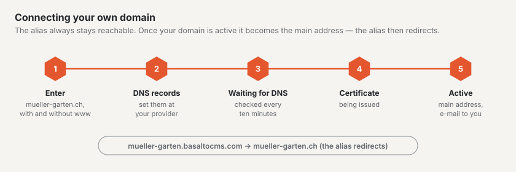

# Domains

Under **Administration › Account › Domains** you decide at which addresses your site can be reached. Owner, administration and billing of the account see the tab; owner and administration may change it.

## Alias

Every site is reachable from the very first moment at its **alias**, for example `mueller-garten.basaltocms.com` — included in every plan.

- **Change alias:** enter the new name (3–40 characters, lowercase letters, digits and hyphen) and choose “Change alias”. The new alias applies immediately. The old one redirects to the site for another **30 days** and is free afterwards.
- You see whether a name is free while typing; if it is taken, a suggestion appears next to it.
- Search engines do not index the alias. If you want to be found, connect your own domain.

## Own domain

You bring your own domain (registered with your provider, for example Infomaniak, Hostpoint, Cloudflare or Swizzonic).

1. Under “Further domain”, enter the domain, for example `mueller-garten.ch`, and choose “Add domain”. We create the address with and without `www` — they count as **one** domain.
2. Enter the **DNS records** shown at your provider exactly as they appear (type, name, value).
3. Wait: we check every ten minutes. “Check now” checks immediately (once per minute). The status changes from “waiting for DNS” to “certificate being issued” to “active” — usually in under 15 minutes, sometimes up to a few hours.
4. As soon as the domain is active, it becomes the **primary address** of your site and you receive an email. From then on the alias redirects to your domain; links using the alias keep working.

If the status says “error”, the tab shows the message. Usually a DNS record is missing or mistyped — correct it and check again.

**Change the primary address:** with “… as primary address” you choose whether your site appears at `www.mueller-garten.ch` or `mueller-garten.ch`; the other address redirects.

**Remove:** “Remove” deletes the domain. If it was the primary address, the alias takes over again.

## How many domains

| Plan | Own domains |
| --- | --- |
| Start | none |
| Standard | 1 |
| Pro | 5 |

When the quota is used up, owner and billing can order an **additional domain for CHF 5 per month** while adding it — or switch to a larger plan. During the trial there is no own domain yet. Your site stays reachable in any case.

## Next

- [Export and cancellation](konto.md)
- [Going live](../einrichtung/live-gehen.md)
