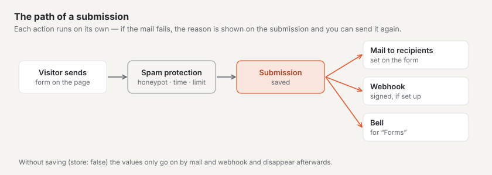
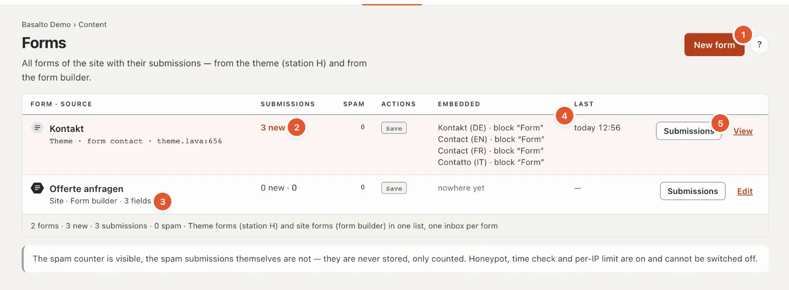
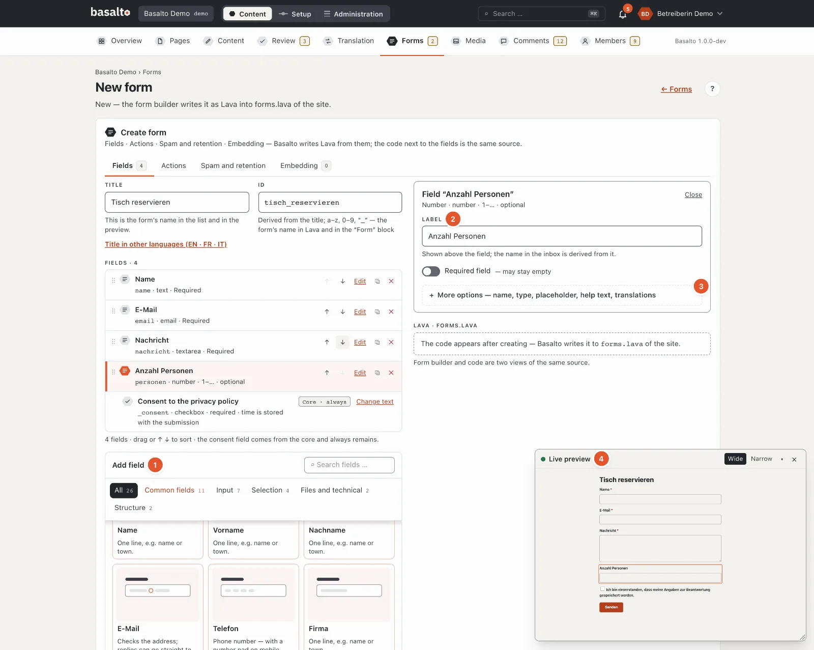
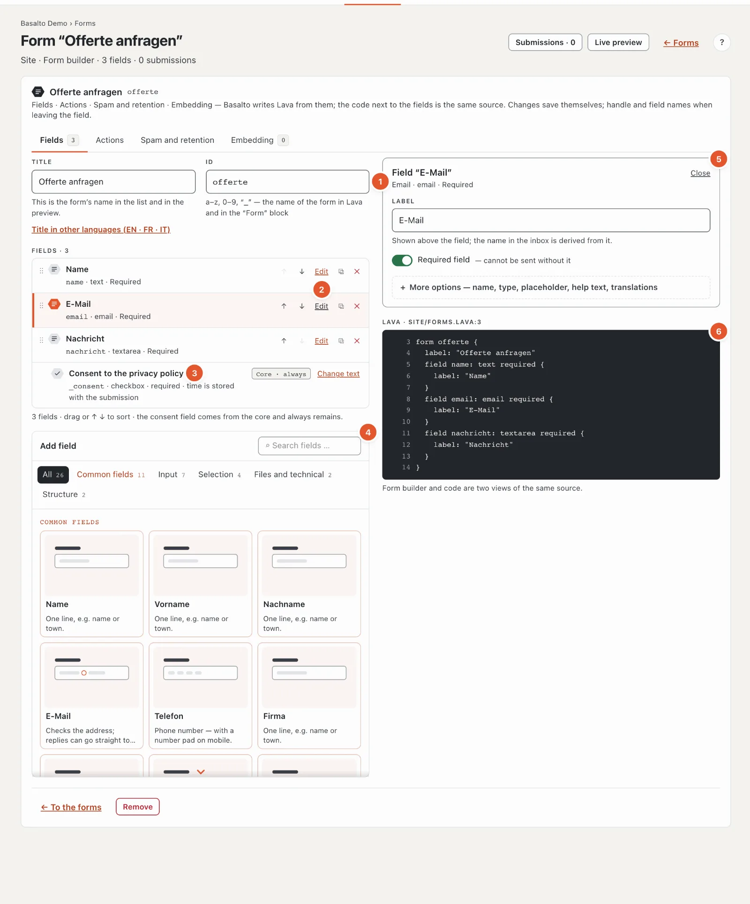
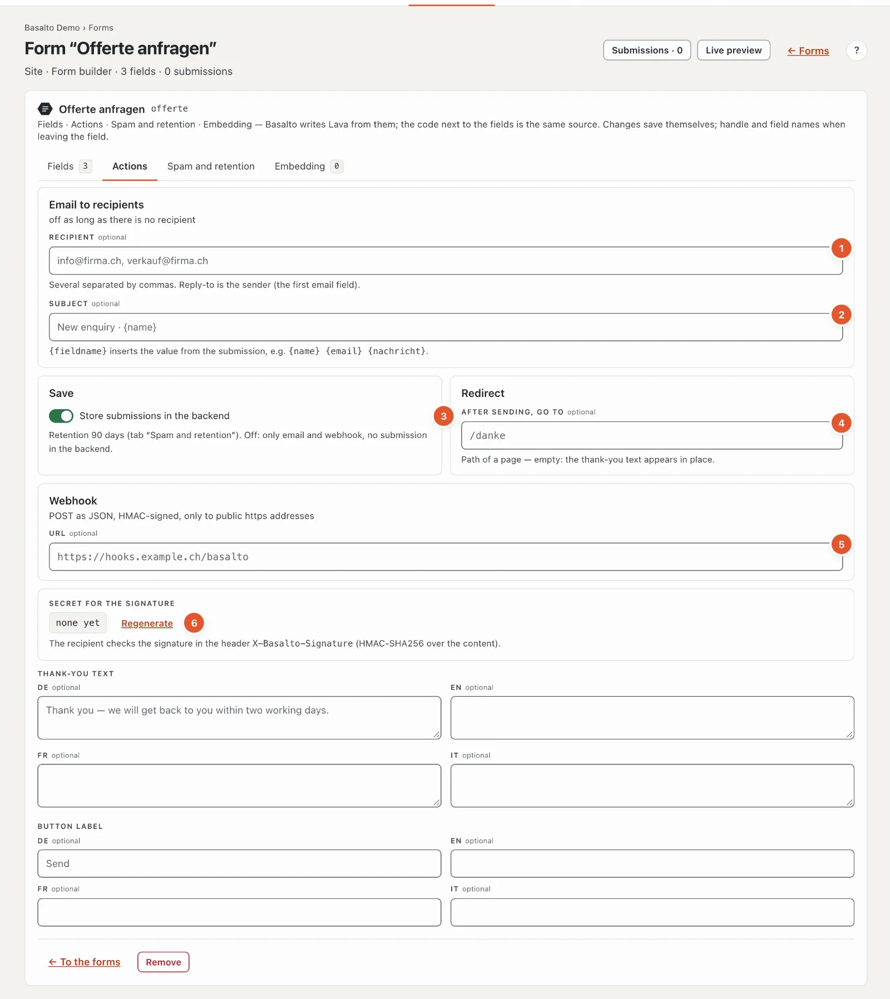
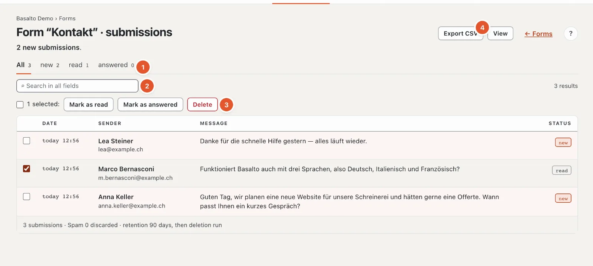
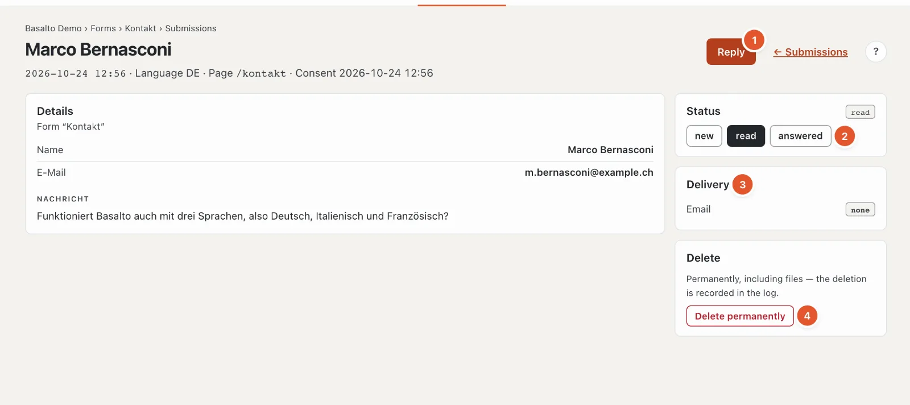

# Forms

With forms you receive enquiries, registrations or orders via the website. Each form has its own **submissions inbox** in the backend and can also send every submission by email or pass it on to another system.

## Where

“Content” mode › **Forms**.

1. **“New form”** creates a form with the form builder.
2. **Submissions**: “3 new · 3” means three new out of three in total. Forms with new submissions are highlighted.
3. **Source**: “Site · Form builder” or “Theme · form contact · theme.lava:612” (the place in the theme).
4. **Embedded**: on which pages and in which language the form sits in the “Form” block — or “nowhere yet”.
5. **“Submissions”** opens the inbox, “Edit” (“View” for theme forms) opens the form.

The list also shows the **spam counter**, the configured **actions** (email, store, redirect, webhook) and under “Last” the time of the latest submission. If an email could not be delivered, it says in red “1 email not delivered — resend from the submission”.

There are two kinds of forms:

- **Site form** — created in the backend with the form builder; you can change it yourself.
- **Theme form** — comes with the theme. You can view it and process its submissions, but you cannot change fields and texts. The Starter theme, for example, brings the “Contact” form.

## Creating a form

1. Click **“New form”**.
2. Enter the **Title**, for example “Book a table”. The **ID** is derived from it (“book_a_table”); you later choose the form by this ID in the “Form” block. Titles in other languages are behind **“Title in other languages”** — if empty, the default language’s title applies.
3. Click **“Create”**.

A new form already has three required fields: **Name**, **Email** and **Message**. Adapt them or add more.

From then on, all changes save themselves; the ID and field names when you leave the field. As long as an entry is invalid, nothing is saved: at the top it says “N entries are invalid”, the tab shows the number of errors and the field shows the reason. The form has four tabs.

### Adding and setting up fields

The form builder guides you like the block forms:

1. **Add field** — a palette with a drawing and a sentence per field, by group (Common fields, Input, Choice, Files and technical, Structure) and with search; Enter adds the first match. The **common fields** come with label, name and required setting: Name, First name, Last name, Email, Phone, Company, Message, Preferred date, Number of people, Attachment and “Please call me back” — labelled in every language of the site.
2. **Essentials first** — a selected field shows only its **Label**, **Required field** and what the type really needs (the **Options** of a selection, the **File types** of a file, the **Value** of a hidden field). The **Name** in the inbox is derived from the label until you change it yourself.
3. **More options** — name, type, placeholder, help text, limits and the **translations** per further language (if empty, the default language applies). If there is an error in there, the area is already open.
4. **Live preview** — the form as visitors see it, in the small window at the bottom right, redrawn with every change. The selected field lights up; clicking a field in the preview opens its settings. Move, resize and close it as for [blocks](bloecke.md#live-preview-in-a-window); once closed, “Live preview” in the page header opens it again.

### “Fields” tab

1. **ID** — lowercase letters, digits and “_”, starting with a letter, 2 to 60 characters, unique within the site. The IDs of theme forms are taken.
2. **The fields** in their order. Below the title there is a short line, for example “email · email · Required” (name, type, required) or “radio · 4 options”. “Edit” opens the settings, ↑ and ↓ move the field (or drag it by the handle ⠿), ⧉ duplicates it, ✕ removes it.
3. **Consent to the privacy policy** — is in every form and cannot be removed (“Core · always”). The time of consent is stored with the submission. You change the text with “Change text”.
4. **Add field** — the palette (see above) with the common fields and one card per type: Text, Email, Number, Phone, URL, Date, Multi-line, Selection, Radio, Checkbox, File, Range, Hidden field, Explanation and Group.
5. **The settings of the selected field** — “Close” folds them away.
6. **The code** — the same form as Lava, read-only and with line numbers; it appears once the form is created. You do not need it: the form builder and the code are two views of the same source.

The settings of a field:

- **Label** and **Required field** — at the top.
- **Name** (under “More options”) — the field’s key in the submission and in the CSV export, derived from the label. It must be unique in the whole form, across groups too. Change it with care once a form has submissions: older submissions keep the old key.
- **Type**, **Placeholder** (grey in the empty field) and **Help text** (shown below the field) — under “More options”, together with label, placeholder, help text and options per further language.
- Depending on the type:
  - **Selection** and **Radio**: the **Options**, one per line and language. Without options the form cannot be saved.
  - **Number** and **Range**: **Min**, **Max** and **Step**.
  - **Text** and **Multi-line**: **Maximum characters** — 500 for text and 5000 for multi-line if left empty.
  - **File**: the allowed **File types** (for example “pdf, docx”) and the **Size in MB**. If left empty, PDFs and images up to 10 MB are allowed.
  - **Hidden field**: the **Value** that is sent along invisibly — for example to tell which campaign an enquiry comes from.
  - **Explanation**: just a text, without input.
  - **Group**: puts fields under one heading; add its sub-fields with the “Add sub-field” palette in the group’s settings. Groups cannot be nested; dragging sorts within the same level.

A form needs at least one input field.

### “Actions” tab

1. **Recipient** — one or more addresses, separated by commas. Without a recipient no email is sent. Replies to this email go to the sender (the form’s first email field).
2. **Subject** — {fieldname} inserts values from the submission, for example “New enquiry · {name}”.
3. **Store submissions in the backend** — if switched off, the values only go out by email and webhook and nothing stays in the backend, attached files neither.
4. **Redirect** — where visitors go after sending: the path of a page (“/thanks”) or a full https address. If empty, the thank-you text appears in place.
5. **Webhook** — passes every submission on as JSON to another system, for example a CRM. Only https addresses on the public internet are allowed. This is usually set up by your technical team.
6. **Secret for the signature** — lets the other system check that the submission really comes from your site (header X-Basalto-Signature). “Regenerate” creates a new secret; the old one stops working at once, so enter the new one at the receiving end.

Below are the **Thank-you text** and the **button label** per language.

Only people who may do everything with forms (right “Forms · all”) see and change the webhook and the secret.

### “Spam and retention” tab

**Spam protection** works without puzzles for visitors. The field, the time check and the limit are always on:

- a field invisible to humans that only machines fill in,
- a time check: whoever sends faster than 3 seconds after loading counts as a machine — as does whoever sends a page that was open for more than 14 days,
- a limit of 5 submissions per minute and IP address.
- a small **computing task for the browser** (proof of work): it runs in the background while the form is filled in, with no puzzle and no data sent to third parties; below the form it says “Spam protection: checked”. Without JavaScript the form asks a simple sum (“4 + 7 =”). It can be switched off under Administration › Settings › Spam protection.

Spam is never stored, only counted. The sender gets the same thank-you response as everyone else — so a machine does not learn why it failed.

Under **Retention** you set after how many days submissions are deleted (1 to 3650). If empty, the site setting applies — by default **90 days** (“Administration › Settings”, group “Retention”, “Keep form submissions”). After that, a nightly cleanup deletes the submissions and their files permanently.

### “Embedding” tab

Here you see on which pages the form appears, with a link to the editor. You put it on a page with the **“Form” block** in the block editor (see [Editing content with blocks](bloecke.md)). Alternatively it can be built into a layout. The inbox is the same in both cases.

### Changing the ID

Blocks and layouts find the form by its ID. While the form is embedded, the ID therefore stays fixed — Basalto reports “The ID stays as long as the form is embedded” and names the pages. Choose another form there first, then the ID can be changed. Submissions and spam counter follow the change.

## Viewing submissions

In the list, click **“Submissions”** next to the form (the same button is at the top of the form itself).

1. **Status** — “All”, “new”, “read”, “answered”, each with its count.
2. **Search** in all fields; it starts by itself as soon as you briefly stop typing.
3. **Process several** — tick the submissions (the tick at the top selects all on this page), then **“Mark as read”**, **“Mark as answered”** or **“Delete”**.
4. **“Export CSV”** — the submissions as a table, see below.

The list shows date, sender, an excerpt of the message and the status. The sender is the first text field and the email address; the excerpt comes from the first multi-line field. Long lists are paged at the bottom.

The three statuses:

- **new** — not opened yet,
- **read** — opened (this happens automatically when you open it),
- **answered** — marked as such by you.

## A submission

At the top are the time, language, the page the submission came from and the time of consent. Below are all **details**; attached files download with one click. If someone later removed a field from the form, its value is still shown with “(field removed)”.

1. **“Reply”** opens your email program with the sender’s address. The button only appears if the submission contains a valid email address. Afterwards mark the submission as “answered”.
2. **Status** — new, read or answered.
3. **Delivery** — for email and webhook each “delivered”, “waiting to be sent”, “not delivered” or “none” (the form sends no email or has no webhook).
4. **“Delete permanently”**, see below.

### Email not delivered

If the email to the recipients could not be sent, the “Delivery” card says “not delivered” with the reason below (the same for the webhook). **“Resend email”** tries again. The list of forms and the “Overview” also point to such submissions.

## Notification

New submissions are announced by the bell at the top right (several submissions in one form share one line). Whether you also want an email for it, you set in your profile under “Notifications”. The email with the content of the submission, on the other hand, goes to the recipients entered in the “Actions” tab.

## Exporting

**“Export CSV”** downloads the submissions as a table that opens directly in Excel or Numbers (semicolon as separator, accented letters are kept) — with date, language, page, status, consent and all fields. For files only the file name is included. An active filter (status, search) also applies to the export. The file is called, for example, “eingaenge-contact-2026-10-21.csv”. Every export is logged.

## Deleting

A submission is deleted **permanently**, including attached files — there is no trash. In the submission: “Delete permanently”, then “Yes, delete”. Several at once: tick them, “Delete”, then “Yes, delete permanently”. The deletion is recorded in the log.

You remove a whole site form at the bottom of the form with “Remove”. Its submissions remain until the next cleanup.

## Frequently asked questions

**Why can’t I see the spam submissions?**
Spam is never stored, only counted. The number is shown in the list of forms and at the bottom of the inbox.

**A theme form should get an additional field.**
Theme forms are changed by the person who maintains the theme. Alternatively, create your own site form and choose it in the “Form” block.

**I cannot change the ID.**
The form is embedded. On the pages named, first choose another form in the “Form” block.

**The submissions of a theme form have disappeared.**
If a form is no longer in the theme, its submissions can no longer be reached either. Ask the person who maintains the theme.

**May I keep submissions longer?**
Keep personal data only as long as you need it. You set the period per form in the “Spam and retention” tab.

## Next

- [Help for editors](index.md)
- [Settings](../verwaltung/einstellungen.md)
