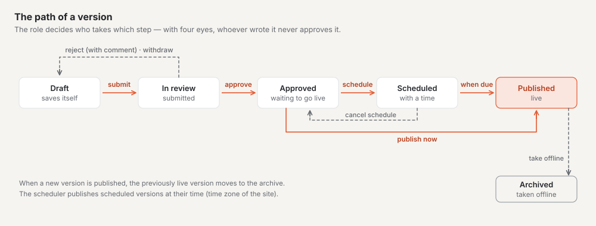
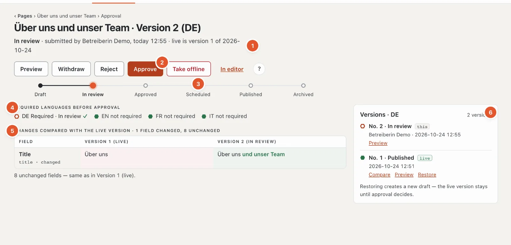
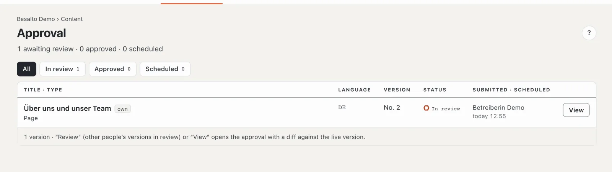

# Approval and publication

Nothing goes live unchecked. Every version goes through a fixed process: editors submit it, approvers review, approve and publish it — immediately or at a scheduled time. The live version on the website stays unchanged until a new one is published.

## Where

- “Content” mode › **Approval** — all versions waiting for review or publication.
- You open the approval of a single page in the page tree with the **“✓ Approval”** button in the row, in the editor via
  the “Approval” link next to the status, or from the list with **“Review”** or **“View”**.

Whoever may approve also learns about every submitted version through the **bell** (and by email if they wish); whoever
submitted learns when the version is rejected, approved or published — see
[Notifications](index.md#notifications).

> “Publish” here means: putting **one version** of a page live. “Publish” in Setup mode is something else — there the
> whole **site** is switched live for the first time.

## The life cycle of a version

At the top of the approval page, a track shows where the version stands:

**Draft → In review → Approved → Scheduled → Published → Archived**

| Status | Meaning |
| --- | --- |
| Draft | is being edited and saves itself automatically |
| In review | submitted, waiting for approval |
| Approved | reviewed, ready to publish |
| Scheduled | will be published at a set time |
| Published | is live on the website |
| Archived | an earlier live version, or taken offline |

Each language has its own versions and goes through the process on its own.

## Who may do what

| Step | Roles |
| --- | --- |
| Submit for approval, withdraw | Editor, Translator, Administrator, Owner |
| Approve, reject | Approver, Administrator, Owner |
| Schedule, publish, take offline | Approver, Administrator, Owner |

Buttons your role doesn’t have don’t appear at all. **“Approve”** and **“Publish”**, however, are also shown locked, with
the reason below — always **one** reason, in a fixed order (see the steps below). If the same reason applies to both, it
says “Approve and publish locked: …”.

## The approval page

1. **Header line:** status, who set it and when, and which version is live (“live is version 1 of …” or “no version
   live yet”).
2. **The steps** possible right now (preview, withdraw, reject, approve, schedule, publish, take offline) and “In
   editor”.
3. **The status track.**
4. **Required languages before approval:** ✓ or ✗ per required language. ✓ means the latest version of that language is
   no longer a draft; languages that aren’t required are shown for information.
5. **Changes** compared with the live version (otherwise with the previous one): one row per changed field with “old”
   and “new”, changed words highlighted, below it “N unchanged fields”. For the first version it says “First version —
   nothing to compare”.
6. **Versions** of this language: “this” marks the one shown, “live” the published one, older ones are under “Archive” —
   with “Compare”, “Preview” and “Restore”.

On the phone, the steps sit in a fixed bar at the bottom.

## The individual steps

### Submit for approval

In the editor or on the approval page: **“Submit for approval”**. The version changes to “In review” and appears in the “Approval” list. If required fields are missing, Basalto does not submit and marks the fields in the editor.

You submit several pages at once in the page tree via the bulk action (see [Pages](seiten.md)).

### Withdraw

If you submitted too early, **“Withdraw”** takes the version back into draft. This is possible as long as it is “In review”.

### Review

The approval page shows **what has changed** — compared with the live version or, if none is live yet, compared with the previous version. With “Preview” you see the page as it will look; “In editor” takes you to the content.

In the list of **versions** you compare an older version with the current one using “Compare”; “Close comparison” hides the comparison again.

### Approve

**“Approve”** sets the version to “Approved”. The button is locked — checked in this order — if

1. the four-eyes principle applies and you created or submitted the version yourself,
2. a required language is still missing (“Approval only with all required languages — missing: …”, see [Translating](uebersetzen.md)),
3. your role does not approve.

### Reject

**“Reject”** opens a **“Comment”** field with a note saying to whom the version goes back (“back to ‹name›”). Write what should change — the comment is mandatory (at most 2000 characters). The version goes back to the author as a draft; the comment then appears at the top of the editor under “Rejected”, and the person gets a notification.

### Schedule

Under **“Schedule”** you choose **Date** and **Time** (prefilled: tomorrow 08:00) and click **“Schedule publication”**. The time applies in the site’s time zone; if you work in a different time zone, the page points this out. A time in the past is rejected — for right away, use “Publish”. Until the scheduled time, the previous live version stays online.

- **“Reschedule”** changes the time.
- **“Cancel schedule”** sets the version back to “Approved”.

Publication is handled by a background service (the scheduler) to the minute. Its “heartbeat” is shown next to the scheduling field: if it reported within the last five minutes, all is well; otherwise it says in red “scheduled publications are not running” — inform your administrators then, because without it scheduled items stay put.

### Publish

**“Publish”** puts an approved or scheduled version live **immediately**. The previous live version is archived. The button is locked — checked in this order — if

1. the slug in this language is already taken by another published page,
2. the alt text requirement applies and an image has no alt text (see [Media](medien.md)),
3. your role does not publish.

### Take offline

**“Take offline”** takes the live version off the web — possible as soon as there is a live version, whatever status the latest version currently has. After the confirmation “Yes, take offline”, the page is no longer reachable in this language; the version is archived. The content itself is kept: with “Restore” in the list of versions it becomes a draft again, which goes through the process once more.

## Four-eyes principle

If the four-eyes principle is switched on, nobody may approve their own work: whoever created or submitted a version cannot approve it themselves. The approval page then shows “Four-eyes principle: whoever submits does not approve.”, and in the list your own versions are marked “own”.

It is switched on by an administrator under “Administration › Settings”, group “Approval”. It is off by default.

## The “Approval” list

The header counts “N awaiting review · N approved · N scheduled”. At the top you filter by **“In review”**, **“Approved”** and **“Scheduled”** — each with the number of versions — or show “All”. Each row names title, kind, language, version number, status and who submitted it when, or when it will be published; scheduled ones come first, by their time. “own” marks versions you submitted (without a submitter: that you wrote).

**“Review”** appears for versions submitted by other people; for all others the button is called “View”. If nothing is waiting, it says “Nothing awaiting approval”, for a filter without matches “Nothing in this filter”. The number on the “Approval” menu item counts what is waiting for review.

## Bringing back an older version

In the list of versions on the approval page, **“Restore”** creates a new draft from an older version. The live version stays until this draft has gone through the process.

## Frequently asked questions

**I have submitted — what now?**
The version is waiting in “Approval”. Whoever may approve sees it there and as a task on the “Overview”. If it is rejected, the comment appears in your editor.

**The page is published, but I want to correct something.**
Simply edit it in the editor. A new draft is created; the live version stays online until the correction has been approved and published.

**Can I approve and publish in one step?**
No, these are two steps: first “Approve”, then “Publish” or “Schedule publication”.

## Next

- [Translating](uebersetzen.md)
- [Pages and page tree](seiten.md)
- [Roles](../verwaltung/rollen.md)
