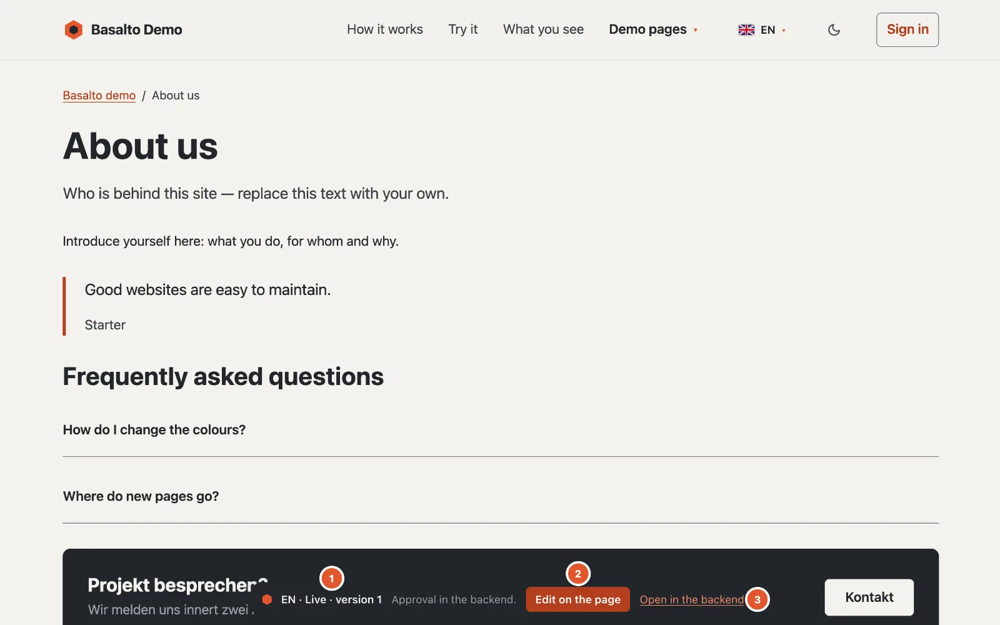
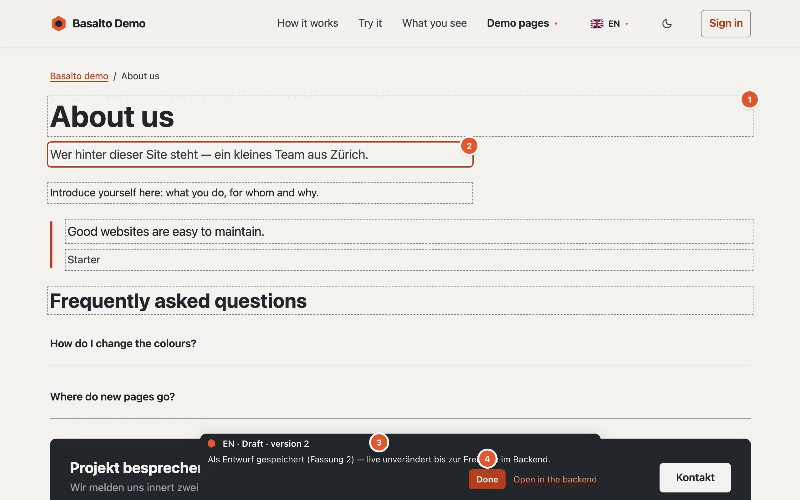

# Editing on the page

You can make small text corrections directly on the website: fixing typos, rearranging a sentence, shortening a title. Your change is saved as a **draft** — nothing changes on the website for visitors until the version has been approved and published in the backend.

## Where

On the website itself. If you are signed in to the backend in the same browser and may edit the page, a small **Basalto bar** appears at the bottom of every published page.

1. **Language and state** — for example “DE · Live · version 4”. If a newer version is already waiting, it is shown too: “Live · version 4 · In review: version 5”. Next to it a hint or the latest message.
2. **“Edit on the page”** switches on editing mode; there the button is called **“Done”**.
3. **“Open in the backend”** takes you straight to the editor of this page and language.

Visitors never see this bar.

## Who may

Everyone who may edit content: Editor, Administrator and Owner. The “Translator” and “Approver” roles alone are not enough — translations are created field by field in the translation view (see [Translating](uebersetzen.md)).

## How to proceed

1. Open the page on the website and click **“Edit on the page”** in the bar. The page reloads and now shows the latest state — including a draft that has not been published yet. The bar says how many fields are editable (“3 editable fields — changes are saved as a draft.”).
2. The editable texts have a **dashed outline** (1 in the picture). Click into one and change the text; the field being edited has a **frame** (2).
3. Just under a second after your last input, Basalto saves by itself. The bar reports “Saving …” and then, for example, “Saved as a draft (version 5) — live unchanged until approval in the backend.” (3)
4. Click **“Done”** (4) to leave editing mode. Otherwise it stays switched on for your session, on other pages too. If not everything is saved yet, Basalto asks “Not all changes are saved. Finish anyway?”.
5. Submit the version for approval in the backend — via “Open in the backend” and there “Submit for approval” (see [Approval and publication](freigabe.md)).

If the latest version has already been submitted, approved or published, your first change starts a **new draft**; the bar points this out.

## What can be edited here

- the **title** and the **introduction**,
- the content type’s text fields,
- text, text area and rich text in **blocks**, including nested ones.

In rich text, the frontend editor knows **Bold** (⌘B or Ctrl+B), **Italic** (⌘I or Ctrl+I) and **Link** (⌘K or Ctrl+K) — without a toolbar. With ⌘K a small window asks for the address; leaving it empty removes the link. Pasted text always arrives as plain text, without foreign formatting.

In single-line fields, **Enter** ends the input; in multi-line text areas Enter makes a new line. **Esc** leaves any field.

## What stays in the backend

- images, tables and embeds,
- rich text with more than simple formatting — the field is then not editable on the page. Simple means: paragraphs, subheadings, lists, quotes, dividers and line breaks, plus bold, italic, underline, strikethrough, code, superscript, subscript and links. Images, tables, task lists or embeds in the rich text make the field a case for the backend,
- adding, moving or deleting blocks,
- slug, metadata and all other settings,
- submitting, approving and publishing.

If there is nothing on a page that can be edited here, the bar reports “No text on this page can be edited here — please use the backend.”

## If something goes wrong

If a field could not be saved, it has a **red frame** and the bar states the reason.

**“This page has been changed elsewhere in the meantime — please reload so nothing is overwritten.”**
Someone changed the same version at the same time in the backend or on the page. Basalto then does not save, so as not to overwrite anything — and accepts nothing more on this page until it is reloaded. Reload the page and make your change again.

**“No connection — the change is not saved yet.”**
The network was gone. Check the connection; the next input tries again.

**“No permission to edit this page.”**
Your role does not (or no longer) allow this page or language — ask the administration.

**“The session has expired — please reload and sign in.”**
Sign in to the backend again and reload the page.

**The text is too long.**
Single-line texts have at most 300 characters, text areas 5000, rich text 20,000. You edit longer texts in the backend.

**I leave the page before it has been saved.**
The browser asks for confirmation if there are still unsaved changes.

## Next

- [Editing content with blocks](bloecke.md)
- [Approval and publication](freigabe.md)
