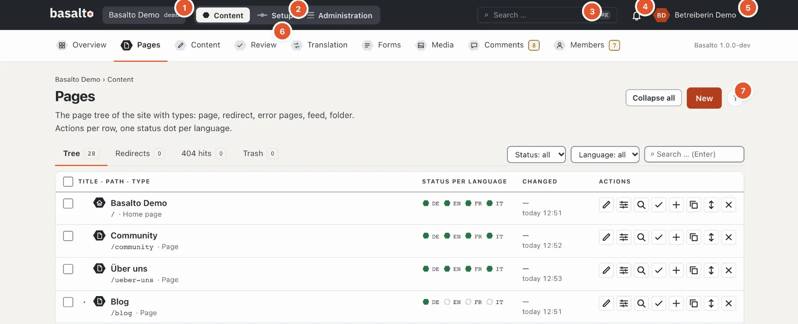
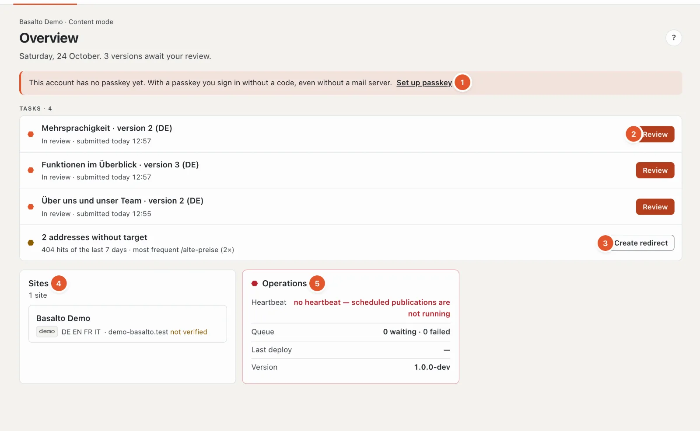
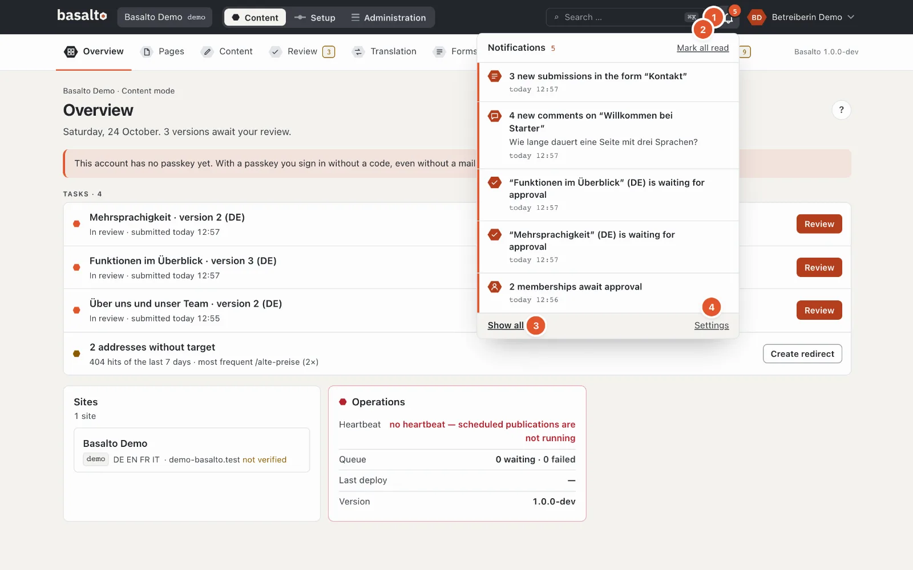
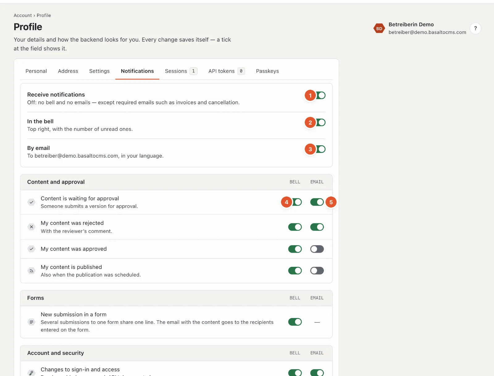
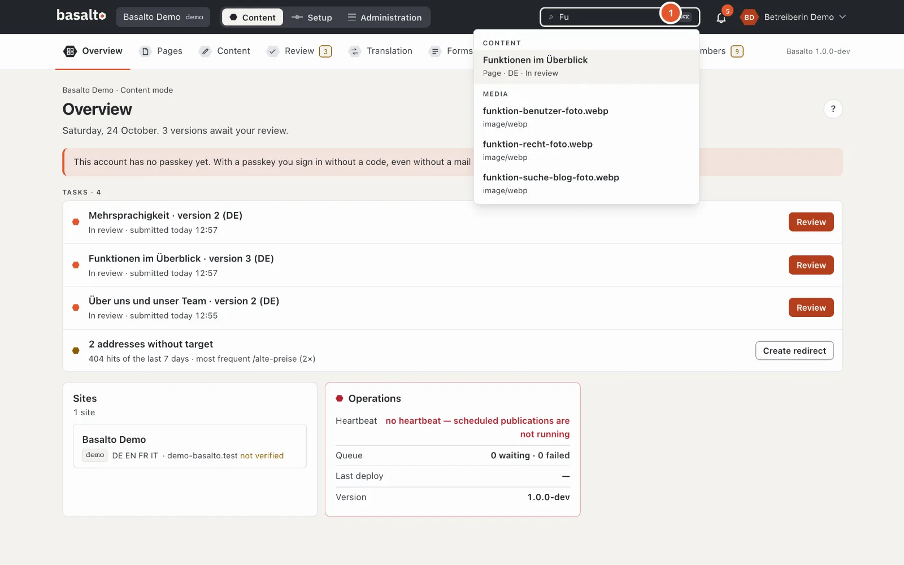

# Help for editors

This help explains the day-to-day work in the Basalto backend: creating pages, maintaining texts and images, translating, approving and publishing. You do not need any technical knowledge for this.

On almost every page in the backend there is a round **“?”** at the top right. It opens the help that matches that page — as a panel on the right edge, while the page behind it stays usable. It is quicker with the **?** or **F1** key; see [Help and keyboard shortcuts](#help-and-keyboard-shortcuts).

## What the help covers

| Page | What it is about |
| --- | --- |
| [Pages and page tree](seiten.md) | Creating, moving, copying and deleting pages; trash, redirects and 404 hits |
| [Editing content with blocks](bloecke.md) | Block editor, rich text, pasting from Word, preview, automatic saving, versions |
| [Media](medien.md) | Media library, uploading, folders, alt texts, image variants, replacing, trash |
| [Translating](uebersetzen.md) | Translation from the default language, required languages, fallback, “Translation” overview |
| [Approval and publication](freigabe.md) | Submitting, approving, rejecting, scheduling, publishing, taking offline; four-eyes principle |
| [Forms](formulare.md) | Creating forms, viewing, exporting and deleting submissions, email to recipients |
| [Comments](kommentare.md) | Moderating, replying to, marking as spam and deleting comments |
| [Members](mitglieder.md) | Members-only pages, sign-in without a password, approval, blocking, invitations |
| [Editing on the page](frontend-editor.md) | Changing texts directly on the website — as a draft |
| [AI suggestions](ki.md) | Have texts improved, fields translated, SEO data and alt texts suggested — only on click, as a draft |

## Roles

What you may do in the backend depends on your role in the site. Roles are assigned by an administrator under “Administration › Users”. This is how the templates are set up — your installation may have adapted them or created its own roles:

| Role | May |
| --- | --- |
| **Editor** | Create, edit and delete pages and content, manage media, maintain forms and submissions, moderate comments, submit versions for approval. Approving, publishing, setup and administration are not included. |
| **Approver** | Review submitted versions, approve or reject them, schedule publications, publish and take offline. |
| **Translator** | Translate content into the site’s other languages — the source language stays locked. |
| **Administrator** | Everything in the site, including setup, users, roles and settings. |
| **Owner** | Everything; the role cannot be changed, every site has at least one owner. |

What your role may not do does not appear in the menu. If you lack a right within a page, the backend shows the reason directly at the locked button — for example “Your role does not approve”. How roles are set up is described in the operations manual under “Roles and rights”.

## Layout of the backend

### The header

1. **Site** — if you work in several sites, choose the site here.
2. **Content · Setup · Administration** — the switch between the modes; you only see those your role needs.
3. **Search …** — the search (see [Search](#search)).
4. The **bell** — your notifications (see [Notifications](#notifications)).
5. Your **profile picture** and name — the menu with profile, settings, help and “Sign out”.
6. The **stations** of the mode, here with a number (see below).
7. The round **“?”** — help for this page.

### “Content” mode

This is where editorial work happens. Below the header are the stations:

- **Overview** — your tasks: versions to review, rejected items, missing translations in required languages, addresses without a target and notices such as missing alt texts. If nothing is pending, it says “Nothing is waiting for you”.
- **Pages** — the website’s page tree.
- **Content** — entries without a fixed place in the page tree, for example blog posts or people.
- **Approval** — everything waiting for review or publication.
- **Translation** — what is missing or outdated in other languages.
- **Forms** — forms and their submissions.
- **Media** — the media library.
- **Comments** and **Members** — only appear if the respective module is switched on for the site.

An **amber** number next to a station means: something is waiting for you there — for “Approval” versions to review, for “Translation” gaps, for “Forms” new submissions, for “Comments” and “Members” what is waiting. A **grey** number is for information only. The numbers are recounted every 30 seconds.

### The overview

At the top is the date and, in one sentence, what is due.

1. **Hints** — for example that your account has no passkey yet, that images without alt text are embedded, that the email of a form submission was not delivered, that a background job failed (with “Try again” and “Dismiss” if you manage operations) or that the installation has no licence yet.
2. **Tasks** with the matching button:
   - **In review** — other people’s versions that you may approve: “Review”.
   - **Approved** — waiting to be published; **Scheduled** — goes live at the set time.
   - **Rejected** — only your own versions, with “Revise”.
   - **Translation** — missing or outdated translations in required languages (from the 100 most recently changed items, at most 30 tasks).
3. **Addresses without a target** — 404 hits of the last 7 days with the most frequent address and “Create redirect”; only if you may publish.
4. **Sites** — the sites you work in, with languages and domain.
5. **Operations** — heartbeat (is the schedule running?), queue, last deploy and version. Red means: something is wrong here — for example, without a heartbeat scheduled publications do not run.

If nothing is due, it says “Nothing is waiting for you”.

### “Setup” mode

This is where the site is designed and built. Below the header is the **route**: nine stations in the order in which a
site comes about — each with the question it answers and the technical term below it:

| Station | Term |
| --- | --- |
| What is the site? | Site |
| What does it look like? | Theme · Design — below it the change to **Themes** |
| How is it built? | Layouts · Templates |
| How do people find their way? | Menus |
| What can be edited? | Content types |
| What are pages made of? | Blocks · Snippets |
| What can visitors send? | Forms |
| What does it start with? | Starter content |
| Ready to go live? | Publish |

Clicking a station opens a card: what the station means, its state (the same check as `basalto:check`) and the pages
that belong to it. A red ✗ or a yellow ! at a station shows where something is missing; a dashed grey ring means the station is still
waiting. **Esc** closes the card. At the end, **“Code”** branches off — the theme editor for anyone who writes the theme
themselves. On a phone the route opens as a list. Everything about it is in the separate help on setup:
[Setup](../einrichtung/README.md).

### “Administration” mode

“Sites”, “Modules”, “Users”, “Roles”, “Settings”, “Licence”, “Operations”, “Log”, “Passkeys” and whatever modules add.
These areas are usually a matter for administrators; they have their own help: [Administration](../verwaltung/README.md).

## Your account: profile and settings

At the top right you see your **profile picture** (or your initials). A click opens the menu with **“Profile”**, **“Settings”**, **“Help and keyboard shortcuts”** and **“Sign out”**; with the keyboard you choose with **↑ ↓** (Home and End jump to the first and last item), **Esc** closes it.

The profile has these tabs:

- **Personal:** first and last name, phone (choose the country code via the flag) and a **profile picture** (JPEG, PNG or WebP up to 5 MB, cropped to a square). Without a picture, your initials appear. The **email address** is changed by the administration.
- **Address:** street, postcode, town and country.
- **Settings:** interface language, time zone, date and time format, **start page after sign-in** (overview, pages, approval, translation or media), **appearance** (light, dark or as in your operating system), **items per page** (25, 50 or 100 — for content, media, form submissions and activity log), **sorting of lists** (newest or oldest first, by title) and the **help keyboard shortcuts** (on or off).

- **Notifications:** see [Notifications](#notifications).
- **Sessions:** where you are signed in — browser, IP address and “last active”; “this session” is the one you are working in. “Sign out” ends a session, **“End all others”** all but this one. Handy if you did not sign out on someone else’s device.
- **API tokens:** for programs that work with Basalto through the interface (for example an import). **“New token”**: name, site, **abilities** (read, write — never more than your role allows) and optionally an expiry date, then “Create token”. The token is shown **only once** — copy it right away. The list shows when a token was created and last used; “Revoke” blocks it at once after a confirmation.
- **Passkeys:** leads to the management of your passkeys (sign-in without a code, with fingerprint, face or device lock). There you also find **“Download my data (JSON)”** — everything Basalto stores about your account.

Every change saves itself and applies only to you.

## Notifications

The **bell** (1) at the top right shows in lava how many notifications are unread (from 100 on “99+”). A click opens the eight newest; unread ones carry the red line on the left. A click on a notification opens what it is about — if it comes from another site, the backend switches there. The tick at the edge marks one as read (a second click makes it unread again), **“Mark all read”** (2) clears them all at once, **Esc** closes. The bell checks every minute whether something new has arrived — only while the window is visible — and then gives a short swing. If you have switched notifications off entirely, the bell shows **“Switch on”**.

**“Show all”** (3) opens the **centre**: all notifications by day, with the filters “Unread” and by group, per line “Mark read” or “Mark unread” and “Remove”, at the top “Mark all as read” and “Remove read ones”.

What you receive depends on your role — for example:

| Notification | Who receives it |
| --- | --- |
| Content is waiting for approval | Whoever may approve |
| My content was rejected, approved, published | Whoever submitted the version |
| New submission in a form | Whoever sees forms and submissions — several submissions to one form share one line |
| New comment | Whoever moderates comments — bundled per piece of content |
| New membership awaits approval | Whoever manages members |
| The vendor’s support accesses your site | Whoever manages the site |
| Changes to sign-in and access | You yourself (new passkey, new API token) |
| Subscription, invoices, trial, domain, export | Owner and billing of the account (subscription only) |

What arrives in the bell and what by email is set in your profile under **“Notifications”** (also via “Settings” (4) at the bottom of the bell): a **main switch** (1), one switch each for **bell** (2) and **email** (3), and below each notification on its own, by group, with the columns **bell** (4) and **email** (5). If you also work in the vendor’s extranet, an **“Extranet”** column is added. **Required emails** such as invoices and cancellation always arrive — there only the bell can be switched off. Where a dash stands instead of a switch, the email is set up elsewhere: for forms on the form (recipients), for comments on the comments block. “Restore defaults” at the bottom resets all individual notifications to their default; the three main switches stay as they are.

## Search

You can also open the **“Search …”** field in the header with the keyboard shortcut **⌘K** (Mac) or **Ctrl+K** (Windows). 

Enter at least two characters. The search finds, at most six results per group:

- **Content** and pages by their title — drafts too, with type, language and status,
- **Media** by file name or title — a result opens the media library with this search term,
- **Users** by name or email address, provided you may manage users.

Use the arrow keys to select a result, **Enter** opens it, **Esc** closes the search. On a phone the search is hidden.

## Help and keyboard shortcuts

The help panel shows the page that matches your work and searches the whole documentation: this editorial help, operations, the developer docs and the marketplace. Type a keyword at the top of the panel; a result takes you straight to the matching section. Links in the text open the next help page in the panel itself. **“Open as page”** shows the page at full width, with all help pages on the left.

**Width of the panel:** drag the left edge of the panel to the left or right with the mouse. With the keyboard, use **← →** on the handle (with Shift in larger steps); **Home** and **End** jump to the largest and smallest width. Basalto remembers the width in your profile — the next time, even on another device, it is the same. On narrow screens the panel fills the whole width.

**Images:** a click on an image in the help shows it large, with the background blurred. **Esc**, a click beside it or **×** closes it.

| Key | Effect |
|---|---|
| **?** or **F1** | open or close help |
| **/** | search the open help |
| **Esc** | close help |
| **⌘K** or **Ctrl+K** | search the backend |
| **↑ ↓** and **Enter** | choose and open a result |

In input fields and editors — the code editor too — **?** and **/** are ordinary characters; there only **F1** opens help. The list of keys is also in the panel under **“Keyboard shortcuts”**.

## Key terms

- **Version** — each language of an entry has numbered versions. What is live on the website is always a specific version. Changes go into a draft; the live version stays untouched until a new one is published.
- **Status of a version** — “Draft”, “In review”, “Approved”, “Scheduled”, “Published”, “Archived”. More on this under [Approval and publication](freigabe.md).
- **Default language** — the site’s main language. Translations are created from it.
- **Required language** — a language without whose version nothing is approved.
- **Automatic saving** — there is no save button in the editor; changes save themselves after a short pause.

## Frequently asked questions

**I changed something, but I do not see it on the website.**
Changes are saved as a draft. They only become visible once the version has been submitted, approved and published. See [Approval and publication](freigabe.md).

**I do not see the “Publish” button, or it is locked.**
The roles “Approver”, “Administrator” and “Owner” may publish. As an editor, you submit the version for approval.

**Where do I find deleted pages or images?**
In the “Trash” tab under “Pages”, or in the media library’s “Trash”. See [Pages](seiten.md) and [Media](medien.md).

## Next

- [Pages and page tree](seiten.md)
- [Editing content with blocks](bloecke.md)
- [Media](medien.md)
