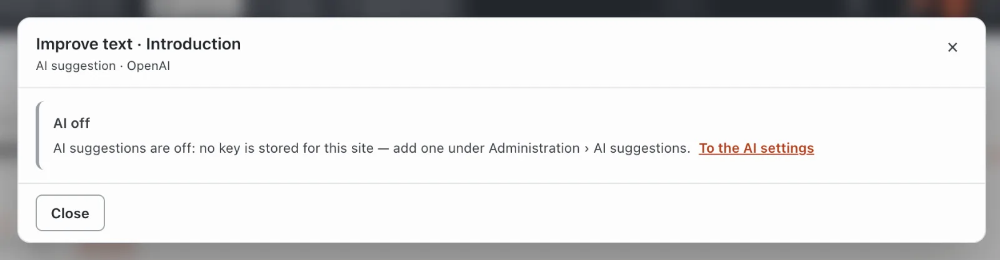
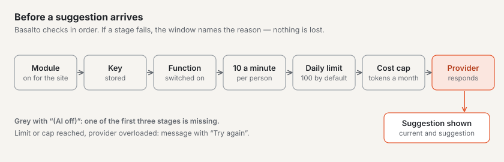
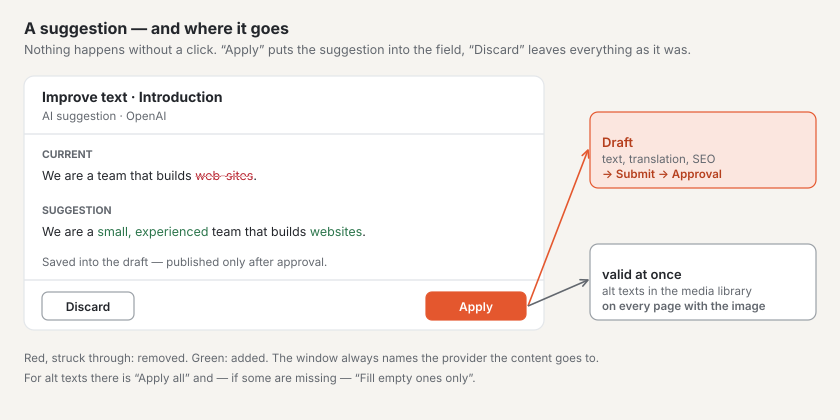
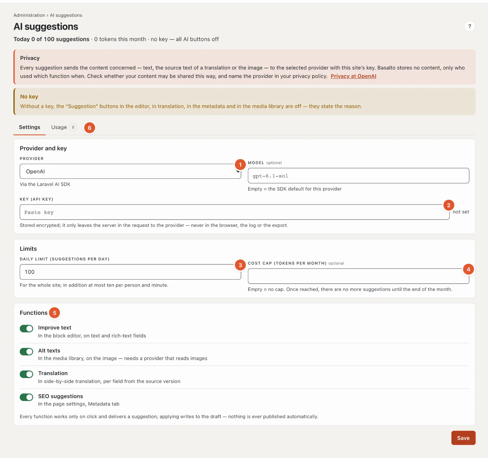

# AI suggestions

With the “AI suggestions” module, an artificial intelligence suggests how a text could read better, what alt text an image needs, how a field could be translated, or which page title and description fit the search results. Three rules always apply:

- **Nothing happens without a click.** The AI only works when you click **“✦ Suggestion”** — never in the background, never when a page opens.
- **It is always a suggestion.** You see it next to the current text and decide: **“Apply”** or **“Discard”**.
- **Applying writes to the draft.** A suggestion is never published automatically — it takes the same route as every change: draft, submit, approval. The only exception are alt texts in the media library (see below).

## Where the buttons are

| Function | Where | Who may |
| --- | --- | --- |
| **Improve text** | In the block editor below every text, text area and rich-text field, also below the introduction | Editor, Administrator, Owner |
| **Translation** | In side-by-side translation below every translatable field — the fourth button next to “→ copy” | everyone who may translate |
| **SEO suggestion** | In the page settings, “Metadata” tab, per language | Editor, Administrator, Owner |
| **Suggest alt texts** | In the media library, in the detail of an image, below the alt texts | everyone who may edit media |

The buttons only appear when the module is switched on for the site. Empty fields have no button — without text there is nothing to improve.

For **alt texts** the button only exists for raster images (JPG, PNG, WebP, GIF) — not for SVG and PDF — and only if the chosen provider can read images (DeepSeek and Groq cannot).

**Grey with “(AI off)”** means: no key is stored for the site or the function is switched off. A click states the reason — the dialog then only has “Close” and the link **“To the AI settings”**.

## How it works

1. Click **“✦ Improve text”** below the field (or “Suggestion”, “SEO suggestion”, “Suggest alt texts”).
2. A dialog opens: “Suggestion on its way …”. After a few seconds, **current** and **suggestion** are shown side by side; removed words in red, new ones in green.
3. **“Apply”** puts the suggestion into the field. You can then keep editing it like any text.
4. **“Discard”** closes the dialog — nothing changes.

In an open draft, autosave stores the applied text as if you had typed it. If the editor shows a published version, the draft is only created with **“Save as new draft”**; the published version stays as it is.

### Improve text

The AI fixes spelling, grammar and punctuation and makes the text clearer — in the same language, with the same message and roughly the same length. In rich text, headings, lists, links and emphasis are kept. If a rich text contains **images, tables, task lists or embeds**, the AI makes no suggestion — these parts would be lost on the way.

### Translation

In side-by-side translation, the AI always takes the text of the **source version** in the default language — not what is in the target field. “Apply to target field” puts the translation into the field of the target language; it is saved to the draft of that language. Check technical terms and names.

### SEO suggestion

From the content of the latest version, the AI suggests a **page title** (60 to 70 characters at most) and a **description** (160 characters at most). “Apply” sets both fields; the search result preview below shows the result at once.

If there is no version in the language yet, it says “content first, then metadata”; if the page has no text yet, there is no suggestion.

### Alt texts

The AI looks at the image and suggests an alt text for **every language of the site**. **“Apply all”** sets all languages. If only some alt texts are missing, there is also **“Fill empty ones only”** — the existing ones then stay as they are.

**Note:** Media have no versions. Applied alt texts are saved immediately and apply at once on all pages showing the image. Applying is recorded in the log. Check the suggestion carefully — the AI knows neither the names of the people nor the context.

## Privacy

Every suggestion sends the content concerned to the provider your site has chosen (such as OpenAI, Anthropic or Mistral): the text of the field, the source text of a translation, the content of a page for the SEO suggestion, or the image. The dialog names the provider every time. Do not send anything that must not leave the house.

Basalto itself stores **no content**: the log only records who used which function on which content and when, and whether the suggestion was applied.

## Switching on and limits

An administrator sets up the AI under **Administration › AI suggestions**. At the top it shows how many suggestions were made today and how many tokens were used this month.

1. **Provider** — OpenAI, Anthropic (Claude), Google Gemini, Mistral AI, xAI (Grok), DeepSeek, Groq or OpenRouter. The **model** is optional; if empty, the provider’s default applies.
2. **Key (API key)** — from the provider. It is stored encrypted and only leaves the server in the request to the provider; afterwards only “set ✓” with the last characters is shown. “Remove key” switches off all AI buttons of the site.
3. **Daily limit** — suggestions per day for the whole site, 100 by default (1 to 10,000). Once reached, the dialog says so; it continues the next day.
4. **Cost cap** — tokens per month (from 1000), empty means no cap. Once reached, there are no more suggestions until the end of the month.
5. **Functions** — one switch each for improve text, alt texts, translation and SEO suggestions.
6. **Usage** — per month the number of suggestions, how many were applied and how many failed, the tokens and the split per function. No content is shown there.

In addition, always:

- **At most ten suggestions per person and minute.**
- **At most 12,000 characters** go to the provider; a longer text gets no suggestion.
- **Provider errors** (overloaded, credit used up, key rejected) appear as an understandable message with **“Try again”**. Nothing is lost.

## Frequently asked questions

**I don’t see a “Suggestion” button.**
The module is not switched on for the site, or the field is empty. Translators do not see “Improve text” and “SEO suggestion”.

**The button is grey and says “(AI off)”.**
The key is missing, or the function is switched off. Ask the site’s administration.

**Is the suggestion already on the website?**
No. Except for alt texts, it lands in the draft and, like every change, needs submission, approval and publishing.

## Next

- [Editing content with blocks](bloecke.md)
- [Setting up AI suggestions](../betrieb/ki.md)
