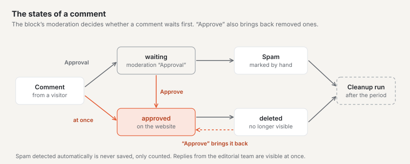
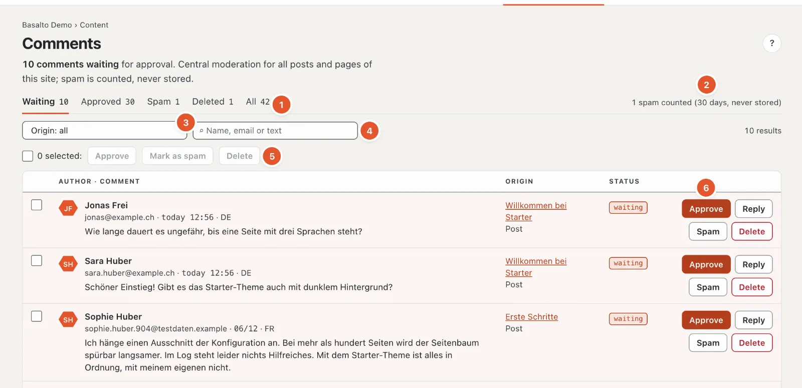
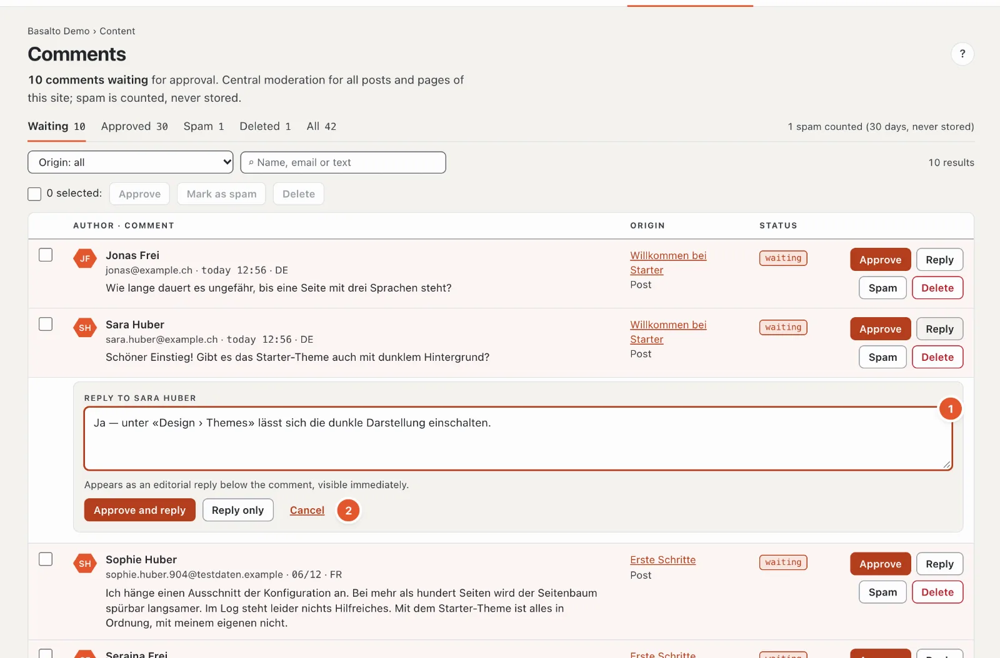

# Comments

With the “Comments” module, visitors can comment on posts and pages — without an account. In the backend you moderate all comments of the site in one place.

## Where

“Content” mode › **Comments**. The menu item only appears if the module is switched on for the site (an administrator does this under “Administration › Sites”, “Modules” tab). The number on the menu item shows how many comments are awaiting approval.

Everyone who may edit content may moderate: Editor, Administrator and Owner.

## How comments get onto a page

Comments appear wherever the **“Comments” block** is placed on a page. In the starter theme, the block has these settings:

| Setting | Effect |
| --- | --- |
| Moderation | “Freigabe” (approval): every comment waits in moderation · “sofort” (immediately): visible until someone removes it |
| Sort order | oldest or newest first |
| Number per page | how many comments appear at once (1 to 100, 20 by default) |
| Replies | visitors may reply on one level, or not at all |
| Notification | email on a new comment to the editors, to the author of the post, or off |
| Close comments | no new comments any more; existing ones stay visible |

You change the settings like any other block in the page’s editor; like any other change, it only takes effect once published.

If moderation is set to “Freigabe”, replies from visitors wait for approval too. After sending, the commenter sees “Your comment is awaiting approval.” Name, email and comment are required, a website is optional; the email address is never published.

## Moderation

1. **Status** — “Waiting”, “Approved”, “Spam”, “Deleted” or “All”, each with its count. If comments are waiting, the page opens directly with “Waiting”.
2. **Spam counter** — how much spam was rejected in the last 30 days. The total since the start is in the footer.
3. **Origin** — only the comments of one page or post.
4. **Search** by name, email or text.
5. **Several at once** — see below.
6. **The actions** per comment.

Comment forms use the same spam protection as [forms](formulare.md), including the computing task for the browser. If **“Check Stop Forum Spam”** is on under Administration › Settings › Spam protection, comments from known spam senders go straight to “Spam” — a mistake can be approved there.

Each row shows the author with email (and website, if given), date and language, the text, for replies “↳ Reply to …”, the origin with a link and the status. Editorial replies carry the label “Editorial”. 50 comments are shown per page; page through the rest at the bottom.

The actions — only those that fit the status appear:

- **“Approve”** — the comment appears on the website. For all comments not yet approved.
- **“Reply”** — opens a reply field (see below). For waiting and approved comments.
- **“Spam”** — marks the comment as spam; it disappears from the website immediately. Editorial replies cannot be marked as spam, only deleted.
- **“Delete”** — removes the comment from the website immediately.

Deleted comments and those marked as spam stay in moderation for a while (filter “Deleted” or “Spam”). With “Approve” you bring back a comment removed by mistake.

## Replying

1. Click **“Reply”** on the comment and write your reply in the **“Reply to …”** field (2 to 5000 characters).
2. If the comment is still waiting, choose **“Approve and reply”** (both in one step) or **“Reply only”** — then the comment keeps waiting. For approved comments the button is simply called “Reply”. “Cancel” closes the field.

On a phone there is only “Approve and reply” or “Reply”.

Your reply appears **immediately** below the comment, marked as an editorial reply, with your name. Replies exist on one level: if you reply to a reply, yours appears below the same original comment.

## Several comments at once

Tick the boxes in front of the comments (or “Select all on this page” at the top) and choose **“Approve”**, **“Mark as spam”** or **“Delete”**.

## Spam

Automatically detected spam — for example from programs that fill in forms in bulk — is **never stored**, only counted. The number is shown at the top of the moderation. The protection is the same as for forms: an invisible field, a time check and a limit per IP address. Whatever still gets through, you mark by hand with “Spam”; this is counted as well.

## Notification

New comments are announced by the bell at the top right (several on one piece of content share one line). The email for it is not set in your profile but on the “Comments” block (setting “Notification”).

## Data protection

At the bottom of the page, the “Data protection” box summarises what is stored:

- **IP address** — only as a checksum, for the per-IP limit; the address itself is not stored.
- **Email address** — stored, but never published.
- **Deletion** — a nightly cleanup run permanently deletes deleted comments and spam after the configured period, **365 days** by default. An administrator changes the period under “Administration › Settings”, group “Retention”, “Keep deleted comments and spam”. Approved and waiting comments are kept.
- **On request** — data access and deletion per email address are handled by the administration under “Administration › Users”.

Anyone who comments explicitly consents to the publication of their name and comment.

## Frequently asked questions

**A comment is not visible on the website.**
Check the status in moderation. “waiting” means it still has to be approved. If the embedding is set to “sofort” (immediately), it appears without approval.

**I do not want any more new comments on a post.**
In the “Comments” block of this post, tick “Close comments”. Existing comments stay visible.

**I deleted a comment by mistake.**
Filter by “Deleted” and click “Approve” on the comment.

## Next

- [Members](mitglieder.md)
- [Help for editors](index.md)
