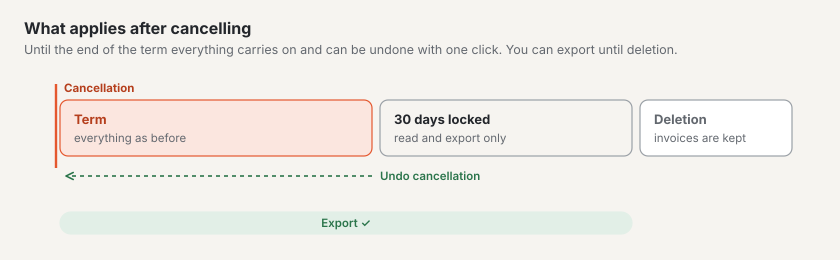

# Export and cancellation

Under **Administration › Account › Export and cancellation** you collect your data and cancel your subscription. The
account's owner, administration and billing see the tab; only the **owner** can cancel.

## Export

“Your data stays yours”: you can create the full export **at any time** — not only when you leave.

1. Under “Scope” choose **Entire account** (owner only) or **one site**.
2. Choose “Create new export”. The export is created in the background; the bar shows how far it is. You can leave the
   page.
3. When it is ready you get an **email with a link**. The link is valid for **7 days**; sign in to download it. After
   that we delete the file — simply create a new one if you need it.

What it contains: content as JSON with all versions and languages, media with their image variants, theme, navigation,
forms, settings and users with their roles. Form submissions (personal data) are not included. The export has the same
format as the import: **export → empty installation → import** gives you the same site, even on your own server.

Only one export runs at a time. Exports may be created by the owner (site or entire account) and by the account's
administration and a site's owner (that site only).

## Cancelling

1. The box “Cancel subscription” shows your dates: **term until**, what applies **afterwards** and the day of
   **deletion**.
2. Enter the **account name** exactly as shown and tick “I have created the export or do not need it”.
3. Choose “Confirm cancellation”. You will receive an email with all dates.

What then applies:

| Period | What applies |
| --- | --- |
| Until the end of the term | Everything as before. The term ends with the paid period; during the **trial immediately**. No further invoice is issued. |
| 30 days after that | **Locked:** your website only shows “This site is no longer available.” You can still read and export everything in the backend but no longer change anything. Other users can no longer sign in. |
| On the day of deletion | We permanently delete sites, media and users. Your account and your **invoices remain**, as the law requires. Your alias becomes free again. |

We remind you by email **seven days** and **one day** before deletion.

During the term a banner at the top of the backend reads: “Cancelled · term until … · then locked for 30 days ·
deletion on …”.

## Withdrawing the cancellation

Until the end of the term one click is enough: **“Withdraw cancellation”** in the banner at the top or in the box “What
applies now”. Your subscription then simply continues as if nothing had happened. After the end of the term this is no
longer possible — the site is locked and will be deleted.

## Move on a plan change

If you switch between **Start** and **Standard** or **Pro**, your sites move to another platform. This happens by
itself:

- During the move (usually a few minutes) you can read in the backend but not save anything. A banner shows it.
- Your website stays reachable the whole time, and its **addresses stay the same** — alias and own domains.
- Afterwards you receive an email. Sign in with the code by email; set up **passkeys** and **two-factor sign-in**
  again.
- Check your sites and choose **“Complete move”** under “Export and cancellation”. Only then do we delete the old copy.

## Frequently asked questions

**Can I continue my site on my own server later?**
Yes. Create an export of the site and import it into a Basalto installation (`basalto:import`).

**I can no longer find the link from the email.**
Under “Export and cancellation” the export is listed with “Download” as long as it is available.

**I have cancelled — can I still export?**
Yes, until deletion: during the term and during the 30 days of the lock.

**Why is the “Cancel subscription” box missing?**
Only the account owner can cancel. You can see your role at the top of the account (“Owner”, “Administration”,
“Billing”).

## Next

- [Domains](domains.md)
- [Sites](../verwaltung/sites.md)
