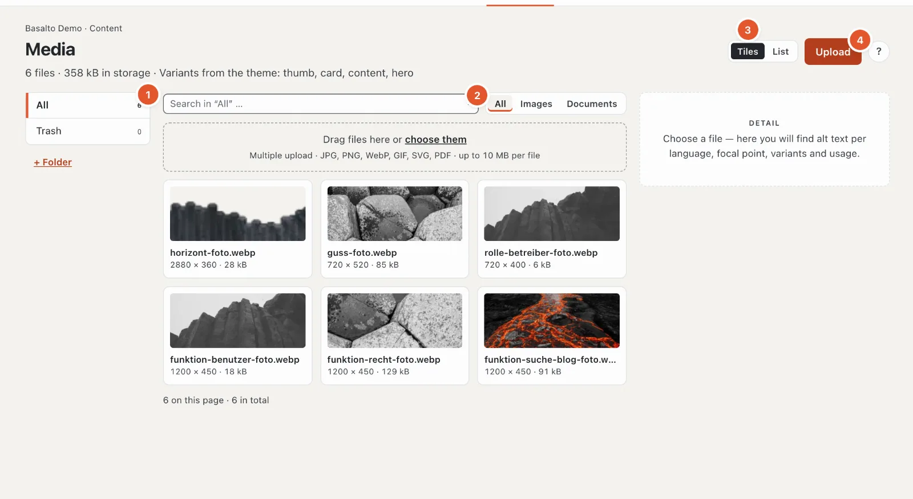
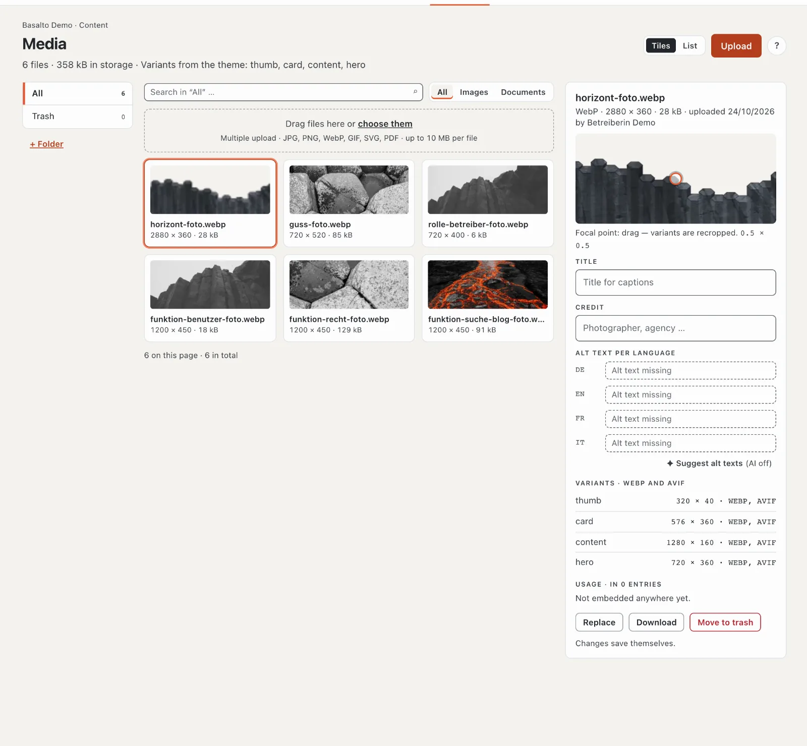
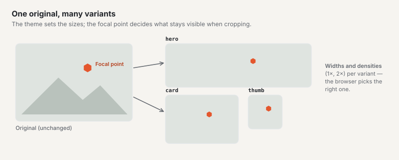
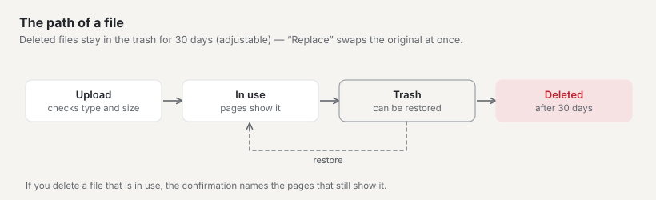

# Media

The media library holds all images and documents of the site. From here you embed them in pages and content. You upload an image once — Basalto creates the right sizes for every device by itself.

## Where

“Content” mode › **Media**.

The header names the number of files, the storage used and the **variants from the theme** (the sizes Basalto cuts from every image). The folders are on the left (1), the files in the middle, and on the right the **detail** of the selected file. At the top you search and filter by type (2: “All”, “Images”, “Documents”) and switch the view between “Tiles” and “List” (3).

- **Search:** across file name, title and credit — only in the open folder (“Search in ‘All’” searches everything); Enter starts it.
- **List:** columns dimensions (“vector” for SVG), size, state (for example “alt text missing”) and uploaded. Order and number per page come from your profile.
- **Empty:** “No files yet” (then the whole area is a drop area), “This folder is empty”, “No matches” or “The trash is empty”.

## Uploading files

1. On the left, open the folder the files belong in (or “All”).
2. Drag the files onto the area **“Drag files here or choose them”** — or click **“Upload”** (4).
3. Basalto shows the state of each file — waiting, uploading, done or rejected — and at the top for example “2 of 3 done · 1 rejected”. For images, “Generating variants …” then appears briefly. While an upload is running, a second one is blocked.

Allowed are **JPG, PNG, WebP, GIF, SVG and PDF up to 10 MB per file**; several files at once are possible. A file is rejected with a reason: wrong type, too large, or an SVG containing a script (for security). If your site has a **storage quota**, the media library warns from 90 % and reports “Storage full — upload blocked.” when it is full. When replacing, the old file doesn’t count.

Roles with “Media · edit” may upload and maintain details; folders, replacing and the trash require “Media · delete”.

Images you paste in the editor from Word or a web page also end up here (see [Editing content with blocks](bloecke.md)).

## Folders

- **“+ Folder”** creates a new folder — inside the folder currently open (at most 6 levels, names up to 120 characters). Enter a name, “Create”.
- **✎** renames a folder, **✕** deletes it — both appear when you hover over the folder. The files in it (also from subfolders) are not lost; they move to “All”.
- You move a file in the detail with the **“Folder”** field.

## The detail of a file

Click a file. On the right you see type, dimensions, size, when and by whom it was uploaded, and:

- **Preview with focal point** — drag the dot onto the most important part of the image (for example a face). Cropped variants are then cut so that this area stays visible. It is saved when you let go; the numbers below (0 to 1 per axis, 0.5 × 0.5 is the centre) show the position. Only raster images are recut.
- **Title** and **Credit** (for example photographer or agency).
- **Alt text per language** (see below).
- **Folder**.
- **Variants** — the sizes Basalto has created for the theme, each with width × height and formats (for example “576 × 360 · WEBP, AVIF”); “pending” while they are still being created.
- **Usage** — which content the file is embedded in.

All details **save themselves**; a “✓ saved” confirms it. “Download” downloads the original.

## Alt text

The alt text describes an image for people who cannot see it, and for search engines. Write briefly what the image shows and what it is for — a separate text for each language of the site.

**“Suggest alt texts”** lets the AI write an alt text per language if the “AI suggestions” module is set up — the suggestions appear in the field right away; check them (see [AI suggestions](ki.md)). Otherwise it says “(AI off)”.

If the **alt text requirement** is switched on in your site:

- In the detail, the label “Required” appears next to “Alt text per language”.
- Images without alt text carry the notice “Alt text missing” in the overview, with the languages concerned.
- Content that contains an image without alt text in its language **cannot be published**. The approval names the images concerned.
- On the “Overview”, a notice appears with the number of embedded images without alt text.

An administrator switches the requirement on under “Administration › Sites”, open the site, tab “General”, **“Alt text required”** (see [The site](../einrichtung/site.md)). Some themes require alt texts on their own — the Starter theme does.

## Image variants

On upload, Basalto creates from every image the sizes the theme provides for — for example a small thumbnail, a card image and a large stage image — in the modern WebP format, depending on the theme additionally AVIF and at double resolution for high-resolution screens. The website delivers the right size to every device. You do not need to do anything for this; there is no need to shrink images beforehand.

There are no variants for SVG graphics and PDF documents.

## Replacing a file

With **“Replace”** in the detail you upload a new file in place of the old one — such as an updated photo or a new price list. All pages that use the file then show the new one; you do not need to embed anything again. The variants are regenerated, and the file name changes to that of the new file.

**Caution:** the old original and its variants are **deleted immediately** — without the trash. If you still need the old file, download it first.

## Trash

**“Move to trash”** in the detail moves a file to the trash. If it is still embedded, the confirmation names the entries; you confirm with “Move to trash anyway”. If it isn’t embedded anywhere, a short confirmation is enough. The detail of a deleted file says “In the trash since …”.

- The **“Trash”** folder on the left shows all deleted files.
- **“Restore”** in the detail brings a file back.
- After **30 days** in the trash, a nightly cleanup run deletes the file permanently — original and variants. The period can be changed under “Administration › Settings” (group “Media”, “Media library trash”).

Until the permanent deletion, pages that still use the image show a variant that has already been created; after that, the spot stays empty. So check the “Usage” before deleting.

## Choosing images in the editor

An image field in the editor opens the media library as a window with **“Choose”**: search by name or number (#12), folders, **“Upload”** right here (raster images only, into “All”), the badge “alt text missing” on images without alt text (it later blocks publishing if the requirement applies). For galleries you choose several images; you then order them in the field.

## On the phone

The folders are a select field at the top, the detail opens as a full-screen sheet, and a fixed bar at the bottom carries “Upload”.

## Frequently asked questions

**I cannot find an image any more.**
Search for the file name at the top of the media library or in the search in the header. Select “All” on the left so that all folders are searched. Also look in the “Trash”.

**Why can I not publish my page?**
If the approval shows “Alt text missing”, add the alt text of the images named here in the media library — in the language of the page.

**Do I have to shrink images before uploading?**
No. Upload the image in good quality (up to 10 MB); Basalto creates the sizes itself.

## Next

- [Editing content with blocks](bloecke.md)
- [Appearance: themes, design and image variants](../einrichtung/aussehen.md)
