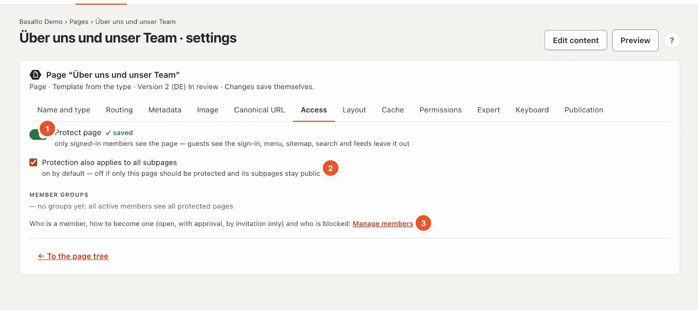
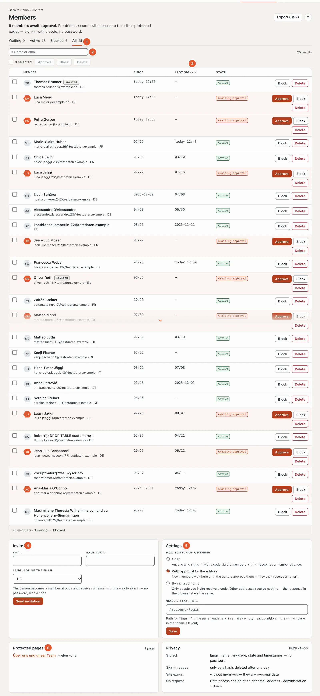

# Members

The “Members” module makes pages visible to signed-in members only — a club area, documents for partners, minutes. Members sign in **without a password**: they enter their email address and receive a code by email. In the backend you see all members of the site, approve new ones, block and invite.

## Where

- “Content” mode › **Members** — the list, invitations, the settings and the protected pages at a glance. The number on the menu item shows how many members await approval.
- In the settings of each page, tab **“Access”** — this is where you protect a page.

The menu item only appears when the module is switched on for the site (“Administration” mode › “Sites”, open the site, tab **“Modules”**; off by default — see [The site](../einrichtung/site.md#modules-tab)).

| Role | May |
| --- | --- |
| Editor | view, approve, block and invite members; protect pages |
| Administrator, Owner | additionally delete memberships, export the list (CSV) and change the settings |

## Protecting a page

Open the page’s settings (“Settings” in the page tree), tab **“Access”**.

1. Switch on **“Protect page”**. The change saves itself and applies at once — also to the version already published.
2. **“Protection also applies to all subpages”** is on by default: everything below this page is then members-only too. Switch it off if only this one page should be protected.

There are no groups of members: all active members see all protected pages of the site (which is why “Member groups” says “no groups yet”). The link **“Manage members”** (3) leads to the list.

A **folder** can be protected as well — handy for a whole members’ area: all pages in the folder are protected.

If a page sits below a protected page, the “Access” tab shows “Protected by “…”” at the top. The page is then protected, whatever you set on the page itself — it can only be opened at the ancestor.

### What guests see

- Instead of the content, a **“Sign-in required”** page with the sign-in form — neither the title nor the text of the protected page. If the site has a “401” error page, its text appears above.
- Protected pages are missing from the **menu**, the **sitemap**, the **search**, **lists** and **feeds**. Members see them in the menu once they are signed in.
- Search engines receive status “401” and “noindex”; none of it ends up in an index.

Protected pages never come from the page cache. Signed-in members always see the fresh page, for themselves only.

### If the module is off

Protected pages stay protected — but nobody can sign in. Guests only see “This page is for members only.” The site’s editors always see protected pages while signed in to the backend (preview, editing on the page).

## How to become a member

Under “Members” › **Settings** an administrator chooses the rule for the site:

| Rule | What happens |
| --- | --- |
| **Open** | Anyone who signs in with a code via the members’ sign-in becomes a member at once. |
| **With approval by the editors** (default) | The membership is created at the first sign-in but waits until the editors approve it. The member then receives an email. |
| **By invitation only** | Only invited addresses receive a code. Nothing is sent to other addresses — the response in the browser stays the same, so nobody can probe who is a member. |

With “With approval”, the bell at the top right announces new requests (“… would like to become a member”; several share one line).

The sign-in appears on every protected page and on the site’s sign-in page (`/account/login`). In the Starter theme, **“Sign in”** at the top right leads there. Under **“Sign-in page”** you can instead name a page of your own on which your theme shows the sign-in — a path starting with “/”, at most 200 characters. It also applies to the links in the emails. “Save” stores the rule and the sign-in page.

### Inviting

Under “Members” › **Invite**: email address, optionally a name, the language of the email — **“Send invitation”**. The person becomes a member at once and receives an email with the way to sign in; in the list they carry the label “invited”.

- If the address is already waiting for approval, the invitation makes it active at once.
- If it is already active, it only receives the email again.
- A blocked address receives no invitation; approve it again first.

## The list

1. **State** — “Waiting”, “Active”, “Blocked”, “All”, each with its count. If members are waiting, the page opens with “Waiting”.
2. **Search** by name or email.
3. **Since** — when the membership was created; **Last sign-in** — “—” means: never signed in.
4. **Invite** and 5. **Settings** (rule and sign-in page), see above.
6. **Protected pages** — all protected pages of the site with a link, and the **Data protection** box.

50 members are shown per page; on a phone as cards one below the other.

The actions per member:

- **“Approve”** — the membership becomes active; whoever was waiting receives an email. This also unblocks blocked members.
- **“Block”** — the person no longer sees any protected page, even after signing in again.
- **“Delete”** (Administrator, Owner) — the membership disappears. The account behind it remains, because it may hold licences or marketplace entries; a person is deleted completely via data protection (see below).

Use the checkboxes to select several members at once. **“Export (CSV)”** at the top right downloads the filtered list (email, name, language, state, timestamps) — with semicolons as separators, so Excel opens it directly. Every export is logged.

## Data protection

- Stored are email, name, language, state and timestamps — **no password**. Sign-in codes only as a hash; the nightly clean-up removes them after one day.
- **Access and erasure** per email address are handled by the administration under “Administration › Users” (or `php artisan basalto:privacy`): the information lists the account and memberships; erasure removes the memberships and anonymises the account.
- The **export of a site** (move, template) does not take members along — they are personal data. The protected pages do go along.

## For theme authors

The tags ``, `` and `` are described in [Lava — the theme language](../entwickler/lava.md#member-tags).

## Frequently asked questions

**A member cannot see the page.**
Check the state in the list: “Awaiting approval” or “Blocked” do not open a protected page. And: is the person signed in to the same site? Accounts are per site.

**I can see the protected page although I am not a member.**
You are signed in to the backend — the site’s editors always see protected pages. Sign out or open a private window to see the page as a guest.

**No code arrives.**
Check the spam folder. If the site is set to “By invitation only”, only invited addresses receive a code.

## Next

- [Comments](kommentare.md)
- [Community](../community/README.md)
