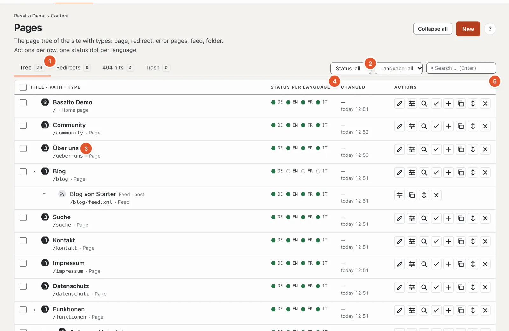
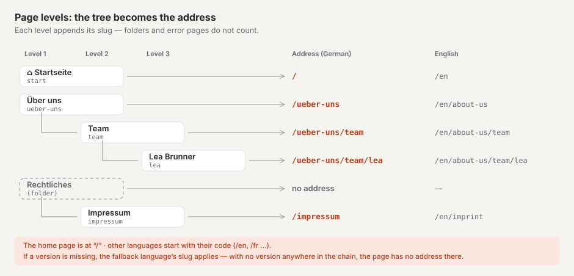
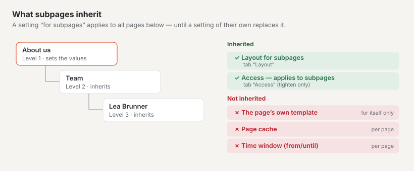
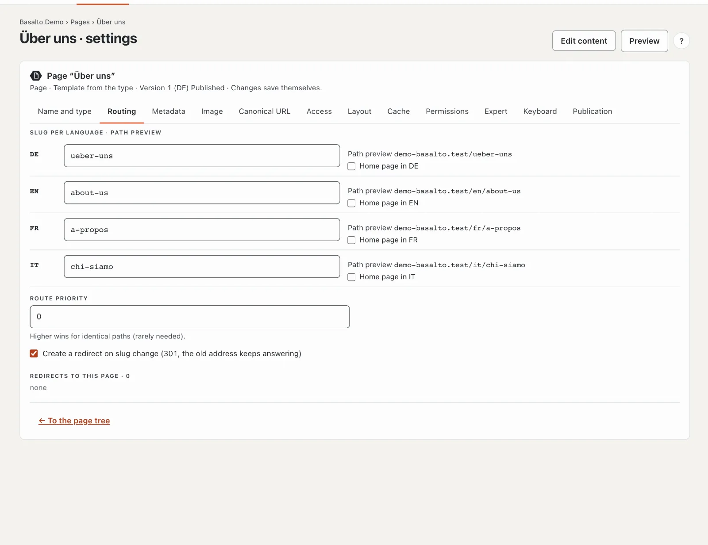
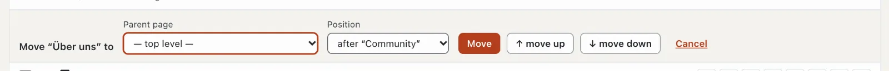

# Pages and page tree

The page tree shows all pages of the website in their order: the main pages at the top, the subpages indented below
them. The tree determines the pages’ **addresses**, the **menus** and the **breadcrumbs** (“Home › About us › Team”).
Where a page sits in the tree is therefore more than order — it decides how visitors find it.

## Where

“Content” mode › **Pages**. The page has four tabs: “Tree”, “Redirects”, “404 hits” and “Trash”; the number next to
each says how many entries there are.

## The tree

Each row shows **title**, **path** and **type** (3), next to it a **status dot** per language (4) and on the right the
**actions** (5). The legend below the tree explains the dots:

| Dot | Meaning |
| --- | --- |
| green, filled | Published — visitors see this version |
| green outline | Approved or scheduled — waiting to be published |
| red outline | In review — submitted, waiting for approval |
| grey | Draft |
| dashed | missing — there is no version in this language yet |
| “outdated” badge | the translation is based on an older version of the default language (see [Translating](uebersetzen.md)) |

Below the title, notes appear where relevant: “not published”, “Folder · structure only”, “Feed · type” or, for a
redirect, “→ target”. The **home page** carries a house icon.

| Button (from the left) | What it does |
| --- | --- |
| ✎ Edit content | opens the page’s block editor (see [Editing content with blocks](bloecke.md)) |
| ☰ Settings | opens name, address, metadata and the other tabs |
| ⌕ Preview | shows the latest version as it will look |
| ✓ Approval | opens the approval of this page (see [Approval and publication](freigabe.md)) |
| ＋ Subpage | creates a new page **below** this one |
| ⧉ Copy | creates a copy right after it |
| ↕ Move | opens the row for moving (parent page and position) |
| ✕ Delete | moves the page and its subpages to the trash |

Folders, feeds and error pages have fewer buttons — they have no content made of blocks.

**Filtering** (2): status and language apply at once, the search (across the titles of all languages and the path) with
Enter. The parent pages of a match stay visible but faded so you can see where it sits; the status filter hides folders.
“Reset filter” shows everything again. “Collapse all” or “Expand all” folds the subpages in or out; the arrow in front of
a row folds only its subpages.

## Page levels: how the tree becomes the address

Every page sits on a **level**: pages without a parent on level 1 (“— top level —”), their subpages on level 2, their
subpages on level 3 — as deep as you like; there is no limit. In the tree, every level is indented a little further and
attached to its parent with “└”.

A page’s **address** (path) consists of the slugs of all its parent pages and its own slug, separated by “/”. The slug
is the part of the address you enter per language in the “Routing” tab.

- Only **pages, redirects and feeds** contribute to the address. **Folders** and **error pages** are skipped: the
  imprint in the folder “Legal” sits at `/impressum`, not at `/rechtliches/impressum`.
- The **home page** sits at `/`; its subpages hang directly below it (`/kontakt`, not `/start/kontakt`).
- **Other languages** start with their code: `/en/about-us/team`. Each language has its own slugs.
- **If a version is missing** in a language, the slug of the fallback language applies (see
  [Translating](uebersetzen.md#fallback-language)); if there is no version anywhere in the chain, the page has no
  address in that language — the path preview then says “Path … not known yet”.

What the levels are good for:

- **Meaningful addresses:** `/services/laravel` tells visitors and search engines where they are.
- **Menus** are built from the tree (see below), and so are **breadcrumbs**.
- **Settings are inherited** downwards (see [What subpages inherit](#what-subpages-inherit)).

To create a page one level lower, click **“＋ Subpage”** in the row of the future parent page or choose the **parent
page** when creating it. Use **“Move”** to put an existing page on another level. If its address changes, Basalto
redirects the old address automatically.

### The home page

There is exactly one home page per language. You set it in the “Routing” tab with “Home page in DE” (or EN …); a new
home page replaces the old one. If none is chosen, another language uses the home page of the default language,
otherwise the first page on the top level applies.

### What subpages inherit

- **“Layout for subpages”** (“Layout” tab) applies to all pages below until a page chooses something else itself.
- **Access:** if you protect a page with “applies to subpages”, all pages below it are protected too; a subpage cannot
  lift the protection (see [Members](mitglieder.md)).
- A page’s own template, its page cache and its time window are **not** inherited.

### Menus and breadcrumbs

Which levels a menu shows is set by the theme: from which level (start level) and how many levels deep (usually one).
The menu only contains pages visitors may see. Not in the menu are:

- folders — their subpages take their place,
- error pages and feeds,
- pages outside their time window and protected pages for guests,
- pages with “Hide in the menu (remains reachable)” (“Expert” tab) — **including their subpages**.

A redirect in the menu leads straight to its target. **Breadcrumbs** start with the home page, skip folders and only
appear from two entries upwards.

## Creating a page

1. Click **“New”** at the top right — or “＋ Subpage” in the row of the future parent page.
2. Choose the **type**. It determines which tabs exist and cannot be changed later:
   - **Page** — a normal page with content made of blocks (12 tabs).
   - **Redirect** — redirects to another page of the site (“internal”) or to an address outside it (“external”) (4
     tabs). Each further language of an external redirect can have its own address, for example the English version of a
     partner site; an empty field means “same as the main language”.
   - **Error page 401, 403, 404, 503** — the page visitors see for this error code — for example 404 when an address is
     not found (5 tabs).
   - **Feed** — a list of the latest entries of a content type as RSS 2.0 or Atom 1.0 (6 tabs).
   - **Folder** — structures the tree; it has no address and no content of its own (3 tabs: name, access,
     permissions).
3. In the “Name and type” tab, enter the **name per language** (at most 200 characters) and choose the **parent page**.
   The name appears in the tree and in menus.
4. Click **“Save”** (or “Save and new” for the next page, “Save and close” to return to the tree).

Saving creates the first version — as a draft in every language for which you entered a name. You then write the
actual content in the block editor via “✎ Edit content”. If something is wrong, the top says “N entries are not right”
with the list of affected tabs; a click jumps there.

When you edit the settings later, there is no save button any more: **changes save themselves.** A “✓ saved” tick
confirms it.

### Rules for the slug

- Lowercase letters a–z, digits and “-” are allowed (not at the start), at most 200 characters; for feeds and sitemaps
  it may end in `.xml`.
- If you leave it empty, Basalto derives it from the name (“Über uns” → `ueber-uns`).
- If the address is already taken in this language, Basalto suggests a free one (“…-2”).

## The settings tabs

| Tab | Content |
| --- | --- |
| Name and type | Name per language, parent page; for redirect and feed their target or source |
| Routing | Slug per language with **path preview**, home page per language, route priority, redirect on slug change, redirects to this page |
| Metadata | Page title (at most 70 characters) and description (160) per language with search result preview, robots |
| Image | Page image for sharing on social networks and for lists, with focal point and alt text |
| Canonical URL | automatic or an address of your own |
| Access | Protect the page — for signed-in members only, optionally including subpages (“Members” module, see [Members](mitglieder.md)) |
| Layout | Template of the page (from the type or one of its own) and “Layout for subpages” |
| Cache | Page cache on or off for this page, duration in the browser and in shared caches (0 to 31,536,000 seconds) |
| Permissions | responsible person and roles of the page — the roles of the site remain decisive for permissions |
| Expert | Visibility in HTML sitemap, search index and menu; CSS class |
| Keyboard | one character (a–z or 0–9, unique per site): visitors jump to the page with Alt or Ctrl+Alt + character |
| Publication | Status of the version per language; time window “Show from” and “Show until” (format YYYY-MM-DD HH:MM) |

**Route priority:** if two items lead to the same address — for example a page and an entry with a route of its own —,
the one with the higher number wins; on a tie, the first in the tree. Rarely needed.

**Time window:** outside the time window the page responds with “not found” and is missing from menus, sitemap and
search — but the version remains published.

## Moving

- **Dragging:** grab a row anywhere and drag it to its new place. Where you drop it decides: in the **upper third** of
  a row the page lands **before** it, in the **lower third** **after** it, in the **middle** it becomes a **subpage**
  of that row (pages and folders only).
- **With “↕ Move”:** the row opens. Choose the new **parent page** and the **position** (“at the start” or “after …”)
  and confirm with “Move”. For small steps there are “↑ up” and “↓ down”; “Cancel” closes the row.

Not possible: putting a page below itself or one of its subpages, below a redirect, a feed or an error page (parents
are only pages and folders) — and without permission for the default language.

If this changes a page’s address, Basalto automatically creates a **redirect** from the old to the new address — for
all subpages as well. The same happens when a page is published with a new slug. You can switch this off per page in the
“Routing” tab (“Create redirect on slug change”).

## Copying

“⧉ Copy” asks “Create copy?”. With “Yes”, a page of the same type with the same settings is created right below the
original. The title gets the suffix “(Copy)”, the slug ends in “-kopie”, and every language starts as a draft.
**Subpages are not copied.**

## Deleting and trash

“✕ Delete” asks for confirmation and moves the page **with all its subpages** to the trash. They are then no longer
reachable on the website.

The **“Trash”** tab lists every deleted page with type, deletion date and — if it had subpages — “with N subpages”.
**“Restore”** puts the page and these subpages back in their old place in the tree. A subpage you had already deleted
on its own before stays in the trash until you restore it yourself.

## Several pages at once

Tick the rows you want (only rows of type “Page”, at most 500; the tick in the header selects all). A bulk action
appears at the top:

- **“Submit”** — sends all drafts of the selected pages to approval (only if all required fields are filled in).
- **“Publish”** — publishes versions that are already approved or scheduled. If your role is not allowed to do this,
  the backend tells you.
- **“Delete”** — moves the pages to the trash.
- “Clear selection” removes all ticks.

The message afterwards lists by title what was not possible (the first five).

## Redirects

The **“Redirects”** tab lists the redirects from old addresses (the 500 newest). The “Origin” column says how they came
about: “automatic” (when moving or changing a slug), “manual” or “import”.

**Creating a redirect by hand:**

1. Under **“Old address”**, enter the path, for example “/old-page”.
2. Under **“Target”**, enter the new address (“/new-page” or a full address starting with https://).
3. Choose the status: **301 permanent**, **302 temporary** or **410 gone** (without target — the address then reports
   “no longer exists”).
4. Click **“Create”**. If there already is a redirect for the old address, it is replaced.

Import many redirects at once with **“Import CSV …”**: one line each “old address; target; status” (semicolon, comma or
tab; an empty status means 301), at most 2 MB and 5000 lines. The message afterwards lists faulty lines (the first 50).
Basalto resolves chains (A → B → C) itself: A leads straight to C.

Change existing redirects directly in the row with “Edit”: Enter or leaving the field saves, Esc cancels. “Remove”
deletes the redirect — the old address then responds with “not found”. The “Hits” column shows how often a redirect has
been used.

## 404 hits

The **“404 hits”** tab shows addresses visitors requested that do not exist — the most frequent first (up to 200), with
count, first and last hit and the page they came from.

- **“Create redirect”** — enter the target; the row is then done.
- **“Dismiss”** — removes the row. If the address is requested again, it is counted anew.

Addresses without new hits are deleted by a nightly clean-up after 90 days (the period can be changed under
“Administration › Settings”, group “Retention”). If there are open 404 hits, a task appears on the “Overview”.

## Frequently asked questions

**I can’t find the slug in the editor.**
Slug, metadata and visibility of a page are in its settings (“☰ Settings”, “Routing” and “Metadata” tabs), not in the
block editor.

**Can I change a page’s type?**
No, the type stays after creation. Create a new page with the type you want and move the subpages.

**I moved a page — are old links broken now?**
No. The automatic redirect leads visitors and search engines to the new address. You see it in the “Redirects” tab.

**Why isn’t my page in the menu?**
Check: Is it on a level the theme’s menu shows? Is “Hide in the menu (remains reachable)” set — on it or a parent page? Is it published and
inside its time window? Is it protected and you are looking as a guest?

**Why folders instead of pages?**
A folder groups pages in the tree without making the address longer — good for “Legal” with imprint and privacy policy
that should still sit at `/impressum` and `/datenschutz`.

## Next

- [Editing content with blocks](bloecke.md)
- [Approval and publication](freigabe.md)
- [Menus](../einrichtung/menues.md)
