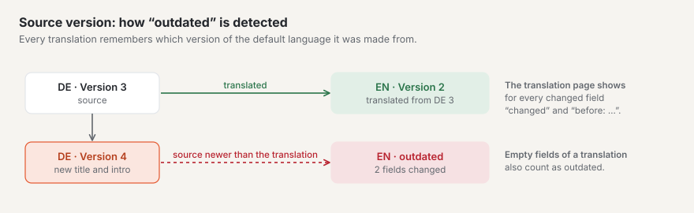
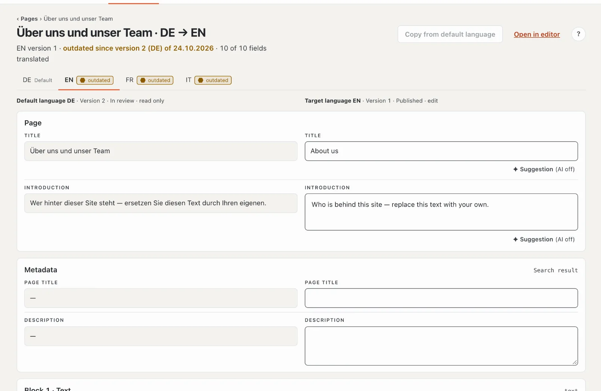
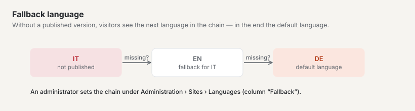
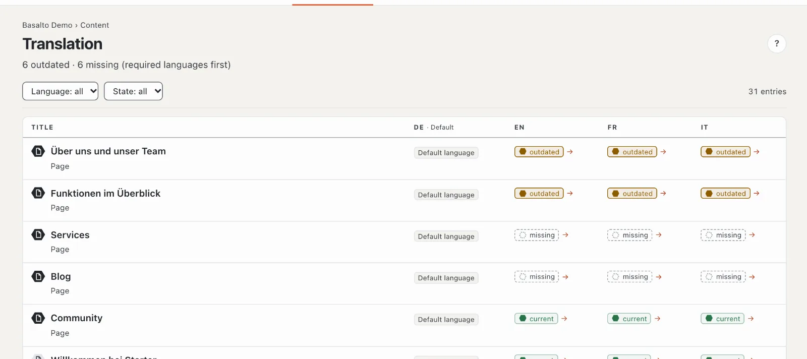

# Translating

If your site has several languages, every translation is created from the **default language**. Basalto remembers which version of the default language a translation is based on and shows you when something has changed there since.

## Where

- “Content” mode › **Translation** — the list of all entries with missing or outdated translations.
- In the editor of an entry in a language other than the default language: **“Translate side by side”**.

## What is translated

The texts are translated: title, introduction, page title and description, as well as the text and rich text fields that the theme marks as translatable.

Everything else — for example images, numbers or select fields — is **shared**: it applies to all languages and is maintained only in the default language. Such fields carry the label “shared”.

## The state of a translation

| State | Meaning |
| --- | --- |
| **current** | the translation matches the latest version of the default language, and all translatable fields are filled |
| **outdated** | a translatable field of the default language has changed since the translation — or fields are empty in the translation that have text in the default language |
| **missing** | there is no version in this language yet |

A new image alone does not make a translation outdated — only changed text does.

## Creating a translation

1. Open the translation — via the “Translation” list (a click on the language’s state in the row) or in the editor via “Translate side by side”.
2. If there is no version in the target language yet, click **“Create translation from …”**. Basalto creates a draft based on the current version of the default language. Without permission for this language or without a version in the default language, the button is disabled.
3. Translate field by field: on the **left** the text of the default language (read only), on the **right** your field in the target language. The column headers name language, version, status and “read only” or “edit”. The fields are grouped in sections: page (title, introduction), metadata (page title, description) and one per block. Below 1024 px width, source and target stand one below the other.
4. Saving happens automatically a little over a second after your last input, once the title is translated. A “✓ saved” on the field confirms it. Text fields hold at most 300 characters, text areas 5000; if something is wrong, the top says “N fields are not right”. Whether you may edit the language is checked when saving.

An empty target field has a dashed border and the note “Translation missing …”.

Helpful:

- **“→ copy”** on an empty field copies the text of the default language into your field — handy for names or technical terms that stay the same.
- **“Copy from default language”** at the top fills all fields that are still empty with the text of the default language.
- **“Suggestion”** on a field lets the AI translate if the “AI suggestions” module is set up (see [AI suggestions](ki.md)); otherwise it says “(AI off)”.
- The counter “… of … fields translated” shows how far you have got; fields that are empty in the default language don’t count.

## Updating an outdated translation

If a translation is outdated, the translation page shows “outdated since version … of …” at the top. The changed fields carry the label **“changed”** and show the earlier text of the default language under “before:”. This way you see exactly what is new and adjust only those passages.

## Submitting and approving

Each language has its own versions and goes through approval on its own. When the translation is finished, submit it — via “Open in editor” and there “Submit for approval”. If the target language’s version is already submitted or published, saving creates a new draft; the live version stays online. More on this under [Approval and publication](freigabe.md).

## Required languages

A **required language** must be present before an entry can be approved. The default language is always required. If a required language is missing, approval is blocked with the notice “Approval only with all required languages — missing: …”. A language counts as present as soon as it has at least been submitted.

In the language tabs at the top, required languages show “Required”. Missing or outdated translations in required languages also appear as a task on the “Overview”.

## Fallback language

If the published version is missing in a language, visitors see the version of the **fallback language** — and if there is none there either, the next one in the chain up to the default language. The translation page points this out (“visitors see the fallback …”).

Which languages are required and which fallback language applies is set by an administrator: “Administration › Sites”, open the site, **“Languages”** tab (columns “Default”, “Required” and “Fallback”).

## The “Translation” overview

The top says “N outdated · N missing”. The list shows the state in every language for each entry (pages and entries, up to 500): first entries with gaps in **required languages**, then those with gaps in other languages, then the rest — within each level the most recently changed first. Each column header says “Default” or “Required”; a hexagon in front of the title tells page and entry apart. Filter by **Language** (the default language can’t be chosen) and by **State** (“outdated” or “missing”); “Reset filter” shows everything again. A click on a language’s state opens the translation. When everything is done, it says “Everything translated”, for a filter without matches “No matches”.

The number next to “Translation” in the menu shows how much is still open.

## Frequently asked questions

**Can I also translate directly in the normal editor?**
Yes. In the editor of the target language, “Create translation from …” creates a draft with the blocks of the default language, which you then overwrite. The “Translate side by side” view is clearer, though, because the source text is directly above your field.

**I cannot edit a field.**
If it says “Applies to all languages — maintained in the default language”, the field is shared. Change it in the editor of the default language. If the column header says “read only”, your role doesn’t allow this language (roles can be limited to certain languages).

**Why is my translation “outdated” even though I did not change anything?**
Someone changed a translatable text in the default language — the “changed” label shows you which field. Or a field is empty in your translation that has text in the default language.

## Next

- [Approval and publication](freigabe.md)
- [The site](../einrichtung/site.md)
