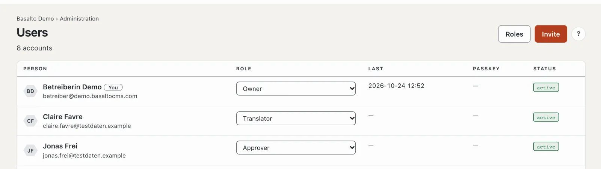
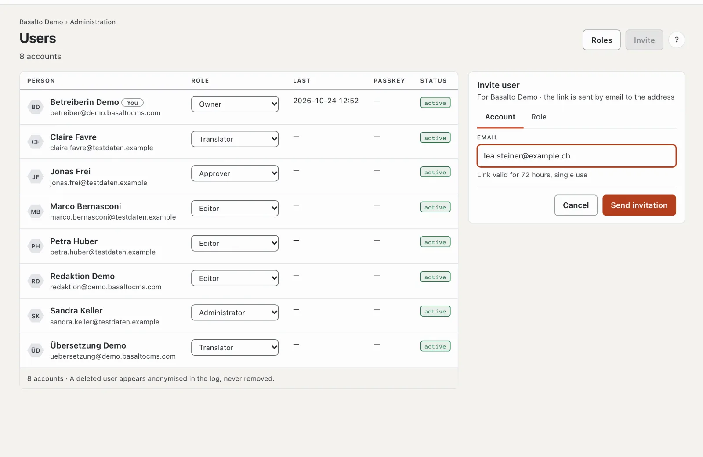
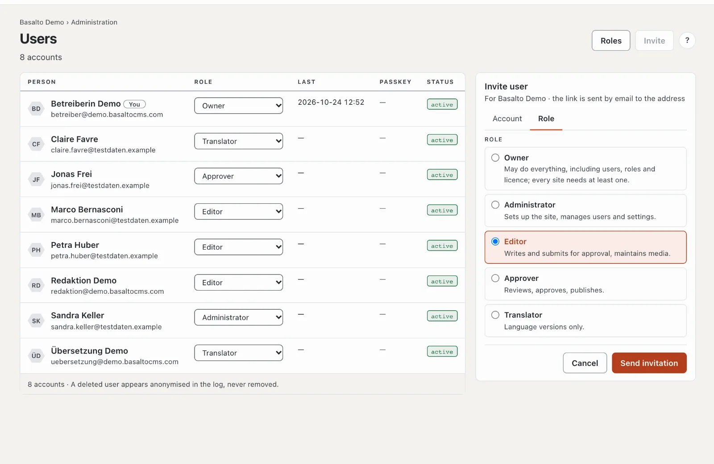
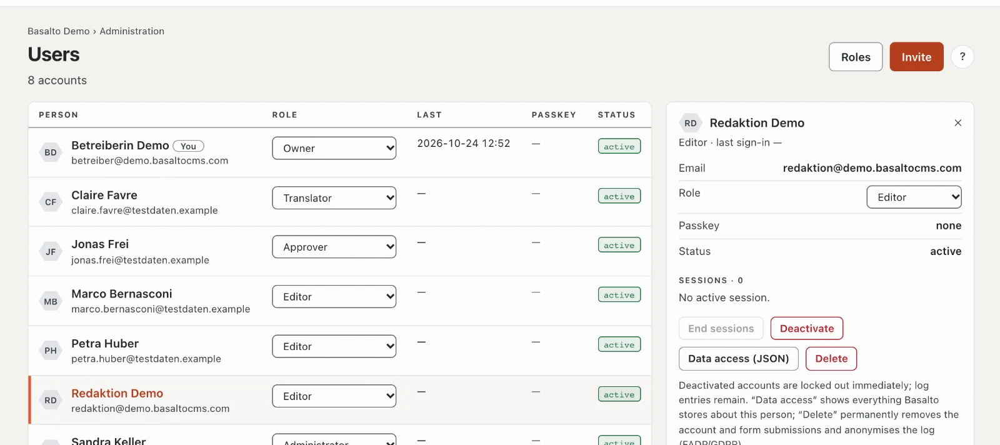

# Users

Under **Users** you see everyone with access to the current site, invite new people and assign roles. Here you deactivate accounts, end sessions and fulfil requests for information and deletion.

## Where

“Administration” mode › **Users**.

One row per person with name and email (“You” marks your own account), **role** in this site, **last** (last sign-in), **passkey** (how many) and **status** (“active”, “deactivated”, “invited”). A click on a row opens the person card on the right. At the top, **“Roles”** leads to the [role matrix](rollen.md).

## Inviting someone

1. **“Invite”** opens the card “Invite user” for the current site on the right.
2. Tab **Account**: the **email address**. The link in the invitation is **valid for 72 hours and can be used once** (the period is set under [Settings](einstellungen.md), group “Sign-in”).
3. Tab **Role**: choose the role — each with a sentence on what it may do.
4. **“Send invitation”**.

The person opens the link and is signed in with it; in future they sign in with a code by email or a passkey. Until then they appear as “invited” in the list, with “valid until …” and “invited by …”. A new invitation to the same address replaces the open one.

For an open invitation:

- **“Send again”** — a new link, the period starts again.
- **“Withdraw”** — after the question “Withdraw?” with “Yes” the link is invalid.
- Once the period is over, it says “invited · expired”. Send the invitation again.

If the address already belongs to this site, Basalto rejects the invitation — change the role in the list instead. If the person has an account in another site, the invitation gives them an additional role in this one.

## Changing the role

Choose another one in the **Role** column — the change applies at once and is recorded in the log. Two rules apply:

- **No giving away rights:** you only assign roles that may not do more than you. The role “Owner” is only assigned by an owner.
- **At least one owner:** nobody can downgrade the last owner of a site.

## The person card

The card shows email, role, passkeys, status and the **sessions** (where the person is currently signed in). Below:

- **“End sessions”** — signs the person out everywhere, for example after a lost device.
- **“Deactivate”** — locks the account: all sessions end at once, signing in is no longer possible. After the question “Deactivate …?” with “Yes, deactivate”. **“Activate”** lifts it again. Log entries stay. Your own account cannot be deactivated; you end your own sessions in your profile.
- **“Information (JSON)”** — everything Basalto stores about this person as a file: for a request under DSG/GDPR.
- **“Delete”** — removes the account and the form submissions with this email address **permanently**; no name stays in the log, the entries appear anonymised. This cannot be undone.

A person’s **email address** cannot currently be changed in the backend; for a change, create a new account and delete the old one.

## Frequently asked questions

**The invitation does not arrive.**
Check the spam folder and whether the installation can send emails (see [Operations](betrieb.md)). “Send again” sends a new link.

**I cannot give a person the role “Administrator”.**
Your own role may do less than an administrator — rights you don’t have yourself cannot be given away.

**Deactivate or delete?**
Deactivate as long as the person might come back or their traces should stay traceable. Delete only on request under DSG/GDPR — it is permanent.

## Next

- [Roles](rollen.md)
- [Activity log](protokoll.md)
