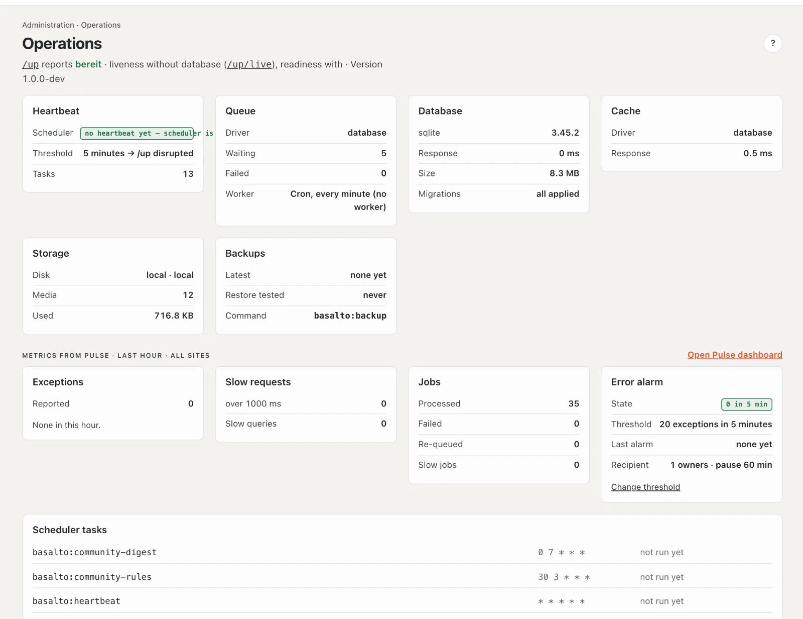

# Operations

**Operations** shows at a glance whether the installation is healthy: is the schedule running, is the queue working, is the database answering, are there backups, are errors piling up. Red means: something is wrong here — usually the technical team is needed.

## Where

“Administration” mode › **Operations**.

At the top is what the status address `/up` reports: **“ready”** means the site is running and all services answer; **“disturbed”** means something is missing (for example the heartbeat). External monitoring polls exactly this address. Plus Basalto’s version.

## The cards

| Card | What it shows | Red means | What to do |
| --- | --- | --- | --- |
| **Heartbeat** | whether the schedule (scheduler) is running, the threshold and how many tasks it has | no heartbeat since the threshold — scheduled publications, cleanup and backups don’t run | technical team: check the scheduler (cron, every minute) |
| **Queue** | driver, waiting and failed jobs, how they are processed | at least one job failed | see below |
| **Database** | kind, version, response time, size and whether all migrations are applied | no connection or pending migrations | technical team: `php artisan migrate` after an update |
| **Cache** | driver and response time | no response | technical team |
| **Storage** | where media are stored, count and space used | storage not reachable | technical team |
| **Backups** | last backup, when a restore was last rehearsed | no backup | “Backup now” or technical team |

In the subscription the **Customer domains** card is added: the state of the own domains.

### Failed jobs

Jobs are work in the background — cutting image variants, sending emails, warming up pages. If one fails, it appears in the “Queue” card with name and reason, and the “Overview” points to it as well. **“Try again”** puts it back into the queue; **“Dismiss”** removes it. Both are recorded in the log. If a job fails again and again, the cause lies deeper — pass the reason on to the technical team.

### Backups

**“Backup now”** starts a backup of the whole installation (database and media) in the background; by default it runs every night and the last 7 are kept (setting “Keep backups”). Only the technical team can **restore** (see [Backup](../betrieb/backup.md)).

A backup saves the whole installation for emergencies. The **export** of a site (under “Sites”) is something else: a copy of a single site for moving.

## State of the installation

At the bottom left of every page, the state is shown in small print: a coloured badge for the environment — **PROD**
(red), **TESTING** (amber), **DEMO** (blue), **LOCAL** (green) — plus the version and when it was delivered. Hovering
shows the commit. On the website in production, only people signed in to the backend see it; visitors see no version
number.

## Metrics and error alarm

Whoever operates the installation sees **metrics of the last hour** below, across all sites — reported exceptions, slow requests and queries, jobs — and **“Open Pulse dashboard”** for details.

The **Error alarm** card shows from how many errors in how many minutes an email goes to the installation account’s owner and administration, when the last alarm was and who receives it. **“Change threshold”** leads to the [settings](einstellungen.md), group “Operations”.

## Scheduler tasks

At the bottom is the list of all scheduled tasks with their rhythm and when they last ran — for example heartbeat (every minute), scheduled publications, backup (at night), cleanup, licence check. “not run yet” for all of them usually means: the scheduler is not running.

## Frequently asked questions

**“no heartbeat” — is the website down?**
No, the website is running. But everything time-controlled stands still. The technical team has to set up the scheduler (see [Installation](../betrieb/installation.md)).

**I don’t see the metrics from Pulse.**
They are reserved for the operators of the installation.

## Next

- [Monitoring](../betrieb/monitoring.md)
- [Updates](updates.md)
