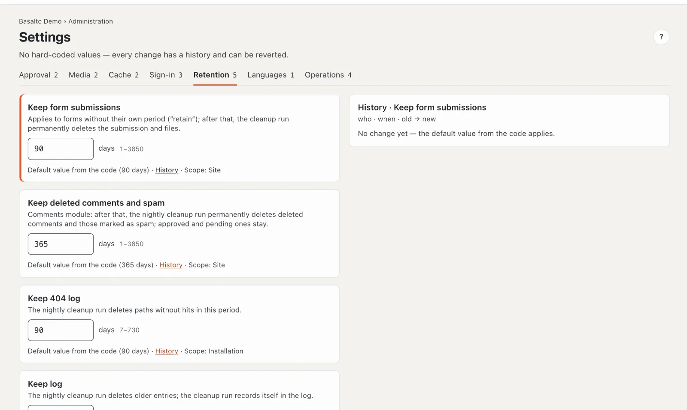
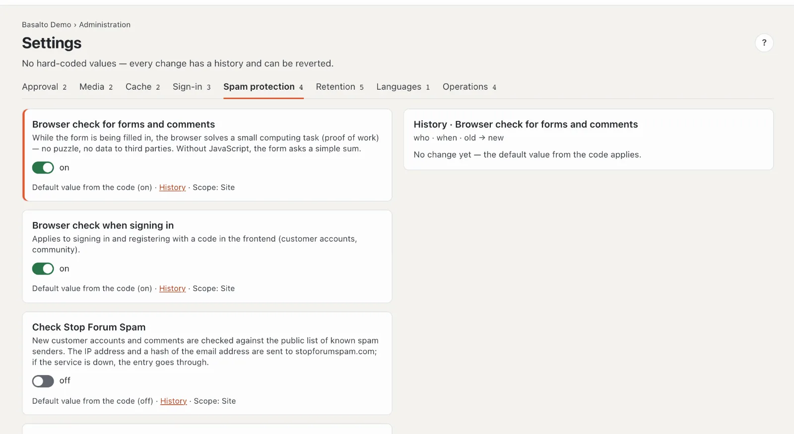

# Settings

Under **Settings** are Basalto’s periods, switches and limits — no fixed values in the code. Every change has a **history** and can be undone.

## Where

“Administration” mode › **Settings**. At the top a tab per group with the number of its values: Approval, Media, Cache, Sign-in, Retention, Languages, Operations.

One card per value:

- **Name** and what the value does.
- The **field** — a switch or a number with unit and allowed range (for example “days 1–3650”).
- Below: **“Starting value from the code (…)”** as long as nobody has changed it, otherwise **“Changed by … on …”**; **“History”**; and **“Scope”** — whether the value applies to the whole **installation** or only to this **site**.

Changes save themselves (“saving …”, then “saved”). If a value is outside the range, the error appears at the field and nothing is saved. Without the right to edit, the fields are locked (“read-only”).

## History and undoing

**“History”** shows every change of this value on the right: who, when, old → new. **“Restore”** on an entry sets the value back to that earlier state — this, too, then appears in the history and in the [activity log](protokoll.md). Without a change it says “No change yet — the starting value from the code applies”.

## All values

| Group | Setting | Default | Range | Applies to | Effect |
| --- | --- | --- | --- | --- | --- |
| Approval | Four-eyes principle | off | — | site | Submitters may not approve their own version. |
| Approval | Keep archived versions | 50 | 0–1000 | site | per item and language; the cleanup deletes older archived versions; 0 = keep all |
| Media | Alt text required | off | — | site | Publishing without alt text per language is rejected (also in the site’s settings). |
| Media | Media library trash | 30 days | 1–365 | installation | after that the cleanup deletes original and variants permanently |
| Cache | Page cache | on | — | site | Pages come ready-made from the cache; every publication invalidates it and warms the page up. Individual pages are excluded in the page’s “Cache” tab. |
| Cache | Pages in the cache at most | 24 hours | 1–168 | site | after that the next request renders anew, even without a change |
| Sign-in | Validity of the sign-in code | 10 minutes | 2–60 | installation | how long the code from the email is valid |
| Sign-in | New code at the earliest after | 30 seconds | 0–600 | installation | “Send code again” counts down this long after the last code; 0 = immediately |
| Sign-in | Validity of one-time links | 60 minutes | 5–1440 | installation | links from installer and console |
| Sign-in | Validity of an invitation | 72 hours | 1–720 | installation | see [Users](benutzer.md) |
| Spam protection | Browser check for forms and comments | on | on/off | site | computing task in the background (proof of work), no puzzle; without JavaScript a simple sum |
| Spam protection | Browser check when signing in | on | on/off | site | signing in and registering with a code in the frontend |
| Spam protection | Check Stop Forum Spam | off | on/off | site | new customer accounts and comments against the public list of known spam senders; the IP address and a hash of the email address go to stopforumspam.com |
| Spam protection | Stop Forum Spam: match from | 80 percent | 1–100 | site | confidence of the list from which an entry counts as spam |
| Statistics | Count visits | on | on/off | Site | count page views and show the cookie settings; visitors and sessions only with consent (see [Statistics](statistik.md)) |
| Retention | Keep form submissions | 90 days | 1–3650 | site | for forms without their own period; afterwards the cleanup deletes submission and files |
| Retention | Keep deleted comments and spam | 365 days | 1–3650 | site | Comments module; approved and waiting comments stay |
| Retention | Keep 404 log | 90 days | 7–730 | installation | paths without hits in this time are dropped |
| Retention | Keep activity log | 365 days | 30–3650 | installation | the cleanup deletes older entries |
| Retention | Keep statistics | 400 days | 30–1095 | Installation | the cleanup deletes older page views |
| Retention | Keep backups | 7 | 1–365 | installation | older backups in the same folder are dropped |
| Languages | Required languages before approval | — | — | site | a reference: required languages and fallback are in the site’s languages (“Open →”) |
| Operations | Heartbeat threshold | 5 minutes | 2–60 | installation | if the last heartbeat is older, the status address reports “disturbed” |
| Operations | Error alarm from | 20 exceptions | 0–100,000 | installation | that many errors in the window trigger an email to the installation account’s owner and administration; 0 = no alarm |
| Operations | Error alarm window | 5 minutes | 1–60 | installation | the time over which errors are counted |
| Operations | Pause after an error alarm | 60 minutes | 5–1440 | installation | no further email for this long |
| Operations | Usage data for the vendor | on | on/off | installation | the update check sends a random ID, the version, PHP and the type of database — no addresses, no content (see [Updates](updates.md)) |

The **cleanup** runs every night and permanently deletes whatever has reached its period. It records itself in the activity log.

## Frequently asked questions

**A value applies to the installation — why do I see it in every site?**
Values with “Scope: installation” apply equally to all sites; a change takes effect everywhere.

**I changed something by mistake.**
Open the “History” and choose “Restore” on the earlier state.

## Next

- [Activity log](protokoll.md)
- [Operations](betrieb.md)
